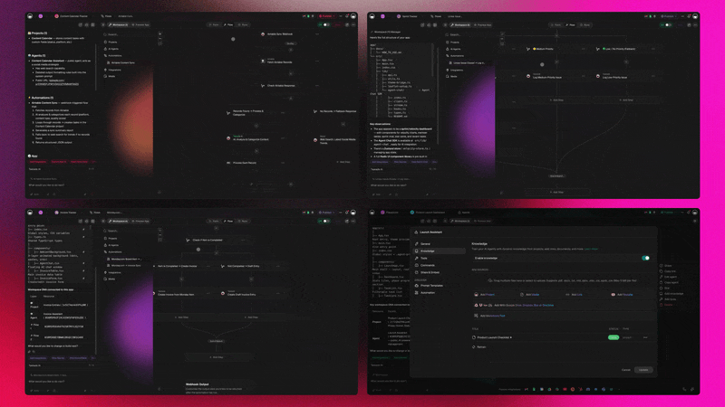
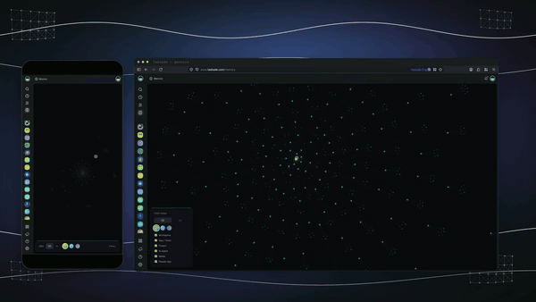
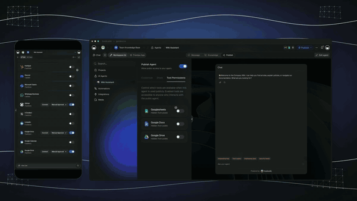
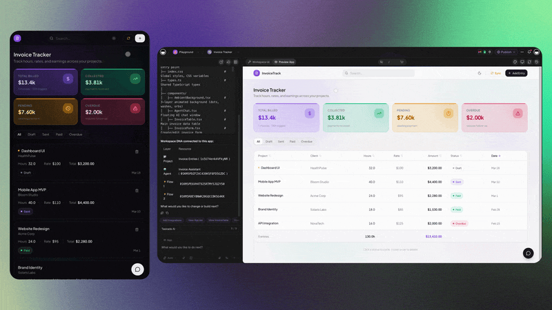

# Build on Taskade

Describe your business in plain English, and Taskade builds a running app for it. You can add logins, put the app on your own domain, and connect your own code or AI agent. Pick where to start:

<table data-view="cards"><thead><tr><th></th><th></th><th data-hidden data-card-target data-type="content-ref"></th></tr></thead><tbody><tr><td><strong>🛠️ Build a business app, no code</strong></td><td>Describe it in plain English. Get a CRM, a client portal, or an ops dashboard, with logins and your own domain.</td><td><a href="genesis-living-system-builder/genesis/getting-started.md">Start building →</a></td></tr><tr><td><strong>🤖 Connect your AI agent</strong></td><td>Let Claude, Codex, Cursor, or ChatGPT work in your workspace with one URL and one sign-in.</td><td><a href="getting-started/ai-agents.md">Connect an agent →</a></td></tr><tr><td><strong>💻 Build on the API</strong></td><td>REST API v1, Action API v2, MCP, and webhooks for your own code.</td><td><a href="apis-living-system-development/developer-home.md">Developer platform →</a></td></tr></tbody></table>


**Do not want to start from a blank prompt?** Clone a ready-made app from the [app gallery](https://www.taskade.com/apps) or from [Taskade's official kits](https://www.taskade.com/apps/official). Then change it in Taskade Genesis. You can also [start from scratch](https://www.taskade.com/create).



**Do you run a real business on your app?** Read [Run Your Business on Taskade Genesis](genesis-living-system-builder/run-your-business/README.md): build the app, add logins, and put it on your own domain.


## What Taskade does

Taskade puts four parts in one workspace: an AI app builder ([Taskade Genesis](https://www.taskade.com/create)), AI agents, automations, and hosting for your apps.

* One prompt gives you one app.
* Your workspace holds the data of the app.
* Your AI agents do the work of a team.
* Your automations run the steps.

<figure><figcaption>One prompt → a working app, with agents, integrations, and automations.</figcaption></figure>

### Platform capabilities

| Capability               | Description                                                    | Learn More                                                                                                  |
| ------------------------ | -------------------------------------------------------------- | ----------------------------------------------------------------------------------------------------------- |
| **AI App Builder**       | Generate full-stack applications from natural language prompts | [Create Your First App →](https://www.taskade.com/learn/genesis/first-app)              |
| **Website Generator**    | Create responsive websites with built-in AI intelligence       | [Publish Your Apps →](https://www.taskade.com/learn/genesis/publishing)            |
| **Workflow Automation**  | Connect 100+ integrations with AI-powered decision making      | [Automations Guide →](https://www.taskade.com/learn/automation/automations-execution)        |
| **AI Agents Platform**   | Deploy custom AI assistants with persistent memory             | [Custom AI Agents →](https://www.taskade.com/learn/agents/custom-agents) |
| **Projects & Databases** | Structured data with real-time sync and custom fields          | [Memory Pillar →](https://www.taskade.com/learn/projects/databases)       |

[**Start Building →**](https://www.taskade.com/create) | [**Browse Community Apps →**](https://www.taskade.com/apps)

### How Taskade fits together

Taskade works best when three parts stay connected. **Memory** stores knowledge. **Intelligence** reasons with that knowledge. **Execution** runs workflows from it.

<figure><figcaption>Memory — every project, doc, and conversation connects into one workspace knowledge graph.</figcaption></figure>

<figure><figcaption>Intelligence — AI agents with persistent memory, custom tools, and slash commands.</figcaption></figure>

<figure><figcaption>Execution — automations connect 100+ tools to run work end to end.</figcaption></figure>

Use this as the canonical overview: [Workspace DNA](genesis-living-system-builder/genesis/workspace-dna.md).

### Quick start

#### Build your first app (5 minutes)

1. [**Getting Started**](genesis-living-system-builder/genesis/getting-started.md) - build your first app, step by step
2. [**Examples & Templates**](genesis-living-system-builder/genesis/examples-and-templates.md) - prompts you can copy
3. [**Community apps**](https://www.taskade.com/apps) - apps you can clone

#### Create AI agents (10 minutes)

1. [**AI Agents Getting Started**](genesis-living-system-builder/ai-features/ai-agents-getting-started.md) - create your first agent
2. [**Prompt Library**](genesis-living-system-builder/space-apps-guide/genesis-prompt-library.md) - prompts by business task

#### Set up automations (15 minutes)

1. [**Automations Overview**](genesis-living-system-builder/automation/) - build your first workflow
2. [**Integration Options**](genesis-living-system-builder/automation/integrations.md) - 100+ integrations

#### Connect an AI agent (2 minutes)

1. Add the hosted MCP server `https://www.taskade.com/mcp` to your AI client and sign in. In Claude Code: `claude mcp add --transport http taskade https://www.taskade.com/mcp`
2. Give your agent [**taskade.com/SKILL.md**](https://www.taskade.com/SKILL.md) - the Taskade skill for AI agents
3. [**Connect an AI Agent**](getting-started/ai-agents.md) - every client, every entry point, and what an agent can do
4. Let your agent search these docs: add the docs MCP server `https://docs.taskade.com/~gitbook/mcp` (public, no sign-in)

#### For developers

* [**Developer Platform**](apis-living-system-development/developer-home.md) - The developer portal: APIs, MCP, and webhooks
* [**REST API v1**](apis-living-system-development/comprehensive-api-guide/README.md) - Complete RESTful reference (full task CRUD)
* [**Action API v2**](apis-living-system-development/api-v2-reference.md) - The newer action-based API (agent prompting, bundles)
* [**Authentication**](apis-living-system-development/developers/authentication.md) - Personal tokens & OAuth 2.0
* [**Open Source**](https://github.com/taskade) - Public repos: [taskade/mcp](https://github.com/taskade/mcp) (MCP server and Claude Code plugin), [taskade/docs](https://github.com/taskade/docs) (this documentation), [taskade/awesome-vibe-coding](https://github.com/taskade/awesome-vibe-coding) (curated tools index), [taskade/tasks.md](https://github.com/taskade/tasks.md) (agent build ledger spec), [taskade/integrations](https://github.com/taskade/integrations) (Integration Kit)
* [**Awesome Vibe Coding**](https://github.com/taskade/awesome-vibe-coding) - Curated vibe-coding tools, agents, and community Genesis app kits

### Explore docs

<table data-view="cards"><thead><tr><th></th><th data-hidden data-card-target data-type="content-ref"></th></tr></thead><tbody><tr><td>Run a business on Taskade Genesis</td><td><a href="genesis-living-system-builder/run-your-business/README.md">Run Your Business</a></td></tr><tr><td>Workspace DNA (canonical)</td><td><a href="genesis-living-system-builder/genesis/workspace-dna.md">Workspace DNA</a></td></tr><tr><td>Taskade Genesis (build apps)</td><td><a href="genesis-living-system-builder/genesis/">Taskade Genesis</a></td></tr><tr><td>AI Agents</td><td><a href="genesis-living-system-builder/ai-features/ai-agents-getting-started.md">AI Agents: Getting Started</a></td></tr><tr><td>Automations</td><td><a href="genesis-living-system-builder/automation/">Automations</a></td></tr><tr><td>Connect an AI agent</td><td><a href="getting-started/ai-agents.md">Connect an AI Agent</a></td></tr><tr><td>Developers</td><td><a href="apis-living-system-development/developer-home.md">Developer Platform</a></td></tr><tr><td>Help &#x26; Support</td><td><a href="help-center/">Help &#x26; Support</a></td></tr></tbody></table>
