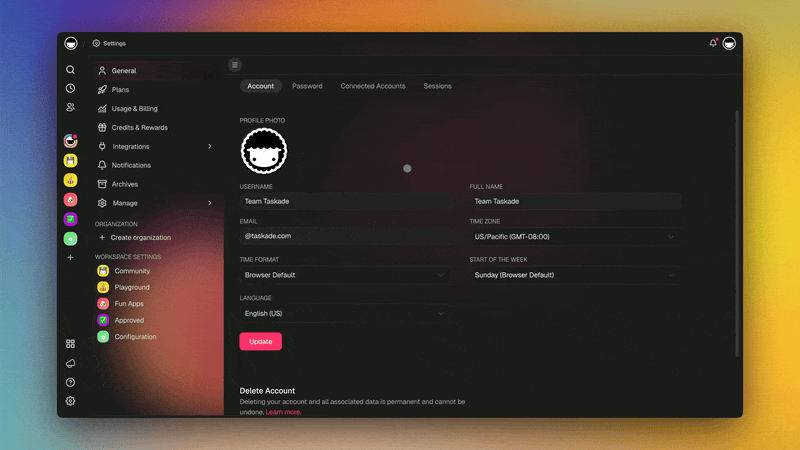
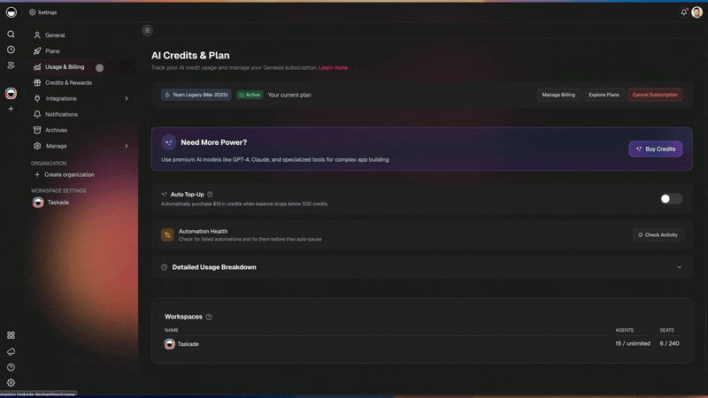
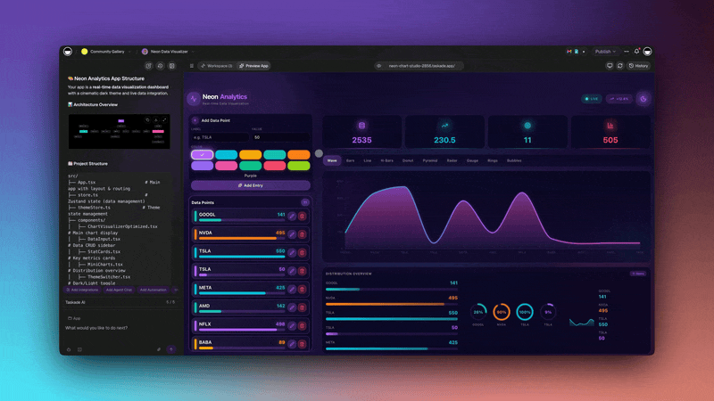

# Credits & Billing

***

## Table of Contents

* [How AI Credits Work](credits-and-billing.md#how-ai-credits-work)
* [Free Credits](credits-and-billing.md#free-credits)
* [Paid Plan Credits](credits-and-billing.md#paid-plan-credits)
* [What Your App Will Cost](credits-and-billing.md#what-your-app-will-cost)
* [Credit Packs](credits-and-billing.md#credit-packs)
* [Auto Top-Up](credits-and-billing.md#auto-top-up)
* [Model-Specific Pricing](credits-and-billing.md#model-specific-pricing)
* [Viewing Your Usage](credits-and-billing.md#viewing-your-usage)
* [What Happens When You Run Out](credits-and-billing.md#what-happens-when-you-run-out)
* [FAQ](credits-and-billing.md#faq)
* [Related](credits-and-billing.md#related)

***

## How AI Credits Work

Every AI request in Taskade — prompting an agent, running an automation with AI, generating a Taskade Genesis app — consumes credits. The credit cost depends on the model:

* **Lightweight models** cost fewer credits per request.
* **Frontier models** (top-tier reasoning models) cost more.
* **Auto mode** picks a model for each request, so you don't need to pick the right model for each task by hand. Auto is the default.

***

## Free Credits

A Free workspace starts with 0 AI credits. On Free, you earn free AI credits with referrals and invites, and you can upgrade any time.

* **Referrals:** you earn credits when someone signs up for Taskade through your referral link and verifies their email, up to a limit. Find your link in [Settings → Earn credits](https://www.taskade.com/settings/credits).
* **Paid plans:** every paid plan includes a monthly AI credit allowance. See the [plan table](README.md#current-plans).


Check the [pricing page](https://www.taskade.com/pricing) for the current plans.


***

## Paid Plan Credits

Paid plans include monthly premium credits that reset on your billing cycle.

| Plan tier  | Monthly credits                                            | Key benefit                   |
| ---------- | ---------------------------------------------------------- | ----------------------------- |
| Starter    | 10,000                                                     | Individuals and small teams (up to 3 members) |
| Pro        | 50,000                                                     | Personal productivity         |
| Business   | 150,000                                                    | Team use, complex AI tasks    |
| Max        | 400,000                                                    | Heavy generation, large teams |
| Enterprise | Custom allowance + admin controls                          | Organization-wide deployments |


Exact credit amounts per tier may change. See the [pricing page](https://www.taskade.com/pricing) for current allocations.


Max and Enterprise plans get refined credit limits designed for bursty workloads — you won't get throttled mid-task during a heavy generation run.

***

## What Your App Will Cost

If you're building and running a real app on Genesis, the question isn't "how many credits does one request cost" — it's "what in my app burns credits, and how much will it burn as I grow." Use this as a decision guide. For exact, current per-request numbers, always check the in-app model picker; published figures drift as models and pricing change.

### What drives your credit use

| What consumes credits                | What drives the cost (relative)                                                                                       |
| ------------------------------------ | -------------------------------------------------------------------------------------------------------------------- |
| **Genesis app generation & iteration** | Heaviest up front, while you build. Each generate and each "edit with AI" pass costs credits; settles down once the app is stable. |
| **AI automation steps**              | Scales with how often your automations run and how many AI steps each run includes. A trigger that fires all day costs more than one that fires occasionally. |
| **An agent answering end-users**     | Scales with the number of people using your published app and how chatty each session is. This is the line item that grows as your app gets traffic. |
| **Agent / Taskade EVE chat**         | Scales with how much you and your team use AI assistance day to day — drafting, summarizing, asking questions in your workspace. |

Steps that don't call AI — plain forms, stored data, non-AI automation actions — don't draw from your credit balance.

### Right-size it

* **Low usage** — You're building for yourself or a small team, with light traffic and occasional automations. A personal paid tier (Pro direction) is usually enough; top up with a credit pack during a build sprint.
* **Medium usage** — A team relies on the app, automations run regularly, and a handful of end-users hit your agent daily. Lean toward the Business tier.
* **High usage** — A public-facing app with steady traffic, an agent answering many end-users, and automations firing throughout the day. Lean toward Max or Enterprise, which are tuned for bursty, high-volume AI workloads without mid-task throttling.

Don't over-buy on day one. Watch your [usage page](credits-and-billing.md#viewing-your-usage) for the first month, then size to what your app actually draws.

### Keep your app from running dry

If real customers use your published app, an agent that runs out of credits mid-session is the worst time to find out. Turn on [**Auto Top-Up**](credits-and-billing.md#auto-top-up) so your balance refills automatically before it hits zero — your customer-facing agent keeps answering instead of stalling on an out-of-credits screen.

***

## Credit Packs

Credit packs are one-time purchases on top of your monthly allocation.

* **Volume-tiered pricing** — bigger packs come with bigger bonuses.
* **Purchased credits never expire** — top up once, use over time. Taskade uses your Monthly Credits first, then these Extra Credits.
* Purchases appear in the workspace activity log for audit visibility.

<figure><figcaption></figcaption></figure>

Use packs when you expect a heavy AI month — during a product launch, a big content sprint, or a large Genesis app build.

***

## Auto Top-Up

Auto Top-Up prevents you from running out of credits in the middle of a workflow.

### How It Works

1. Set a **balance threshold** (the default is 9,000 credits).
2. Set a **top-up amount** in dollars (the default is $20).
3. When your balance drops below the threshold, or gets too low for the next AI step, Taskade automatically buys a credit pack with your saved card.

### Setting It Up

1. Open [Settings → Credits](https://www.taskade.com/settings/usage) in a web browser.
2. Find the **Auto-reload** row on the **Credits** card and turn the switch on.
3. To change the amounts, click **Manage**, then **Change settings**.
4. Pick the **Top up amount** and the **When credit balance drops below** value, then click **Save changes**.

<figure><figcaption></figcaption></figure>


Auto Top-Up charges your payment method automatically when triggered. Set a reasonable threshold and top-up amount to match your expected usage.


Auto Top-Up is available on every paid plan. The mobile apps and the app-store desktop apps hide this control.

***

## Model-Specific Pricing

Each AI model has its own credit cost per request. Pricing is adjusted periodically to track provider costs.

* You can see the current per-model credit cost in the model picker before selecting a model.
* Auto mode picks a model for each request.
* For the authoritative current list, check the in-app model picker.

***

## Viewing Your Usage

Taskade surfaces credit usage in several places.

* **Usage page** in your account settings shows monthly credit consumption.
* **Workspace activity log** records every credit pack purchase.
* **Per-agent usage analytics** show which agents consume the most credits.
* **Automation run reports** show credits used per run.

<figure><figcaption></figcaption></figure>

***

## What Happens When You Run Out

Taskade never silently fails an AI request due to insufficient credits.

* **Paid users**: You're routed to the upgrade or credit-pack screen.
* **Free users**: You're prompted to upgrade.
* **Out-of-credits error** surfaces cleanly in the UI — no mysterious silent drops.


Public agent visitors never see internal billing errors. If your app's agent runs out of credits, external users see a neutral error message, not billing details.



Building against the API? See the [REST API guide](../apis-living-system-development/comprehensive-api-guide/README.md) for rate limits and error-handling conventions when requests fail.


***

## FAQ

Do credits expire?

On paid plans, purchased credit packs don't expire. Monthly premium credits reset each billing cycle. A Free workspace has no monthly allowance — check the pricing page for current policy.

Can I refund unused credits?

Refund policies vary. Contact support for case-by-case review.

Does Auto Top-Up have a spending cap?

Yes. Auto Top-Up buys at most 5 times in 24 hours. If you set a monthly spend limit, it stops for the rest of the month at that limit. Monitor your usage page during the first month to tune the settings.

Which models use the fewest credits?

Lightweight models have the lowest per-request cost. The model picker shows current pricing for each available model.

Does a Genesis app clone cost me credits?

Cloning a Genesis app does not consume credits on its own. AI usage inside the cloned app consumes credits normally.

***

## Related


[.](./)



[ai-features](../genesis-living-system-builder/ai-features/)


---

_Step-by-step guides on taskade.com/learn: [Taskade AI Usage](https://www.taskade.com/learn/agents/ai-usage), [Auto Top-Up: Stay Building With Automatic Credit Refills](https://www.taskade.com/learn/account/auto-topup), [Billing and Pricing FAQ](https://www.taskade.com/learn/account/billing-faq)._
