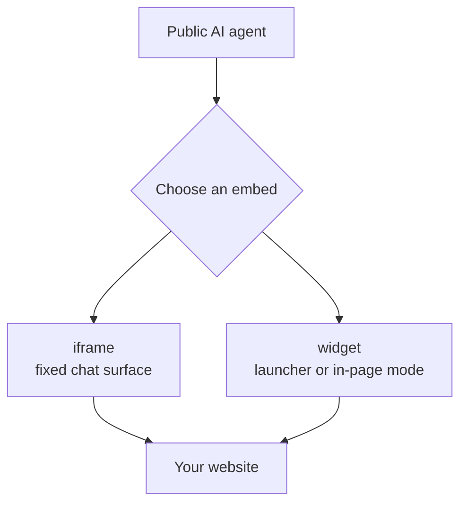

# Embed a Public AI Agent

You can put a public Taskade AI agent on your website as an iframe or as a chat widget. Publish the agent, copy the code from **Publish** → **Embed**, and paste the code into your page.

## Before you start

You must have these items:

- **An AI agent in your workspace.** Every plan can publish and embed an agent.
- **Edit access to the HTML of your website.** You paste one `<iframe>` or two `<script>` tags.
- **Optional, Business and up:** **Hide Branding**, a custom background, and a meta image for the public agent.

## Publish the agent and copy the code

Turn on public access. Then copy the code that Taskade makes for you.

1. Open the agent, then open the **Publish** tab. The **Share** menu item in the agent list opens the same screen.
2. Turn on the **Publish Agent** switch.
3. Open the **Embed** sub-tab.
4. Pick **Add to your website** for an iframe, or **Add a chat widget** for a widget.
5. Copy the generated code.

The code holds the current public agent ID. It holds only the options that the selected mode supports. The **Customize** sub-tab sets the look. **Tool Permissions** shows only when the agent has tools.



## Choose an embed type

Pick the smallest embed that fits the page.

| Embed | What visitors see | Best fit |
| --- | --- | --- |
| iframe | A chat surface that is always visible | Help centers and dedicated assistant pages |
| `bubble` | A corner button that opens a chat panel | Support and sales pages |
| `modal` | A launcher that opens a centered dialog | Focused conversations |
| `sidebar` | A launcher that opens a full-height drawer | Pages that must remain visible |
| `searchBar` | An Ask AI pill mounted inside your layout | Headers and documentation |
| `inline` | An open chat panel mounted inside your layout | Dedicated assistant sections |

`bubble` is the widget default, so Taskade does not put it in the generated code. An agent with saved widget settings is different. Read [Save the widget settings as the default](#save-the-widget-settings-as-the-default).

An `inline` widget must mount into a page element. A `searchBar` widget can also mount into one, for a pill in a site header. The generated snippet includes this host element:

```html
<div id="taskade-agent"></div>
```

Move this element to the place where the pill or panel must show. Keep its ID the same as the `target` value. A `searchBar` with no `target` is a pill in the corner that `popup.position` sets.

## Add an iframe

Use the iframe if the agent must stay open inside a fixed area of the page.

```html
<iframe
  allow="clipboard-read; clipboard-write"
  src="YOUR_PUBLIC_AGENT_URL"
  width="100%"
  height="400"
  frameborder="0"
  allowfullscreen
></iframe>
```

| Setting | Default | Range |
| --- | --- | --- |
| `width` | `600` | 100 to 4,000 pixels, or `100%` with **Responsive width (100%)** |
| `height` | `400` | 100 to 4,000 pixels |

## Add the widget

Place the generated script near the end of the page body.

```html
<script src="https://assets.taskade.com/embeds/latest/taskade-embed.min.js"></script>
<script type="module">
  window.taskadeAgent = TaskadeEmbed.TaskadeEmbed.init({
    "publicAgentId": "PUBLIC_AGENT_ID"
  });
</script>
```

Keep the double name `TaskadeEmbed.TaskadeEmbed.init`. The CDN bundle gives the current initializer at that path.

The snippet keeps the widget handle on `window.taskadeAgent`. The code of your page can call these methods:

| Method | Effect |
| --- | --- |
| `open()`, `close()`, `toggle()` | Show or hide the chat |
| `isOpen()` | Return the open state |
| `setOptions()`, `setTheme()` | Change options or the theme after load |
| `destroy()` | Remove the widget from the page |

For an inline panel, add the host element. Then set the mode and the target:

```html
<div id="taskade-agent"></div>
<script src="https://assets.taskade.com/embeds/latest/taskade-embed.min.js"></script>
<script type="module">
  window.taskadeAgent = TaskadeEmbed.TaskadeEmbed.init({
    "publicAgentId": "PUBLIC_AGENT_ID",
    "mode": "inline",
    "target": "#taskade-agent"
  });
</script>
```

### Save the widget settings as the default

**Save as default** on the **Embed** sub-tab stores the widget settings on the agent. You can save a default for the `bubble`, `modal`, and `sidebar` modes. A `searchBar` or `inline` widget sits inside your page, so its settings stay in the snippet.

If the settings on the screen match the saved default, Taskade makes a short snippet that holds only `publicAgentId`. The widget loads the saved settings when it starts. A `trigger` or `interface` option stays in the snippet, because Taskade does not save those two. A later save updates every site that uses the short snippet.

If a snippet sets one of `mode`, `theme`, `popup`, `launcher`, `behavior`, or `visibility`, the widget ignores all saved settings. To show the plain widget on one site, set `"mode": "bubble"` in the snippet of that site.

## Configure the widget

Pass only the options that the selected mode uses.

| Field | Accepted value | Effect |
| --- | --- | --- |
| `publicAgentId` | Public agent ID | Selects the agent |
| `mode` | `bubble`, `modal`, `sidebar`, `searchBar`, `inline` | Selects the widget shell |
| `target` | CSS selector | Mounts `searchBar` or `inline` inside the page |
| `theme.colorScheme` | `light`, `dark`, `auto`, `host` | Sets the color scheme of the widget. `auto` makes the launcher and panel follow the visitor's system setting. `host` follows a `dark` class on the `<html>` element of your page. With no value, the widget uses the theme that the agent owner saved |
| `theme.accent` | 3-digit or 6-digit hex color | Sets the launcher and chat accent |
| `theme.radius` | `none`, `small`, `medium`, `large`, `full` | Sets the corner rounding of the widget panel and the welcome bubble. The default is `large` |
| `theme.density` | `compact`, `comfortable`, `spacious` | Sets the spacing of the welcome bubble. The default is `comfortable` |
| `theme.fontFamily` | CSS font list up to 200 characters | Sets the font of the launcher label, the search pill, and the welcome bubble. Quoted names and commas are allowed. CSS functions are not |
| `interface.header.subtitle` | Text up to 80 characters | Adds a second line to the chat header |
| `interface.header.avatarUrl` | `http` or `https` image URL | Replaces the avatar in the chat header. Taskade drops any other URL, and a URL with embedded credentials |
| `interface.disclaimer` | Text up to 200 characters | Shows a plain-text notice under the chat |
| `popup.position` | `bottom-right`, `bottom-left`, `top-right`, `top-left` | Places launcher modes |
| `launcher.size` | `sm`, `md`, `lg` | Sets the corner launcher size |
| `launcher.label` | Text up to 60 characters | Adds text to a launcher or search pill |
| `behavior.proactiveMessage.text` | Text up to 200 characters | Shows a welcome bubble |
| `behavior.autoOpenDelay` | 1 through 120 seconds | Opens the chat after a delay |
| `trigger.selector` | CSS selector up to 200 characters | Lets your own page element open or close the chat |
| `trigger.hotkey` | Shortcut up to 40 characters | Lets a keyboard shortcut open or close the chat |

Some options apply only to some modes:

- The `theme` radius, density, and font change the widget around the chat. They do not change the chat transcript.
- `launcher.size` does not apply to `searchBar` or `inline`.
- `popup.position` applies to `searchBar` only when it has no `target`.
- An `inline` widget is always open. It uses no label, proactive message, auto-open delay, custom trigger, or hotkey.

## Keep public access safe

The embed gives the public access to the agent. Do these steps before and after you publish:

- Review the agent's instructions and knowledge before you publish it.
- Keep secrets and private records out of public knowledge sources.
- Turn off tools that a public visitor must not use.
- If the public agent does not need the web, keep **Search the web** and **Read a web page** off for visitors.
- Test the public page in a signed-out browser.
- If the wrong people get the link, turn off the **Publish Agent** switch.
- Keep your API token out of the page. The embed code needs only the public agent ID. Only your server code uses a token. Read [Authentication](developers/authentication.md).


**Note:** A public agent keeps no memory between visitor chats. Read what visitors asked in the agent's **Messages** tab.


A public chat can search the web or read a page only when the matching tool is on for visitors. A visitor does not see tool results or the reasoning of the agent. Taskade also hides the input of most tool calls from the visitor. The visitor sees the reply and the web sources of a search. A signed-in member of the workspace of the agent still sees the tool details.

## Review questions the agent did not answer

The Agent Inbox collects the public questions that your agent did not answer well. You can then teach the agent the answer. The inbox covers chats on the public agent page and in the embed. A private chat in your workspace never goes to the inbox.

Two things add a question to the inbox:

- After each agent reply in a public chat, Taskade looks for a question that the agent did not answer.
- A visitor clicks the thumbs-down button (**Bad response**) on a reply. The question of that reply goes to the inbox with the reason that the visitor typed. The reason box tells the visitor that the agent owner can read it.

To review the questions:

1. Open the agent, then open the **Knowledge** tab.
2. Open the **Inbox** sub-tab. It shows after Taskade adds the first question.
3. For each question, click **Answer & save**.
4. Write the answer.
5. Click **Save as knowledge**.

To skip a question, click **Dismiss**.

The saved answer becomes agent knowledge, so the agent can use it with the next visitor. Taskade also keeps the questions in a workspace project named `Agent Inbox - <agent name>`. Every member who can view agents can read this project.

| Limit | Value |
| --- | --- |
| Open questions in one inbox | 200. Then Taskade stops adding questions until you answer or dismiss some |
| New questions for one agent | 30 per hour. Rated-down replies have their own budget of 30 per hour |
| Length of one question | 240 characters. Taskade shortens a longer question |
| Reasons kept under one question | 3 |

## Next steps

- [Publish Agents Publicly](https://www.taskade.com/learn/agents/public-agents): the product steps for sharing an agent by link.
- [Agent Widgets](https://www.taskade.com/learn/agents/agent-widgets): pick and style a chat widget in the app.
- [Enable public agent access](https://www.taskade.com/docs/actions/enable-public-agent-access): publish an agent from code with the Action API.
- [Action API guide](api-v2-reference.md): call agents and projects from your own service.
- [Hosted Taskade MCP](genesis-app-mcp.md): reach the same workspace from an AI client.

---

_This page is also published at [taskade.com/docs/guides/agent-embeds](https://www.taskade.com/docs/guides/agent-embeds)._
