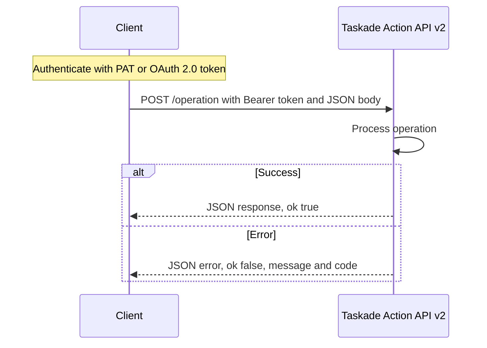

# Action API Guide

The Action API **v2** is an **action-based** API. Each operation sends a JSON body with `POST` to a named endpoint.

It is not RESTful. It has no `GET /workspaces` or `PUT /tasks/{id}` endpoints.

Media downloads, bundle downloads, and [webhook registration](webhooks.md#webhook-registration-api) are the REST-style exceptions.


**v2 is in beta (`2.0.0-beta`) and runs alongside v1.** It adds **`promptAgent`** and signed webhook registration.

**Tasks are fully writable in v2.**

Content: `createTask`, `updateTask`, `deleteTask`, `moveTask`, `completeTask`, `uncompleteTask`.

Metadata: `assignTask`, `unassignTask`, `setTaskDate`, `deleteTaskDate`, `setTaskNote`, `deleteTaskNote`, `setTaskFieldValue`, `deleteTaskFieldValue`.

v1 has the longest track record. It alone reads a single task, at `GET /projects/{projectId}/tasks/{taskId}`.

v2 renames, archives, and exports a project with `renameProject`, `archiveProject`, and `exportProject`. Neither version deletes a project. See [Choose an API](#choose-an-api).


The live OpenAPI spec is published at [taskade.com/api/documentation/v2](https://www.taskade.com/api/documentation/v2).

## Before you start

- A Taskade account with a verified email address.
- A personal access token from [taskade.com/settings/api](https://www.taskade.com/settings/api), or an OAuth 2.0 access token. See [Authentication](developers/authentication.md).
- `curl` in a terminal. The tabbed examples also show Python 3 with `requests` and TypeScript on Node.js 18 or later.

Save the token in your terminal. Every example on this page reads it from `TASKADE_TOKEN`:

```bash
export TASKADE_TOKEN="tskdp_your_token_here"
```

---

## Choose an API

Taskade ships **two** public HTTP APIs. They share the same authentication.

| | **REST API v1** | **Action API v2** |
| --- | --- | --- |
| Base URL | `https://www.taskade.com/api/v1` | `https://www.taskade.com/api/v2` |
| Style | RESTful: GET, POST, PUT, DELETE | Action / RPC: POST /{operation} |
| Status | Stable (GA) | Beta (`2.0.0-beta`) |
| Live spec | [/api/documentation/v1](https://www.taskade.com/api/documentation/v1) | [/api/documentation/v2](https://www.taskade.com/api/documentation/v2) |
| Task create / update / delete | ✅ Full CRUD | ✅ Create, update, delete, move |
| Task assignees / dates / notes / fields | ✅ | ✅ |
| Read a **single** task, date, note or field | ✅ `GET /projects/{projectId}/tasks/{taskId}`, `…/date`, `…/note`, `…/fields/{fieldId}` | ❌ list-only (`listTasks`, `listBlocks`, `listFields`) |
| Project rename, archive, or export | ❌ (`GET /projects/{projectId}` is read-only) | ✅ `renameProject`, `archiveProject`, `exportProject` |
| Project delete | ❌ | ❌ |
| Prompt an agent | ❌ | ✅ `promptAgent` |
| Agent lifecycle (create/update/delete) | ✅ | ✅ |
| Bundles (export/import Taskade Genesis apps) | ✅ | ✅ |
| Signed webhook registration | ❌ | ✅ `POST /webhooks` |
| Reference | [API reference](https://www.taskade.com/docs/rest) | This page |

The v2 task operations are `createTask`, `updateTask`, `deleteTask` and `moveTask`, plus `assignTask`, `setTaskDate`, `setTaskNote`, `setTaskFieldValue` and more.

Use **v2** for LLM tools, agent prompts, or webhook registration. One verb per endpoint maps directly to a tool definition.

Use **v1** for its longer stability record. Also use v1 to read one task, date, note, or field directly.

Every row in this table is checkable. Each row comes from the two live OpenAPI documents. The generated [Action API reference](https://www.taskade.com/docs/actions) and [REST API reference](https://www.taskade.com/docs/rest) are built from those same specs.

---

## Base URL and authentication

All v2 operations live under:

```text
https://www.taskade.com/api/v2
```

Send a personal access token, or an OAuth 2.0 access token for apps that act for other users, in the `Authorization` header:

```http
Authorization: Bearer <your token>
```

See the [Authentication guide](developers/authentication.md) for personal tokens and OAuth 2.0 with PKCE.

---

## Calling convention

Every v2 call sends a JSON body with `POST` to an operation name. The API returns JSON.

A successful response has `"ok": true`. A list operation adds an `items` array, and a single-item operation adds an `item` object.

Here is a single Action API v2 call, from authentication to JSON response.



The call below lists the projects that your account can open. It needs no IDs:

```bash
curl -s -X POST https://www.taskade.com/api/v2/listMyProjects \
  -H "Authorization: Bearer $TASKADE_TOKEN" \
  -H "Content-Type: application/json" \
  -d '{}'
```

```json
{ "ok": true, "items": [{ "id": "Pj8sK2nV4wQx6ZbE", "name": "API quickstart" }] }
```


**Receiving events:** Register a **signed** outbound webhook with `POST /api/v2/webhooks`.

Taskade signs every delivery with an HMAC secret. Make sure that each signature is valid.

See the [Webhook Registration API](webhooks.md#webhook-registration-api). The older `subscribeWebhook` and `unsubscribeWebhook` operations are deprecated.


---

## Endpoints

The examples below read IDs from shell variables. Save each ID when a response gives it to you:

```bash
export SPACE_ID="your_workspace_id"
export PROJECT_ID="your_project_id"
export AGENT_ID="your_agent_id"
```

### List spaces (workspaces)

**`POST /listSpaces`** is every integration's entry point. Send a JSON body. Every field in it is optional, so send `{}` when you do not filter.





#### cURL

```bash
curl -s -X POST https://www.taskade.com/api/v2/listSpaces \
  -H "Authorization: Bearer $TASKADE_TOKEN" \
  -H "Content-Type: application/json" \
  -d '{}'
```





#### Python

```python
import os
import requests

res = requests.post(
    "https://www.taskade.com/api/v2/listSpaces",
    headers={"Authorization": f"Bearer {os.environ['TASKADE_TOKEN']}"},
    json={},
)
print(res.json()["items"])
```





#### TypeScript

```typescript
const res = await fetch("https://www.taskade.com/api/v2/listSpaces", {
  method: "POST",
  headers: {
    Authorization: `Bearer ${process.env.TASKADE_TOKEN}`,
    "Content-Type": "application/json",
  },
  body: JSON.stringify({}),
});
const { items } = await res.json();
```





**Response:**

```json
{
  "ok": true,
  "items": [
    { "id": "Wk3rT9pLmQ2vXa7c", "name": "My Workspace" }
  ]
}
```

Filter with `{ "filterBy": { "name": { "operator": "contains", "value": "Marketing" } } }`.

---

### List folders in a space

**`POST /listFolders`** returns `{ ok, items: [{ id, name }] }`.

```bash
curl -s -X POST https://www.taskade.com/api/v2/listFolders \
  -H "Authorization: Bearer $TASKADE_TOKEN" \
  -H "Content-Type: application/json" \
  -d "{\"spaceId\": \"$SPACE_ID\"}"
```

---

### List projects in a space

**`POST /listProjects`** takes `{ spaceId, completed? }` and returns `{ ok, items: [{ id, name?, icon?, completed?, archived?, color?, tags? }] }`. Set `completed` to `false` to list only open projects, or to `true` to list only completed projects. Leave it out to list both. Archived projects are not in the list.

```bash
curl -s -X POST https://www.taskade.com/api/v2/listProjects \
  -H "Authorization: Bearer $TASKADE_TOKEN" \
  -H "Content-Type: application/json" \
  -d "{\"spaceId\": \"$SPACE_ID\"}"
```

---

### Get a project

**`POST /getProject`** returns `{ ok, item: { id, name?, icon?, completed?, archived?, color?, tags? } }`.

```bash
curl -s -X POST https://www.taskade.com/api/v2/getProject \
  -H "Authorization: Bearer $TASKADE_TOKEN" \
  -H "Content-Type: application/json" \
  -d "{\"projectId\": \"$PROJECT_ID\"}"
```

---

### Create a project

**`POST /createProject`** seeds a project from Markdown.





#### cURL

```bash
curl -s -X POST https://www.taskade.com/api/v2/createProject \
  -H "Authorization: Bearer $TASKADE_TOKEN" \
  -H "Content-Type: application/json" \
  --data @- <<EOF
{
  "spaceId": "$SPACE_ID",
  "contentType": "text/markdown",
  "content": "# Q2 Planning\n\n- Review roadmap\n- Draft OKRs"
}
EOF
```





#### Python

```python
import os
import requests

res = requests.post(
    "https://www.taskade.com/api/v2/createProject",
    headers={"Authorization": f"Bearer {os.environ['TASKADE_TOKEN']}"},
    json={
        "spaceId": os.environ["SPACE_ID"],
        "contentType": "text/markdown",
        "content": "# Q2 Planning\n\n- Review roadmap\n- Draft OKRs",
    },
)
print(res.json()["item"]["id"])
```





**Response:**

```json
{ "ok": true, "item": { "id": "Pj8sK2nV4wQx6ZbE", "name": "Q2 Planning" } }
```

---

### List tasks

**`POST /listTasks`** is paginated with `after` / `before` cursors. Each task is `{ id, text, parentId?, completed }`. Set `completed` to `false` to list only open tasks, or to `true` to list only completed tasks. The cursors and `limit` apply to the filtered list.

```bash
curl -s -X POST https://www.taskade.com/api/v2/listTasks \
  -H "Authorization: Bearer $TASKADE_TOKEN" \
  -H "Content-Type: application/json" \
  -d "{\"projectId\": \"$PROJECT_ID\", \"limit\": 100}"
```

**Response:**

```json
{
  "ok": true,
  "items": [
    { "id": "Tk5yH1cR7mD3aF9u", "text": "Review roadmap", "completed": false }
  ]
}
```


v2 reads and writes tasks.

To change a task, see [`createTask`](https://www.taskade.com/docs/actions/create-task), [`updateTask`](https://www.taskade.com/docs/actions/update-task), and [`moveTask`](https://www.taskade.com/docs/actions/move-task).

To set metadata, see [`assignTask`](https://www.taskade.com/docs/actions/assign-task), [`setTaskDate`](https://www.taskade.com/docs/actions/set-task-date), [`setTaskNote`](https://www.taskade.com/docs/actions/set-task-note), and [`setTaskFieldValue`](https://www.taskade.com/docs/actions/set-task-field-value).

To read **one** task, use the [REST API v1 Tasks endpoints](https://www.taskade.com/docs/rest).


If Google Calendar is connected on an eligible workspace, dates set with `setTaskDate` can sync the same way as dates set in Taskade.

---

### Prompt an agent

**`POST /promptAgent`** sends a single prompt to a workspace agent. The endpoint returns a synchronous text response. This capability is **v2-only**.

Each call uses the workspace's AI credits, the same as an agent chat in the app. If the workspace has no AI credits left, the call fails before the agent runs.





#### cURL

```bash
curl -s -X POST https://www.taskade.com/api/v2/promptAgent \
  -H "Authorization: Bearer $TASKADE_TOKEN" \
  -H "Content-Type: application/json" \
  --data @- <<EOF
{
  "spaceId": "$SPACE_ID",
  "agentId": "$AGENT_ID",
  "prompt": "Summarize yesterday's standup notes"
}
EOF
```





#### Python

```python
import os
import requests

res = requests.post(
    "https://www.taskade.com/api/v2/promptAgent",
    headers={"Authorization": f"Bearer {os.environ['TASKADE_TOKEN']}"},
    json={
        "spaceId": os.environ["SPACE_ID"],
        "agentId": os.environ["AGENT_ID"],
        "prompt": "Summarize yesterday's standup notes",
    },
)
print(res.json()["summary"])
```





#### TypeScript

```typescript
const res = await fetch("https://www.taskade.com/api/v2/promptAgent", {
  method: "POST",
  headers: {
    Authorization: `Bearer ${process.env.TASKADE_TOKEN}`,
    "Content-Type": "application/json",
  },
  body: JSON.stringify({
    spaceId: process.env.SPACE_ID,
    agentId: process.env.AGENT_ID,
    prompt: "Summarize standup notes",
  }),
});
const { summary } = await res.json();
```





**Response:**

```json
{ "ok": true, "summary": "Here is a summary of the standup..." }
```

If the agent is not in that space, the call returns `404`:

```json
{ "ok": false, "message": "Agent not found", "code": "NOT_FOUND", "statusMessage": "Not Found" }
```

To list past conversations, use **`POST /listConversations`** with `{ agentId, limit?, page? }`.

To read one, use **`POST /getConversation`** with `{ agentId, convoId, includeTranscript? }`.

Pass `"includeTranscript": true` to add a Markdown `transcript` field to the response.

---

### Manage agents

| Operation | Body |
| --- | --- |
| `POST /listAgents` | `{ spaceId, filterBy? }` |
| `POST /getAgent` | `{ agentId }` |
| `POST /createAgent` | `{ folderId, name, data }` |
| `POST /updateAgent` | `{ agentId, name?, data? }` |
| `POST /deleteAgent` | `{ agentId }` |
| `POST /generateAgent` | `{ folderId, text }` - generate an agent from a description |
| `POST /enablePublicAgentAccess` | `{ agentId }` → `{ ok, publicUrl }` |

---

### Attach knowledge to an agent

**`POST /addKnowledgeProject`** grounds an agent in a project. (`removeKnowledgeProject`, `addKnowledgeMedia`, `removeKnowledgeMedia` mirror it.)

```bash
curl -s -X POST https://www.taskade.com/api/v2/addKnowledgeProject \
  -H "Authorization: Bearer $TASKADE_TOKEN" \
  -H "Content-Type: application/json" \
  -d "{\"agentId\": \"$AGENT_ID\", \"projectId\": \"$PROJECT_ID\"}"
```

The response returns the updated agent as `{ ok, item: { id, name, space_id, data } }`.

---

### Export / import a bundle

**`POST /exportBundle`** returns a portable Taskade Genesis app bundle. **`POST /importBundle`** installs one. Export needs the Pro plan or higher.

See [Bundles & App Kits](bundles.md) for the full schema, the binary `.tsk` variants, and the plan errors.

```bash
curl -s -X POST https://www.taskade.com/api/v2/exportBundle \
  -H "Authorization: Bearer $TASKADE_TOKEN" \
  -H "Content-Type: application/json" \
  -d "{\"spaceId\": \"$SPACE_ID\"}"
```

The response is `{ "ok": true, "item": { "version": "1", "items": { ... } } }`.

---

### Full operation list

* **Workspaces & structure:** `listSpaces`, `listFolders`, `listMyProjects`, `listTemplates`, `listMedia`.
* **Projects:** `listProjects`, `getProject`, `createProject`, `createProjectFromTemplate`, `copyProject`, `completeProject`, `restoreProject`, `archiveProject`, `renameProject`, `exportProject`, `listBlocks`, `listFields`, `listProjectMembers`, `getShareLink`, `enableShareLink`.
* **Tasks, content:** `listTasks`, `createTask`, `updateTask`, `deleteTask`, `moveTask`, `completeTask`, `uncompleteTask`.
* **Tasks, metadata:** `assignTask`, `unassignTask`, `setTaskDate`, `deleteTaskDate`, `setTaskNote`, `deleteTaskNote`, `setTaskFieldValue`, `deleteTaskFieldValue`.
* **Agents, lifecycle:** `listAgents`, `getAgent`, `createAgent`, `updateAgent`, `deleteAgent`, `promptAgent`, `generateAgent`.
* **Agents, conversations:** `listConversations`, `getConversation`.
* **Agents, knowledge:** `addKnowledgeProject`, `removeKnowledgeProject`, `addKnowledgeMedia`, `removeKnowledgeMedia`.
* **Agents, public access:** `enablePublicAgentAccess`, `getPublicAgent`, `updatePublicAgent`.
* **Media:** `uploadMedia`, `getMedia`, `deleteMedia`, plus `GET /media/{mediaId}/content` and `GET /media/spaces/{spaceId}/content` for downloads.
* **Bundles:** `exportBundle`, `importBundle`, `importBundleZip`, plus `GET /bundles/{spaceId}/export/zip`.
* **Webhooks:** `POST /webhooks`, `GET /webhooks`, `GET /webhooks/{id}`, `DELETE /webhooks/{id}`. See [Webhooks](webhooks.md#webhook-registration-api). `subscribeWebhook` and `unsubscribeWebhook` are deprecated.

The authoritative, always-current list is the [live v2 spec](https://www.taskade.com/api/documentation/v2).

---

## Pagination

`listTasks` and `listBlocks` use **cursor pagination** with `after` and `before`. `listProjectMembers`, `listConversations`, `listMyProjects`, `listMedia`, and `listTemplates` use **page pagination** with `page` and `limit`.

```bash
# Next page of tasks: pass the id of the last task that you received
export LAST_TASK_ID="Tk5yH1cR7mD3aF9u"

curl -s -X POST https://www.taskade.com/api/v2/listTasks \
  -H "Authorization: Bearer $TASKADE_TOKEN" \
  -H "Content-Type: application/json" \
  -d "{\"projectId\": \"$PROJECT_ID\", \"limit\": 100, \"after\": \"$LAST_TASK_ID\"}"
```

---

## Rate limits

Every rate-limited response carries the current budget in two sets of headers. Header names are case-insensitive:

| Header | Meaning |
| --- | --- |
| `RateLimit-Limit` and `X-Rate-Limit-Limit` | Your total budget for the current window |
| `RateLimit-Remaining` and `X-Rate-Limit-Remaining` | Requests left in the window (`0` when you are blocked) |
| `RateLimit-Reset` | Whole **seconds** until the window reopens |
| `X-Rate-Limit-Reset` | Seconds until the window reopens. This value can be fractional |
| `Retry-After` | Sent on a `429` response only. Whole seconds to wait before you retry |

v2 operations share the public API's per-**IP** budget with every other public request. The budget is 40 requests per 60 seconds for each IP address, as the [live v2 spec](https://www.taskade.com/api/documentation/v2) states. Taskade can change it without a docs release, so read the headers for the live values.

A `429` response carries `Retry-After`, in whole seconds. Wait that number of seconds before you retry. Earlier retries are also rejected.

```typescript
async function withRetry<T>(fn: () => Promise<T>, retries = 3): Promise<T> {
  for (let i = 0; i < retries; i++) {
    try {
      return await fn();
    } catch (err: any) {
      if (err.status === 429 && i < retries - 1) {
        const resetSec = Number(err.headers?.["retry-after"] ?? err.headers?.["x-rate-limit-reset"]);
        const waitMs = resetSec > 0 ? resetSec * 1000 : 2 ** i * 1000;
        await new Promise(r => setTimeout(r, waitMs));
        continue;
      }
      throw err;
    }
  }
  throw new Error("Retry exhausted");
}
```

For sustained throughput, batch operations such as `/createTask`, which takes a `tasks` array. Reduce polling frequency. Stagger scheduled jobs.

---

## Errors

Every error response carries `ok: false`, `message`, `code`, and `statusMessage`. A missing or wrong token returns `401`:

```json
{
  "ok": false,
  "message": "Unauthorized",
  "code": "UNAUTHORIZED",
  "statusMessage": "Unauthorized"
}
```

A schema validation failure returns `400` with `code: "FST_ERR_VALIDATION"` and the same four fields. Its `message` names each field that failed, then the reason.

Branch on `ok` and `code`. Do not parse the human-readable `message`.

### Fix common errors

| What you see | Status | Retry? | Fix |
| --- | --- | --- | --- |
| `"code": "FST_ERR_VALIDATION"` | 400 | No | Read `message`, fix each field that it names, then send the request again |
| `"code": "BAD_REQUEST"` | 400 | No | Read `message` and correct the request body |
| `"code": "UNAUTHORIZED"` | 401 | No | Send `Authorization: Bearer $TASKADE_TOKEN`, or refresh the OAuth access token |
| `"code": "PAYMENT_REQUIRED"` | 402 | No | Upgrade the plan. If the body has `featureId`, it names the missing entitlement |
| `"code": "FORBIDDEN"` | 403 | No | Use an account with the correct role in that workspace |
| `"message": "Agent not found"` with `"code": "NOT_FOUND"` | 404 | No | Make sure that the ID and the `spaceId` are correct |
| `"code": "TOO_MANY_REQUESTS"` | 429 | Yes | Wait for the number of seconds in the `Retry-After` header, then retry |
| `5xx` status | 5xx | Yes | Retry up to 3 times with backoff |


Never retry on `400`, `401`, `403`, or `404`. Fix the request first.


---

## Security best practices

- **Never commit tokens.** Use environment variables or a secret manager.
- **Use OAuth, not personal tokens**, for multi-user applications.
- **Rotate personal tokens** periodically. You can hold up to 5 at a time.
- **Encrypt refresh tokens at rest.** They are long-lived.

## Next steps

- [Action API reference](https://www.taskade.com/docs/actions): every v2 operation, with its body and response.
- [REST API guide](comprehensive-api-guide/README.md): the v1 API, which reads a single task.
- [Authentication](developers/authentication.md): OAuth 2.0 for apps that act for other users.
- [Webhooks](webhooks.md): register a signed webhook with `POST /api/v2/webhooks`.
- [Bundles and App Kits](bundles.md): export and import a Taskade Genesis app.

---

_This page is also published at [taskade.com/docs/getting-started/action-api-guide](https://www.taskade.com/docs/getting-started/action-api-guide)._
