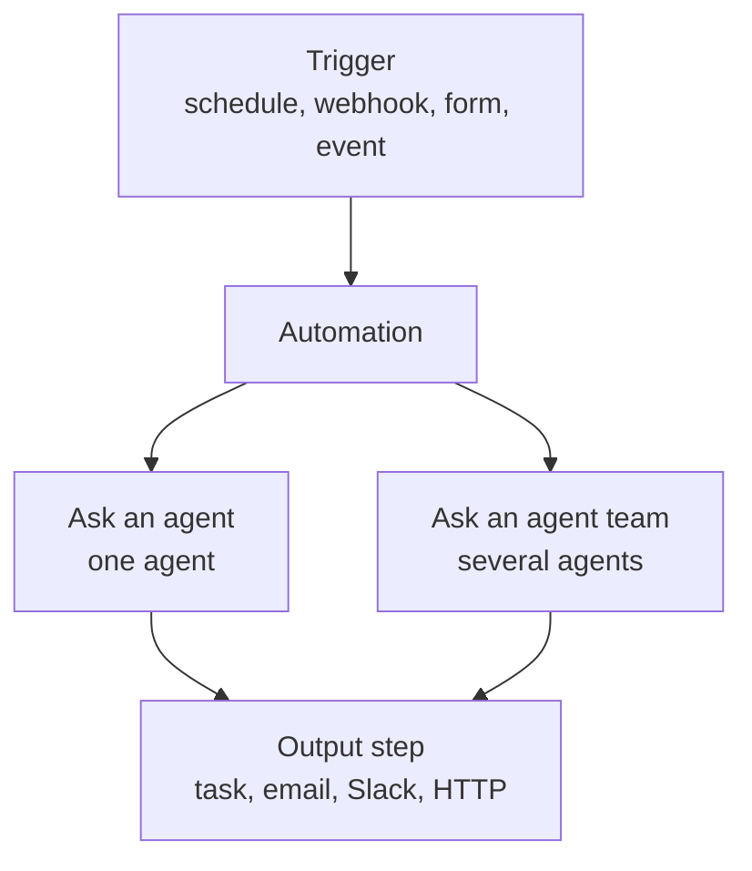
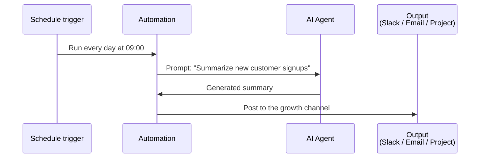
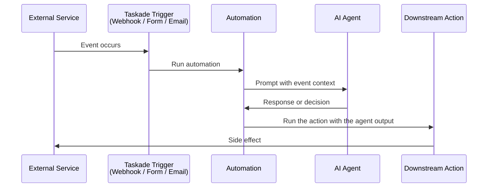
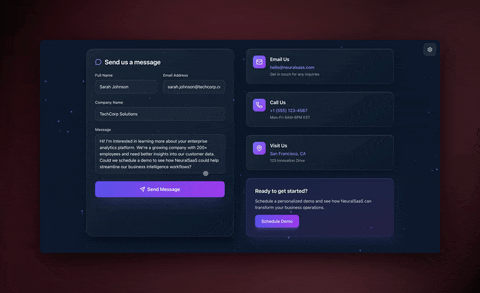
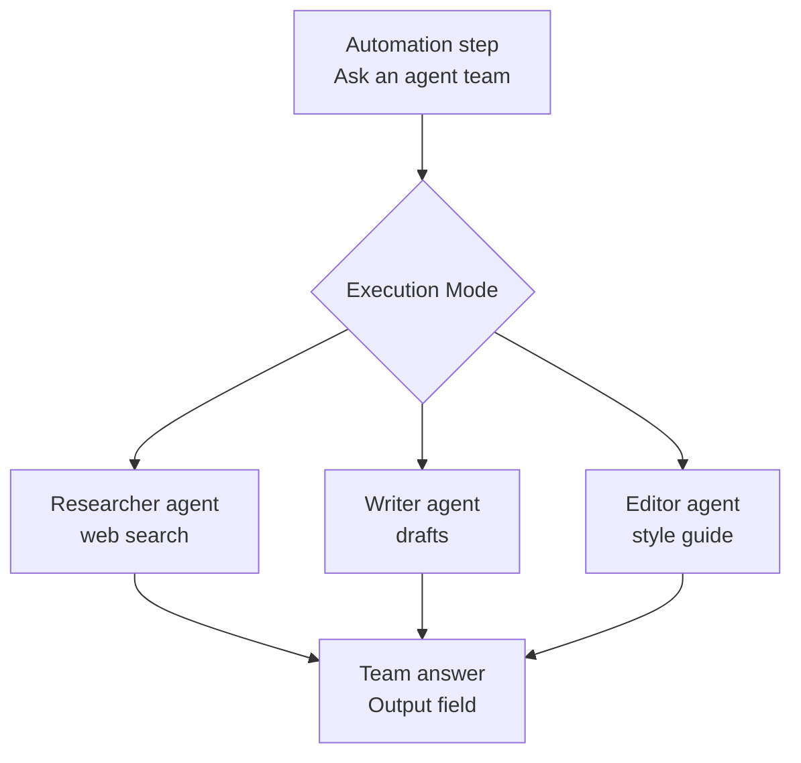
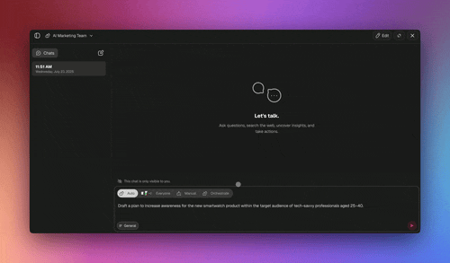
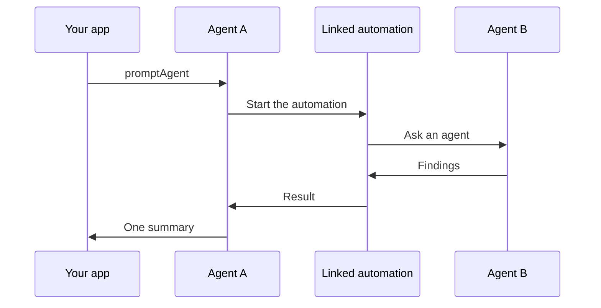

# Autonomous Agents

An autonomous agent in Taskade does work that a trigger starts, with no person who prompts each step. You build one from three parts: automations, AI Teams, and automations that link one agent to another.

An autonomous agent is **an AI agent that an automation runs for you, on a schedule or an event**. Your own code can also start it with one API call. For the product side, see [AI Agents in Learn Taskade](https://www.taskade.com/learn/agents).

## The Three Building Blocks

Each building block removes one kind of manual prompt.

Start with an automation. Add an AI Team when one task needs several kinds of expertise. Chain agents through an automation when one agent must hand work to another.

| Building block | What it does | When to use |
| --- | --- | --- |
| **Automations** | A trigger (schedule, webhook, form, email, or a Taskade event) runs steps, including **Ask an agent** | Most "do this when that happens" cases |
| **AI Teams** | The **Ask an agent team** step sends one task to several agents | Tasks that need distinct expertise |
| **Cross-agent invocation** | An agent starts an automation, and that automation prompts another agent | Specialist chains that your app does not orchestrate |

You can combine the three. Many real systems use two of them together. Browse ready-made examples in the [automation gallery](https://www.taskade.com/automate).



## Pattern: Scheduled Agent Task

A schedule trigger runs an automation that prompts an agent and sends the result somewhere.



### What to add

Each part of the automation maps to one piece in the automation editor.

| Part | What to add | Notes |
| --- | --- | --- |
| Trigger | A **Schedule** trigger: **Every hour**, **Every day**, **Every week**, **Every month**, or **Custom schedule** | **Every few minutes** needs a paid plan |
| Agent step | An **Ask an agent** action, with your agent selected | Insert trigger data, such as the run time, with the variable controls in the prompt |
| Output step | Slack, email, a new task, or **Send HTTP Request** | Send the agent's answer where your team reads it |

A schedule does not start at the exact minute that you set. Taskade spreads the start times of many schedules, so they do not all run at once:

| Schedule interval | Latest start after the set time |
| --- | --- |
| Every hour, or less often | 30 minutes |
| More often than every hour | Half the interval, at most 10 minutes |

Thus a run set for **Every day** at 09:00 starts between 09:00 and 09:30. Do not make an automation that must start at an exact minute.

## Pattern: Event-Triggered Agent

An outside event, such as a webhook call, a form entry, or an email, runs an automation that an agent drives.



### Example: customer feedback triage

<figure><figcaption></figcaption></figure>

A **Webhook Received** trigger takes the form entry, and an agent classifies it. The **Choose a path** step then sends each kind of feedback to its own action.

| Agent result | Path |
| --- | --- |
| Negative and urgent | Create a support ticket |
| Feature request | Add a task to the feedback project |
| Positive | Send a thank-you email |

The **Webhook Received** trigger needs the Pro plan or above. A shareable form (the automation's **Form** tab) and **When an email arrives** work on every plan.

## Pattern: Multi-Agent Team

An AI Team sends one task to several agents. Each agent keeps its own knowledge, tools, and instructions.



### Execution modes

<figure><figcaption></figcaption></figure>

The **Ask an agent team** step has an **Execution Mode** setting with three values:

| Mode | What happens |
| --- | --- |
| **Auto** | The single best agent for the task responds |
| **Everyone** | Every agent in the team responds |
| **Orchestrate** | Taskade makes a plan, and the agents work through its steps together |

The step does not support Agent App tools. If a tool needs manual approval, the run fails.

### Member roles

A team member can have a role, for example Researcher or Writer. When you edit a team, click **Add role** next to a member. A role is one line of at most 60 characters.

The team manager reads the roles when it picks the member for each task or step. In **Orchestrate** mode, Taskade tells the manager to give only review steps to a member with the role `Verifier` (in any letter case). The manager never gives this member a step that creates, changes, or sends data. This is an instruction to the manager, not a tool limit. The member keeps its tools. A team with no roles works as before.

You can also ask Taskade EVE to rename a team, change its instruction, add or remove a member, or set a role.

### Programmatic use

The `promptAgent` operation prompts one agent, not a team. To reach a team from code, link an automation to that agent. Then put an **Ask an agent team** step in the automation.

```bash
curl -s -X POST "https://www.taskade.com/api/v2/promptAgent" \
  -H "Authorization: Bearer $TASKADE_TOKEN" \
  -H "Content-Type: application/json" \
  -d '{"spaceId":"'"$SPACE_ID"'","agentId":"'"$AGENT_ID"'","prompt":"Produce a blog post on our Q2 launch, ready to publish."}'
```

The response holds the agent's final text in `summary`:

```json
{
  "ok": true,
  "summary": "Here is the Q2 launch post, ready to publish."
}
```

## Pattern: Self-Invoking Chain

One agent reaches another agent **through an automation**. Taskade has no agent-as-a-tool type.

Link an automation to Agent A in its **Actions** → **Automation** sub-tab. Put an **Ask an agent** step in that automation, pointed at Agent B.



Your app sends one request to Agent A:

```javascript
const res = await fetch("https://www.taskade.com/api/v2/promptAgent", {
  method: "POST",
  headers: {
    Authorization: `Bearer ${process.env.TASKADE_TOKEN}`,
    "Content-Type": "application/json",
  },
  body: JSON.stringify({
    spaceId: process.env.SPACE_ID,
    agentId: process.env.AGENT_A_ID,
    prompt: "Research the latest on X and draft a blog outline",
  }),
});
const data = await res.json();
if (!data.ok) throw new Error(`${res.status} ${data.code}`);
console.log(data.summary);
```

The response is the same shape as any `promptAgent` call:

```json
{
  "ok": true,
  "summary": "Here is the blog outline, based on the latest research."
}
```

With cross-agent invocation, Taskade does the orchestration. Your app sends one request, and the automation gives the work to the next agent.

## Pattern: Human Approval

A **Wait for approval** step pauses a run until a person approves or rejects the request. Use it after an agent step and before an action that you cannot undo, such as a payment or a message to a customer.

| Setting | What it does |
| --- | --- |
| **Who approves** | The workspace members that you pick. The first answer counts |
| **What they see** | A short line that says what to approve |
| **Details** | Values from earlier steps that help the approver decide |
| **Wait for** | 1 day, 3 days, or 7 days. The default is 3 days |
| **Then** | **Approve** or **Reject** when the wait ends with no answer. The default is **Reject** |

The approver gets an email and can decide in Taskade. An approval continues the run. A rejection, or a timeout set to **Reject**, stops the run.

Later steps can read the decision fields `approved`, `decision`, `decidedBy`, `decidedAt`, and `comment`. The `decision` field is `approved`, `rejected`, or `timed_out`. While the run waits, its status is `waiting`. The `get_flow_runs` tool of the [hosted Taskade MCP](genesis-app-mcp.md) reports the same status.

A connector can also send the request in its own channel. Gmail, Outlook, Slack, Microsoft Teams, Telegram, Discord, Twilio (SMS), and WhatsApp have request-approval actions. These connectors need a paid plan. A request-approval action waits 3 days, then rejects if no one decides.

An agent does not get a request-approval action as a tool. If an agent calls one, Taskade refuses the call.

## Monitoring and Observability

Watch each run. Taskade stops an automation that fails again and again.

### Run history

The automation's **Runs** tab shows the **Run History**. Filter it with **All**, **Completed**, **Failed**, or **Running**.

### Credit usage

AI steps use credits. These screens show where the credits go:

- **Settings** → **Credits**: **Usage this month** for the account, with the **Where your credits went** list for the person who pays for a paid plan.
- **App Settings** → **Insights** → **AI Usage**: the credits, tokens, and builds for one app.

### Continue after a failed step

An action step has a **Continue if this step fails** setting. Turn it on for a step whose failure must not stop the whole run, for example one item of a loop. Then pick what happens next:

| Choice | What happens when the step fails |
| --- | --- |
| **Stop here** (default) | In a loop, the run moves to the next item. Outside a loop, the run stops at this step |
| **Go to the next step** | The run goes on to the next step, which reads the results of the failed step as empty |

With either choice, Taskade does not mark the run failed, and the failed step still shows in **Runs**. This also applies to a step inside a **Choose a path** branch.

### Retry a step when a service is down

An action step has a **Retry if this step fails** setting. Use it for a step that calls a service that can be busy or down for a short time.

| Setting | Values |
| --- | --- |
| **Wait** | 1 to 5 minutes between tries. The default is 5 minutes |
| **then try again, up to** | 1 to 5 more tries. The default is 3 |

Taskade retries only a failure that a later try can fix. A step with bad input or a broken connection fails at once, with no retry. **Continue if this step fails** applies after the last try. Agent steps, such as **Ask an agent** and **Ask an agent team**, do not have this setting.


**Warning:** If a step sends a message, turn on retries only if a second copy is permitted. A retry can send the message twice. Retries can also delay later runs of the automation.


### Automatic pause after failures

Taskade turns off an automation that fails again and again. This stops a broken connection from using more runs.

| Event | Result |
| --- | --- |
| 1st and 3rd failure in a row | Taskade sends a notice |
| 5th failure in a row | The automation turns off, and owners get an email |
| A successful run | The count goes back to zero |

Filtered runs, Taskade rate-limit refusals, and stalled runs that Taskade restarts do not count as failures. A failure of a provider that Taskade runs on its own account, such as a web search vendor, does not count either. A run with a failed step that has **Continue if this step fails** turned on does not count, because Taskade does not mark it failed. A `429` from an outside service does count.

If triggers arrive faster than the automation can run, Taskade keeps the newest triggers and skips the older ones. The run message says "Automation fell behind" and gives the number of skipped triggers.

## Plan Gating

Each building block has an exact plan gate.

| Capability | Where it is available |
| --- | --- |
| Automations (triggers and actions) | **Every plan.** Free includes 10 runs per billing period. Paid plans include more runs at the base level: 350 on Starter, 1,000 on Pro, and 10,000 on Business and above, shared by the workspace |
| Premium connector steps | **Every paid plan** |
| Pro connector steps | **Pro and above** |
| **Every few minutes** schedule | **Every paid plan** |
| **Webhook Received** trigger and the webhook registration API | **Pro and above** |
| AI Teams (**Ask an agent team**) | **Pro and above** |
| Hosted Taskade MCP (inbound: Claude or Cursor reach your workspace) | **Every paid plan** |
| MCP Client connector (outbound: an automation calls a remote MCP server) | **Every plan, Free included** |
| An agent that connects to an outside MCP server | **Not available.** Use the MCP Client connector in an automation |


**Note:** Plan gates can change between releases. See [pricing](https://www.taskade.com/pricing) for the current matrix.


## Next steps

- [Action API guide](api-v2-reference.md): prompt agents and read results from your code.
- [Webhooks](webhooks.md): start an automation from another app, or get Taskade events.
- [SDK Cookbook](sdk-cookbook.md): copy patterns for retries, pagination, and tests.
- [Long-Term Memory](long-term-memory.md): see where an agent's memory lives.
- [Autonomous AI Agents](https://www.taskade.com/learn/agents/autonomous): build the same patterns in the app.

---

_This page is also published at [taskade.com/docs/guides/autonomous-agents](https://www.taskade.com/docs/guides/autonomous-agents)._
