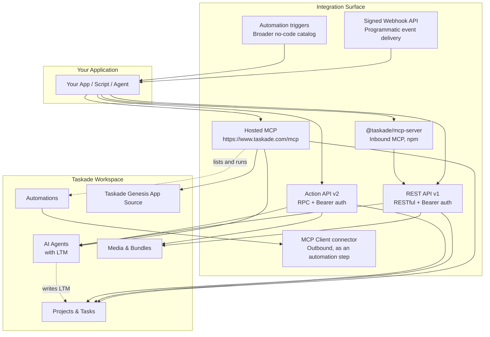

# Developer Platform

Use Taskade APIs to integrate your app. You can also build automations or connect AI tools.

Many teams first build visually with [Taskade Genesis](https://www.taskade.com/create). They then extend the app with the API.

## Before you start

- A Taskade account with a verified email address. Taskade does not create a token for an unverified account.
- `curl` in a terminal, or any HTTP client.
- Basic Taskade concepts: workspaces, projects, and tasks. If you are new to Taskade, start with [Learn Taskade](https://www.taskade.com/learn).

## Integration surface at a glance



## Choose a surface

| I want to... | Use |
| --- | --- |
| Write tasks, manage assignees/dates/fields (full CRUD) | [REST API v1](comprehensive-api-guide/README.md). The [Action API v2](api-v2-reference.md) writes the same data. It has no call that reads one task, or its assignees, date, note, or field value. |
| Prompt agents, register signed webhooks | [Action API v2](api-v2-reference.md) |
| Manage agents, export/import bundles | Either version |
| Hit endpoints from any language | [REST API v1](comprehensive-api-guide/README.md) + [Action API v2](api-v2-reference.md) |
| Expose Taskade projects, tasks, and agents to Claude Desktop, Cursor, or other MCP clients | [Hosted Taskade MCP](genesis-app-mcp.md) or [Workspace MCP](workspace-mcp.md) |
| Call another MCP server's tools from an automation | [MCP Client connector](https://www.taskade.com/learn/connect/mcp-client-integration) |
| Edit Taskade Genesis app source code from your IDE | [Hosted MCP (Taskade Genesis apps)](genesis-app-mcp.md) |
| Receive real-time events in your app | [Webhooks](webhooks.md) |
| Add a public AI agent to your website | [Agent Embeds](agent-embeds.md) |
| Understand long-term memory | [Long-Term Memory](long-term-memory.md) |
| Build agents that run without a prompt | [Autonomous Agents](autonomous-agents.md) |
| Build automations without code | [Automations Engine](https://www.taskade.com/automate) |
| Browse community apps and templates | [taskade.com/apps](https://www.taskade.com/apps) |

## Get a token

Use a **personal access token** for scripts, both APIs, the local MCP server, and hosted MCP callers that set their own headers. Interactive clients can connect to hosted MCP with OAuth 2.0.

1. Go to [taskade.com/settings/api](https://www.taskade.com/settings/api).
2. Go to **Personal access tokens** and click **Create token**.
3. Give the token a descriptive name.
4. Copy the token. Taskade does not show it again.
5. Save the token in your terminal:

```bash
export TASKADE_TOKEN="tskdp_your_token_here"
```

> ⚠️
> Treat your API token like a password. Never commit it to version control or share it publicly.

## Base URLs

Taskade ships **two** public HTTP APIs. Both APIs use the same token:

| API | Base URL | Style | Use it for |
| --- | --- | --- | --- |
| [REST API v1](comprehensive-api-guide/README.md) | `https://www.taskade.com/api/v1` | RESTful (`GET`/`POST`/`PUT`/`DELETE`) | Full task CRUD, assignees, dates, notes, fields |
| [Action API v2](api-v2-reference.md) | `https://www.taskade.com/api/v2` | Action / RPC (`POST /{operation}`), with REST-style exceptions for media, bundle downloads, and webhook registration | Prompting agents, agent lifecycle, bundles, signed webhooks, task CRUD |


> ℹ️
> **Live OpenAPI specs (source of truth)** come from the running API:
>
> * REST API v1 - [interactive docs](https://www.taskade.com/api/documentation/v1) · [openapi.json](https://www.taskade.com/api/documentation/v1/json)
> * Action API v2 - [interactive docs](https://www.taskade.com/api/documentation/v2) · [openapi.json](https://www.taskade.com/api/documentation/v2/json)
>
> The `/docs/rest/*` and `/docs/actions/*` catalogs come from committed OpenAPI snapshots.
>
> The Getting Started, Guides, and MCP pages contain hand-written examples and patterns.
>
> For an exact field or status code, use the generated catalog and its source spec.

## Make your first call

Each API lists the projects that your account can open. Send the same token to both.

```bash
# REST API v1
curl -s https://www.taskade.com/api/v1/me/projects \
  -H "Authorization: Bearer $TASKADE_TOKEN"

# Action API v2: every operation is a POST with a JSON body
curl -s -X POST https://www.taskade.com/api/v2/listMyProjects \
  -H "Authorization: Bearer $TASKADE_TOKEN" \
  -H "Content-Type: application/json" \
  -d '{}'
```

Both calls return `ok: true` and an `items` array. Each item carries the project `id` and `name`:

```json
{
  "ok": true,
  "items": [
    { "id": "Pj8sK2nV4wQx6ZbE", "name": "API quickstart" }
  ]
}
```

The v1 item can also carry `icon` and `completed`.

## Errors

Both APIs return the same JSON error envelope. The HTTP status matches the `code`. For example, `POST /api/v2/webhooks` on a Free plan returns `402`:

```json
{
  "ok": false,
  "message": "Webhooks require a Pro plan or higher.",
  "code": "PAYMENT_REQUIRED",
  "statusMessage": "Payment Required"
}
```

Branch on `ok` and `code`. Do not parse `message`.

Some `PAYMENT_REQUIRED` errors also carry a `featureId` field. It names the plan entitlement that the request needs. For example, a bundle export on a plan without export returns `featureId: "space.bundle.export"`.

| What you see | Cause | Fix |
| --- | --- | --- |
| `"code": "UNAUTHORIZED"` with `"message": "Unauthorized"` | The token is missing, wrong, or revoked | Send `Authorization: Bearer $TASKADE_TOKEN`. Make sure that the variable is set in the same terminal. |
| `"code": "FST_ERR_VALIDATION"` | The request body or a parameter does not match the schema | Read `message`. It names each field that failed, then the reason. |
| `"code": "PAYMENT_REQUIRED"` | The plan does not include this operation | Upgrade the plan, or read `featureId` to see which entitlement is missing. |
| `"code": "FORBIDDEN"` | Your account cannot do this in the workspace | Use an account with the correct role in that workspace. |
| `"code": "NOT_FOUND"` | The ID is wrong, or your account cannot see the item | Check the ID and your workspace access. |
| `"code": "TOO_MANY_REQUESTS"` | You hit a rate limit | Wait for the number of seconds in the `Retry-After` header, then send the request again. |

## Developer resources

| Resource | Description |
| --- | --- |
| [REST Endpoint Catalog](https://www.taskade.com/docs/rest) | Generated from the committed v1 OpenAPI spec - exact methods, parameters, and response schemas |
| [Actions Endpoint Catalog](https://www.taskade.com/docs/actions) | Generated from the committed v2 OpenAPI spec - exact operation bodies and response schemas |
| [REST API Guide](comprehensive-api-guide/README.md) | Hand-written REST concepts, examples, and usage patterns |
| [Action API Guide](api-v2-reference.md) | Hand-written action/RPC concepts, examples, and usage patterns |
| [Authentication Guide](developers/authentication.md) | Personal access tokens and OAuth 2.0 (PKCE), including both hosted MCP options |
| [Workspace MCP](workspace-mcp.md) | Run `@taskade/mcp-server` to connect Claude Desktop, Cursor, and Claude Code ([source](https://github.com/taskade/mcp)) |
| [Workspace MCP - Advanced](workspace-mcp-advanced.md) | Multi-client setup, troubleshooting, security |
| [Hosted Taskade MCP](genesis-app-mcp.md) | Connect to `https://www.taskade.com/mcp` with OAuth or a Personal Access Token. Create and manage projects, edit tasks, manage and prompt agents, and edit Taskade Genesis app source |
| [MCP Client connector](https://www.taskade.com/learn/connect/mcp-client-integration) | Outbound MCP through an **automation**. Point the connector at a remote MCP server. Agents do not call MCP servers directly ([which MCP?](mcp-overview.md)) |
| [Integration Kit (GitHub)](https://github.com/taskade/integrations) | Open-source Zapier and n8n actions & triggers built on the public API - contribute or self-host |
| [Webhooks](webhooks.md) | Trigger automations from external events and call any API |
| [Agent Embeds](agent-embeds.md) | Add a public AI agent with an iframe or configurable widget |
| [Bundles & App Kits](bundles.md) | Import or export full Taskade Genesis apps as portable `.tsk` bundles |
| [Long-Term Memory](long-term-memory.md) | Memory-as-Projects architecture - editable, queryable, API-addressable |
| [Autonomous Agents](autonomous-agents.md) | Automations, orchestration, cross-agent invocation patterns |
| [TypeScript SDK (Preview)](sdk-quickstart.md) | Generated client for v2. It is not yet on public npm, so use the REST API |
| [Contact support](https://www.taskade.com/contact) | Help from the Taskade team |

## What you can build

- **Custom dashboards** that pull data from Taskade workspaces and projects
- **CI/CD integrations** that create tasks or update statuses on deploy
- **AI assistants** that manage tasks and agents through the MCP Server
- **Internal tools** that connect Taskade to your company's systems
- **Automation bots** that react to events and keep projects in sync

## Next steps

- [Quickstart](https://www.taskade.com/docs/getting-started/quickstart): create a project and add tasks in about five minutes.
- [Authentication](developers/authentication.md): use OAuth 2.0 when your app acts for other Taskade users.
- [Taskade API overview](developers/api.md): the REST and Action APIs, side by side.
- [Webhooks](webhooks.md): get an event when data changes, instead of polling.
- [Community apps](https://www.taskade.com/apps): working examples built with Taskade.

---

_This page is also published at [taskade.com/docs/getting-started/developer-platform](https://www.taskade.com/docs/getting-started/developer-platform)._
