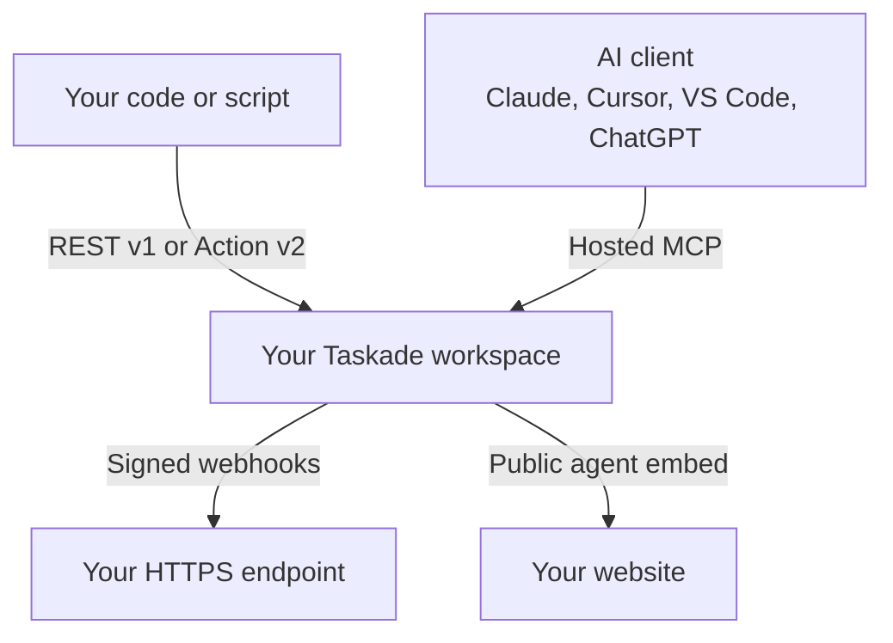

# Taskade API Overview

The Taskade API lets your code read and change workspaces, projects, tasks, AI agents, media, and app bundles over HTTPS. This page starts the Taskade API documentation: one first call, every API surface, and the path that fits your task.


**TL;DR:** Create a personal access token at [taskade.com/settings/api](https://www.taskade.com/settings/api). Send it as `Authorization: Bearer $TASKADE_TOKEN` to `https://www.taskade.com/api/v1`. For AI clients, connect to the hosted MCP server at `https://www.taskade.com/mcp`.


## Make your first call in 30 seconds

One token and one `curl` command return the workspaces that your account can use.


**Warning:** Keep the token out of source code and out of the browser. A personal access token has no scopes. It can do everything that your account can do.


1. Open [taskade.com/settings/api](https://www.taskade.com/settings/api).
2. Under **Personal access tokens**, click **Create token**. Type a name, then click **Create**.
3. Copy the token. Taskade shows it one time only.
4. Save the token in your terminal:

```bash
export TASKADE_TOKEN="tskdp_your_token_here"
```

5. List your workspaces:

```bash
curl -s https://www.taskade.com/api/v1/workspaces \
  -H "Authorization: Bearer $TASKADE_TOKEN"
```

The response lists each workspace with its `id` and `name`:

```json
{
  "ok": true,
  "items": [
    { "id": "Wk3rT9pLmQ2vXa7c", "name": "My Workspace" }
  ]
}
```

You are done when the response holds `"ok": true` and the names of your workspaces. To create a project and add tasks next, follow the [Quickstart](https://www.taskade.com/docs/getting-started/quickstart).

## Taskade API surfaces

Every surface below uses the workspaces that your Taskade account already has. Pick one by what calls what.



| Surface | What it does | Start here |
| --- | --- | --- |
| **REST API v1** | Resources and HTTP verbs for workspaces, folders, projects, tasks, agents, media, and bundles | [REST API guide](../comprehensive-api-guide/README.md) · [Reference](https://www.taskade.com/docs/rest) |
| **Action API v2** (beta, `2.0.0-beta`) | One verb for each operation, such as `/listSpaces`, `/createTask`, and `/promptAgent`. A good fit for AI tools. | [Action API guide](../api-v2-reference.md) · [Reference](https://www.taskade.com/docs/actions) |
| **Hosted MCP server** | Lets Claude, Cursor, VS Code, ChatGPT, and other MCP clients read and change a workspace and edit Taskade Genesis app source | [Hosted Taskade MCP](../genesis-app-mcp.md) |
| **Workspace MCP** (local) | Runs a local stdio server that wraps REST API v1 | [Workspace MCP](../workspace-mcp.md) |
| **Webhooks** | Sends signed Taskade events to your endpoint, or starts an automation from an incoming HTTP call | [Webhooks](../webhooks.md) |
| **Public agent embed** | Puts a public AI agent on your site as an iframe or a chat widget | [Agent embeds](../agent-embeds.md) |
| **Bundles** | Exports and imports a whole app or workspace as JSON, `.zip`, or `.tsk` | [Bundles & App Kits](../bundles.md) |
| **MCP Client connector** | Lets a Taskade automation call the tools of another MCP server | [Which Taskade MCP do I want?](../mcp-overview.md) |
| **TypeScript SDK** | A generated client for the Action API v2. It is in preview and not on npm yet. | [TypeScript SDK](../sdk-quickstart.md) |

Each surface has its own endpoint and access rule:

| Surface | Endpoint or package | Access |
| --- | --- | --- |
| **REST API v1** | `https://www.taskade.com/api/v1` | Every plan. Personal access token or OAuth 2.0, with the permissions of the token owner. |
| **Action API v2** | `https://www.taskade.com/api/v2` | Every plan. Same credentials as REST API v1. |
| **Hosted MCP server** | `https://www.taskade.com/mcp` | OAuth 2.0 with PKCE or a personal access token. Every paid plan (Starter and above). |
| **Workspace MCP** (local) | `npx -y @taskade/mcp-server` | Personal access token in `TASKADE_API_KEY`. Each call keeps its API access rules. |
| **Webhooks** | `POST https://www.taskade.com/api/v2/webhooks` | Pro plan and above |
| **Public agent embed** | The embed code from the agent's publish settings | Every plan. No token: the agent must be public. |
| **Bundles** | `/api/v1/bundles/…` or `/api/v2/exportBundle` | Export: Pro plan and above. Import: per-item plan limits. |
| **MCP Client connector** | An automation step | Every plan, Free included |
| **TypeScript SDK** | `@taskade/sdk` (preview) | Not available yet. Call the API over HTTPS. |

## Choose your path

Use REST API v1 for scripts and back-end jobs. Use the Action API v2 or MCP when an AI model calls Taskade. Use webhooks when Taskade must call you.

| If you want to | Use | Start here |
| --- | --- | --- |
| Make your first call and create a project | REST API v1 | [Quickstart](https://www.taskade.com/docs/getting-started/quickstart) |
| Sync tasks with another system | REST API v1 | [REST API guide](../comprehensive-api-guide/README.md) |
| Give an AI agent or LLM a set of Taskade tools | Action API v2 | [Action API guide](../api-v2-reference.md) |
| Work on a workspace from Claude, Cursor, VS Code, or ChatGPT | Hosted MCP server | [Hosted Taskade MCP](../genesis-app-mcp.md) |
| Get an event when data changes, instead of polling | Webhooks | [Webhooks](../webhooks.md) |
| Act for other Taskade users from your app | OAuth 2.0 | [Authentication](authentication.md) |
| Back up, move, or share a whole app | Bundles | [Bundles & App Kits](../bundles.md) |
| Put an AI agent on your website | Public agent embed | [Agent embeds](../agent-embeds.md) |

## Base URL and authentication

Each API has one base URL. Every request carries a token in the `Authorization` header.

| API | Base URL | Spec version |
| --- | --- | --- |
| REST API v1 | `https://www.taskade.com/api/v1` | `1.0.0` |
| Action API v2 | `https://www.taskade.com/api/v2` | `2.0.0-beta` |

Send the token as a bearer token:

```bash
curl -s https://www.taskade.com/api/v1/me/projects \
  -H "Authorization: Bearer $TASKADE_TOKEN"
```

A list call returns `{ "ok": true, "items": [...] }`. A single-item call returns `{ "ok": true, "item": {...} }`.

| Credential | Use it when | Get it |
| --- | --- | --- |
| Personal access token | Your own scripts, back-end jobs, and local MCP servers. An account holds 5 active tokens maximum. | [Personal access tokens](personal-tokens.md) |
| OAuth 2.0 access token | Your app acts for other Taskade users | [Authentication](authentication.md) |

## Core API resources

The REST API v1 has one table for each resource. Each path links to its generated reference page, with the full parameters and responses. Paths are relative to `https://www.taskade.com/api/v1`.


**Note:** The generated [REST catalog](https://www.taskade.com/docs/rest) and [Actions catalog](https://www.taskade.com/docs/actions) come from the committed OpenAPI specs. If a hand-written example differs from a catalog page, the catalog page is correct.


### Workspaces

Workspaces hold your folders and projects.

| Endpoint | What it does |
| --- | --- |
| [`GET /workspaces`](https://www.taskade.com/docs/rest/workspaces-get) | List the workspaces that your account can use |
| [`GET /workspaces/{workspaceId}/folders`](https://www.taskade.com/docs/rest/workspace-folders-get) | List the folders in a workspace |
| [`POST /workspaces/{workspaceId}/projects`](https://www.taskade.com/docs/rest/workspace-create-project) | Create a project in a workspace |

### Folders

Folders (subspaces) hold projects, agents, and media inside a workspace.

| Endpoint | What it does |
| --- | --- |
| [`GET /folders/{folderId}/projects`](https://www.taskade.com/docs/rest/folder-projects-get) | List the projects in a folder |
| [`GET /folders/{folderId}/agents`](https://www.taskade.com/docs/rest/folder-agent-get) | List the agents in a folder |
| [`POST /folders/{folderId}/agents`](https://www.taskade.com/docs/rest/folder-create-agent) | Create an agent in a folder |
| [`POST /folders/{folderId}/agent-generate`](https://www.taskade.com/docs/rest/folder-agent-generate) | Generate an agent from a description |
| [`GET /folders/{folderId}/medias`](https://www.taskade.com/docs/rest/medias-get) | List the media files in a folder |
| [`GET /folders/{folderId}/project-templates`](https://www.taskade.com/docs/rest/folder-project-templates-get) | List the project templates in a folder |

### Projects

A project holds tasks, notes, and structured data.

| Endpoint | What it does |
| --- | --- |
| [`GET /projects/{projectId}`](https://www.taskade.com/docs/rest/project-get) | Get one project |
| [`POST /projects`](https://www.taskade.com/docs/rest/project-create) | Create a project |
| [`POST /projects/from-template`](https://www.taskade.com/docs/rest/project-from-template) | Create a project from a template |
| [`POST /projects/{projectId}/copy`](https://www.taskade.com/docs/rest/project-copy) | Copy a project to a folder |
| [`POST /projects/{projectId}/complete`](https://www.taskade.com/docs/rest/project-complete) | Mark a project complete |
| [`POST /projects/{projectId}/restore`](https://www.taskade.com/docs/rest/project-restore) | Restore a completed project |
| [`GET /projects/{projectId}/members`](https://www.taskade.com/docs/rest/project-members-get) | List the project members |
| [`GET /projects/{projectId}/fields`](https://www.taskade.com/docs/rest/project-fields-get) | List the custom fields |
| [`GET /projects/{projectId}/shareLink`](https://www.taskade.com/docs/rest/project-share-link-get) | Get the share link |
| [`PUT /projects/{projectId}/shareLink`](https://www.taskade.com/docs/rest/project-share-link-enable) | Turn on the share link |
| [`GET /projects/{projectId}/blocks`](https://www.taskade.com/docs/rest/project-blocks-get) | List the top-level blocks |
| [`GET /projects/{projectId}/tasks`](https://www.taskade.com/docs/rest/project-tasks-get) | List the tasks |

### Tasks

A task is one item in a project. It can carry assignees, a date, a note, and field values.

| Endpoint | What it does |
| --- | --- |
| [`POST /projects/{projectId}/tasks/`](https://www.taskade.com/docs/rest/task-create) | Create up to 20 tasks |
| [`GET /projects/{projectId}/tasks/{taskId}`](https://www.taskade.com/docs/rest/task-get) | Get one task |
| [`PUT /projects/{projectId}/tasks/{taskId}`](https://www.taskade.com/docs/rest/task-put) | Update a task |
| [`DELETE /projects/{projectId}/tasks/{taskId}`](https://www.taskade.com/docs/rest/task-delete) | Delete a task |
| [`POST /projects/{projectId}/tasks/{taskId}/complete`](https://www.taskade.com/docs/rest/task-complete) | Mark a task complete |
| [`POST /projects/{projectId}/tasks/{taskId}/uncomplete`](https://www.taskade.com/docs/rest/task-uncomplete) | Mark a task open again |
| [`PUT /projects/{projectId}/tasks/{taskId}/move`](https://www.taskade.com/docs/rest/task-move) | Move a task in the project |
| [`GET /projects/{projectId}/tasks/{taskId}/assignees`](https://www.taskade.com/docs/rest/task-assignees-get) | List the assignees |
| [`PUT /projects/{projectId}/tasks/{taskId}/assignees`](https://www.taskade.com/docs/rest/task-put-assignees) | Set the assignees |
| [`DELETE /projects/{projectId}/tasks/{taskId}/assignees/{assigneeHandle}`](https://www.taskade.com/docs/rest/task-delete-assignees) | Remove one assignee |
| [`GET /projects/{projectId}/tasks/{taskId}/date`](https://www.taskade.com/docs/rest/task-get-date) | Get the date |
| [`PUT /projects/{projectId}/tasks/{taskId}/date`](https://www.taskade.com/docs/rest/task-put-date) | Set the date |
| [`DELETE /projects/{projectId}/tasks/{taskId}/date`](https://www.taskade.com/docs/rest/task-delete-date) | Remove the date |
| [`GET /projects/{projectId}/tasks/{taskId}/note`](https://www.taskade.com/docs/rest/task-note-get) | Get the note |
| [`PUT /projects/{projectId}/tasks/{taskId}/note`](https://www.taskade.com/docs/rest/task-note-put) | Set the note |
| [`DELETE /projects/{projectId}/tasks/{taskId}/note`](https://www.taskade.com/docs/rest/task-note-delete) | Remove the note |
| [`GET /projects/{projectId}/tasks/{taskId}/fields`](https://www.taskade.com/docs/rest/task-fields-value-get) | List all field values |
| [`GET /projects/{projectId}/tasks/{taskId}/fields/{fieldId}`](https://www.taskade.com/docs/rest/task-field-value-get) | Get one field value |
| [`PUT /projects/{projectId}/tasks/{taskId}/fields/{fieldId}`](https://www.taskade.com/docs/rest/task-field-value-put) | Set one field value |
| [`DELETE /projects/{projectId}/tasks/{taskId}/fields/{fieldId}`](https://www.taskade.com/docs/rest/task-field-value-delete) | Remove one field value |

### AI Agents

An AI agent answers chats and runs work with its own instructions and knowledge.

| Endpoint | What it does |
| --- | --- |
| [`GET /agents/{agentId}`](https://www.taskade.com/docs/rest/agent-get) | Get an agent |
| [`PATCH /agents/{agentId}`](https://www.taskade.com/docs/rest/agent-update) | Update an agent |
| [`DELETE /agents/{agentId}`](https://www.taskade.com/docs/rest/delete-agent) | Delete an agent |
| [`PUT /agents/{agentId}/publicAccess`](https://www.taskade.com/docs/rest/agent-public-access-enable) | Make an agent public |
| [`GET /agents/{agentId}/public-agent`](https://www.taskade.com/docs/rest/agent-public-get) | Get the public agent settings |
| [`PATCH /agents/{agentId}/public-agent`](https://www.taskade.com/docs/rest/agent-public-update) | Update the public agent settings |
| [`GET /public-agents/{publicAgentId}`](https://www.taskade.com/docs/rest/public-agent-get) | Get a public agent by its public ID |
| [`POST /agents/{agentId}/knowledge/project`](https://www.taskade.com/docs/rest/agent-knowledge-project-create) | Add a project to the agent knowledge |
| [`POST /agents/{agentId}/knowledge/media`](https://www.taskade.com/docs/rest/agent-knowledge-media-create) | Add a media file to the agent knowledge |
| [`DELETE /agents/{agentId}/knowledge/project/{projectId}`](https://www.taskade.com/docs/rest/agent-knowledge-project-remove) | Remove a project from the knowledge |
| [`DELETE /agents/{agentId}/knowledge/media/{mediaId}`](https://www.taskade.com/docs/rest/agent-knowledge-media-remove) | Remove a media file from the knowledge |
| [`GET /agents/{agentId}/convos/`](https://www.taskade.com/docs/rest/agent-convos-get) | List the agent conversations |
| [`GET /agents/{agentId}/convos/{convoId}`](https://www.taskade.com/docs/rest/agent-convo-get) | Get one conversation |

### Media

Media files are the uploads in a workspace.

| Endpoint | What it does |
| --- | --- |
| [`GET /medias/{mediaId}`](https://www.taskade.com/docs/rest/media-get) | Get the media details |
| [`DELETE /medias/{mediaId}`](https://www.taskade.com/docs/rest/media-delete) | Delete a media file |
| [`GET /medias/{mediaId}/download`](https://www.taskade.com/docs/rest/media-download) | Download one media file |
| [`GET /medias/spaces/{spaceId}/download`](https://www.taskade.com/docs/rest/media-download-all) | Download the media of a space |
| [`POST /medias/spaces/{spaceId}/upload`](https://www.taskade.com/docs/rest/media-upload) | Upload a file (raw body, `?filename=`) |

### Bundles

A bundle is a portable copy of a whole app or workspace. See [Bundles & App Kits](../bundles.md).

| Endpoint | What it does |
| --- | --- |
| [`GET /bundles/{spaceId}/export`](https://www.taskade.com/docs/rest/bundle-export) | Export a space as JSON |
| [`GET /bundles/{spaceId}/export/zip`](https://www.taskade.com/docs/rest/bundle-export-zip) | Export a space as a `.zip` or `.tsk` file |
| [`POST /bundles/{workspaceId}/import`](https://www.taskade.com/docs/rest/bundle-import) | Import a JSON bundle |
| [`POST /bundles/{workspaceId}/import/zip`](https://www.taskade.com/docs/rest/bundle-import-zip) | Import a `.zip` or `.tsk` file |

### User projects

Your own recent projects, across workspaces.

| Endpoint | What it does |
| --- | --- |
| [`GET /me/projects`](https://www.taskade.com/docs/rest/me-projects-get) | List the projects of the current user |

## Errors

Every error returns `"ok": false` and an upper-case `code`. Branch on `ok` and `code`. Do not parse `message`.

### HTTP status codes

| Status | Meaning |
| --- | --- |
| `200 OK` | The request succeeded |
| `400 Bad Request` | A parameter or a field is not valid |
| `401 Unauthorized` | The token is missing or not valid |
| `402 Payment Required` | The operation needs a higher plan, or the account has no credits left |
| `403 Forbidden` | Your account does not have permission |
| `404 Not Found` | The item does not exist, or your account cannot see it |
| `429 Too Many Requests` | You hit a rate limit |
| Other `4XX` | Another client error. Read the response body. |

### Error response format

Every error carries `ok`, `message`, `code`, and `statusMessage`. A missing token returns `401`:

```json
{
  "ok": false,
  "message": "Unauthorized",
  "code": "UNAUTHORIZED",
  "statusMessage": "Unauthorized"
}
```

A plan error can also carry `featureId`, the plan feature that the call needs. The bundle export returns `"featureId": "space.bundle.export"` with its `402`.

### Fix common errors

Match the `code` in the response to a fix.

| What you see | Cause | Fix |
| --- | --- | --- |
| `"code": "UNAUTHORIZED"` | The token is missing, wrong, or revoked | Send `Authorization: Bearer $TASKADE_TOKEN`. Make sure that the variable is set in the same terminal. |
| `"code": "FST_ERR_VALIDATION"` | A field or parameter does not match the schema | Read `message`. It names each field that failed, then the reason. |
| `"code": "PAYMENT_REQUIRED"` | The workspace plan does not include the operation | Read `featureId` if it is present. Upgrade the workspace, or use a workspace on a higher plan. |
| `"code": "NOT_FOUND"` | The ID is wrong, or your account cannot see the item | Check the ID and your workspace access. |
| `"code": "TOO_MANY_REQUESTS"` | You hit a rate limit | Wait for the number of seconds in the `Retry-After` header, then send the request again. |

## Code examples

The same calls in three runtimes. Each example reads the token from the `TASKADE_TOKEN` environment variable.

### JavaScript (Node.js 18 or later)

```javascript
const API_BASE = 'https://www.taskade.com/api/v1';
const headers = {
  Authorization: `Bearer ${process.env.TASKADE_TOKEN}`,
  'Content-Type': 'application/json',
};

// Get all workspaces
async function getWorkspaces() {
  const response = await fetch(`${API_BASE}/workspaces`, { headers });
  return response.json();
}

// Get project tasks
async function getProjectTasks(projectId) {
  const response = await fetch(`${API_BASE}/projects/${projectId}/tasks`, { headers });
  return response.json();
}

// Create a task at the end of a project
async function createTask(projectId, content) {
  const response = await fetch(`${API_BASE}/projects/${projectId}/tasks/`, {
    method: 'POST',
    headers,
    body: JSON.stringify({
      tasks: [{ contentType: 'text/markdown', content, placement: 'beforeend' }],
    }),
  });
  return response.json();
}
```

### Python

Python 3 with the `requests` package.

```python
import os
import requests

API_BASE = 'https://www.taskade.com/api/v1'
headers = {
    'Authorization': f"Bearer {os.environ['TASKADE_TOKEN']}",
    'Content-Type': 'application/json',
}

# Get all workspaces
def get_workspaces():
    response = requests.get(f'{API_BASE}/workspaces', headers=headers)
    return response.json()

# Get project tasks
def get_project_tasks(project_id):
    response = requests.get(f'{API_BASE}/projects/{project_id}/tasks', headers=headers)
    return response.json()

# Complete a task
def complete_task(project_id, task_id):
    response = requests.post(
        f'{API_BASE}/projects/{project_id}/tasks/{task_id}/complete',
        headers=headers,
    )
    return response.json()
```

### cURL

Save the IDs that you use, then send the requests:

```bash
export FOLDER_ID="your_folder_id"
export AGENT_ID="your_agent_id"

# Get projects in a folder
curl -s "https://www.taskade.com/api/v1/folders/$FOLDER_ID/projects" \
  -H "Authorization: Bearer $TASKADE_TOKEN"

# Get an agent
curl -s "https://www.taskade.com/api/v1/agents/$AGENT_ID" \
  -H "Authorization: Bearer $TASKADE_TOKEN"
```

A list call returns `{ "ok": true, "items": [...] }`. A single-item call returns `{ "ok": true, "item": {...} }`.

## Best practices

Follow these rules to keep an integration safe, fast, and correct.

### Security

- Store tokens in environment variables or a secret manager.
- Never put a token in client-side code or in a public repository.
- Use one token for each integration, so that you can revoke one without the others.
- Handle every error response.

### Performance

- Page through large lists. Tasks and blocks use cursor pagination.
- Cache responses when the data permits it.
- Retry a `429` after the number of seconds in its `Retry-After` header.

### Data management

- Validate data before you send it to the API.
- Record partial failures, and retry only the calls that failed.

## Next steps

1. **Make a full first integration:** [Quickstart](https://www.taskade.com/docs/getting-started/quickstart) creates a project and adds tasks in about five minutes.
2. **Look up an endpoint:** [REST API reference](https://www.taskade.com/docs/rest) lists every v1 endpoint with its parameters and responses.
3. **Build AI tools:** [Action API guide](../api-v2-reference.md) gives one verb for each operation.
4. **Connect an AI client:** [Hosted Taskade MCP](../genesis-app-mcp.md) has the setup for Claude, Cursor, VS Code, and ChatGPT.
5. **Get help:** search the [Help Center](https://www.taskade.com/learn), or email support@taskade.com.

---

_This page is also published at [taskade.com/docs/getting-started/api-overview](https://www.taskade.com/docs/getting-started/api-overview)._
