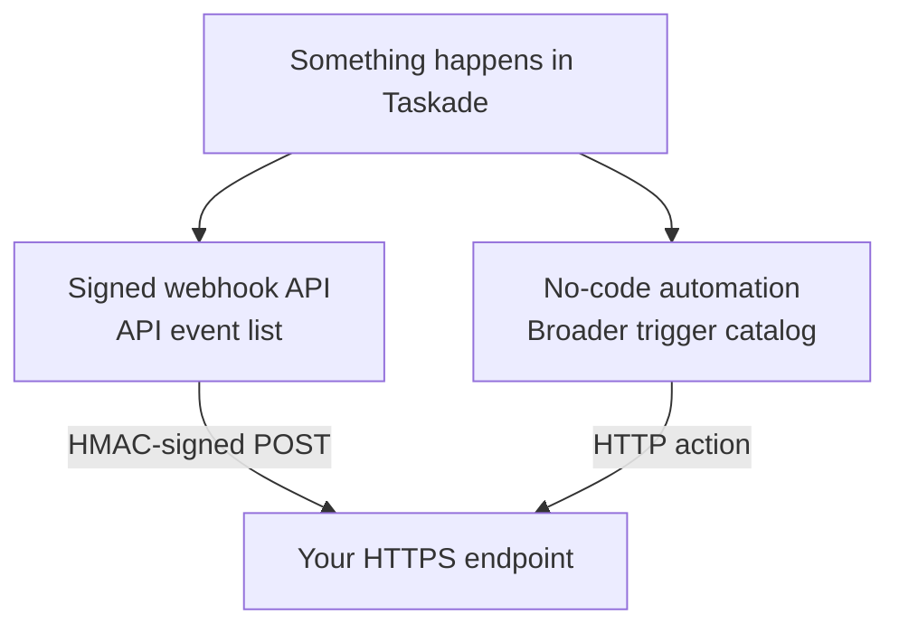
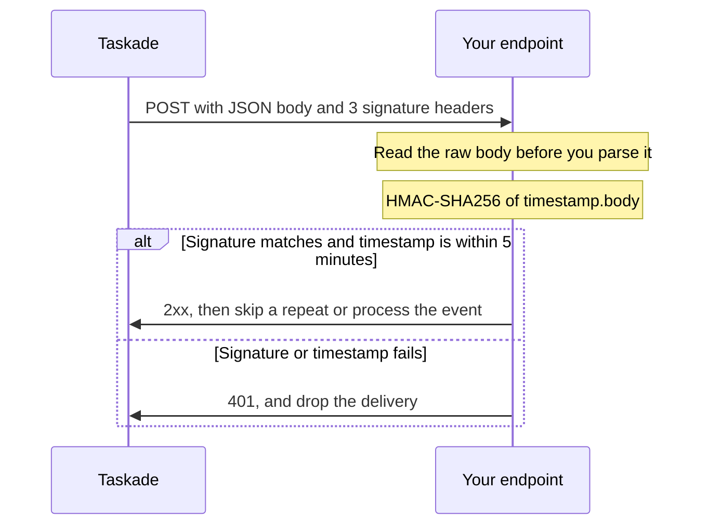

# Taskade Webhooks

Use webhooks to connect Taskade to other services. Start an automation from another service, call another API from an automation, or get a signed `POST` when something changes in Taskade.


**TL;DR:** To start an automation, `POST` JSON to its webhook URL with a Bearer token or a signature. To get Taskade events in your app, register a signed webhook with `POST /api/v2/webhooks`, then check `X-Taskade-Signature-V2` and `X-Taskade-Timestamp` on each delivery. Both need the Pro plan or higher.


| You want to | Use | Jump to |
| --- | --- | --- |
| Start an automation from another service | Inbound webhook | [Inbound webhooks](#inbound-webhooks) |
| Call another API from an automation | Send HTTP Request action | [Outbound HTTP requests](#outbound-http-requests) |
| Get Taskade events in your code | Signed webhook API | [Webhook Registration API](#webhook-registration-api) |
| Get Taskade events with no code | Trigger and HTTP action | [Receiving Taskade events](#receiving-taskade-events) |




When your integration needs registrations managed in code and verifiable HMAC deliveries, use the signed API. Its events are the explicit list in [Supported events](#supported-events).

The no-code route is broader. Automation triggers also cover events such as task added, task completed, due-date changes, custom-field updates, schedules, and connected services. You choose the outgoing payload in the HTTP action.

## Before you start

- A workspace on the **Pro plan or higher**. Webhook triggers and the Webhook Registration API return `402` on Free and Starter.
- For the Webhook Registration API, an account with a verified email address and a personal access token from [taskade.com/settings/api](https://www.taskade.com/settings/api).
- An HTTPS endpoint that you control, if you receive events.
- `curl` in a terminal.

Save the token in your terminal. The registration examples read it from `TASKADE_TOKEN`:

```bash
export TASKADE_TOKEN="tskdp_your_token_here"
```

***

## Inbound webhooks

Receive data from an external service to start a Taskade automation.

### How it works

1. **Create a webhook trigger** in an automation.
2. Copy the URL from the **Webhook URL** field in the trigger panel.
3. In **Verify requests**, choose how Taskade checks each call: a Bearer token, a Stripe signature, or an HMAC-SHA256 signature. See [Authentication](#authentication).
4. Enable the automation. For a Bearer token, Taskade generates the token at this step.
5. Configure your external service to **POST JSON data** to the URL, with the token or the signature that you chose.
6. Use the webhook payload as **dynamic data** in subsequent actions.


> ℹ️
> Taskade generates one webhook URL per automation. The URL has the form `https://www.taskade.com/webhooks/flow/<automation-id>/sync`. It identifies the automation, so it does not change.
>
> Webhook triggers run on **Pro and above**. On Free and Starter, a call returns `402` with `code: "PAYMENT_REQUIRED"`, and the automation does not run.


### Payload structure

The webhook accepts `application/json`, `multipart/form-data`, or `application/x-www-form-urlencoded`. Taskade rejects any other content type with `400`.

A JSON body larger than about 1.1 MB returns `413`. Taskade applies the limit after it encodes the body, so the message of a `PAYLOAD_TOO_LARGE` error states about 1.5 MB. Each payload field becomes a **dynamic variable** for subsequent actions.

**Example payload:**

```json
{
  "event": "form_submitted",
  "name": "Jane Doe",
  "email": "jane@example.com",
  "message": "Interested in a demo"
}
```

All four fields (`event`, `name`, `email`, `message`) are available as dynamic variables in your automation steps.

### Authentication

The **Verify requests** setting in the webhook trigger panel decides which calls start the automation. A new webhook trigger starts at **None**, so anyone with the URL can start it. Pick a check before you share the URL.

| Verify requests | What the caller sends | Use it for |
| --- | --- | --- |
| **None** | Nothing | A test, or a sender that cannot authenticate |
| **Bearer token** | `Authorization: Bearer <token>` | Your own code, a form tool, or any sender that can set a header |
| **Stripe signature** | The `Stripe-Signature` header | A Stripe webhook endpoint |
| **HMAC-SHA256 signature** | A hex HMAC-SHA256 of `<timestamp>.<raw body>`, and the timestamp, in two headers | A Taskade signed webhook, or another sender that signs the same way |

With **None**, the panel shows this message:

```text
This webhook is public. Anyone with the URL can trigger this flow.
```

The URL does not change, so the token or the signing secret is the only thing that protects the automation.

#### Use a Bearer token

Taskade generates the token when you enable the automation, and then rejects every call that does not send it.

**Get the token:**

1. Open the webhook trigger panel in your automation.
2. In **Verify requests**, select **Bearer token**.
3. Enable the automation. Taskade generates the token.
4. In the **Authorization Token** field, click **Show** or **Copy**.

**Call the webhook:**

Save the webhook URL and the authorization token from the trigger panel. Then send the payload with the token in the `Authorization` header:

```bash
export WEBHOOK_URL="https://www.taskade.com/webhooks/flow/your_automation_id/sync"
export WEBHOOK_TOKEN="token_from_the_trigger_panel"

curl -s -X POST "$WEBHOOK_URL" \
  -H "Authorization: Bearer $WEBHOOK_TOKEN" \
  -H "Content-Type: application/json" \
  -d '{"event": "form_submitted", "name": "Jane Doe"}'
```

The webhook token is a different secret from `TASKADE_TOKEN`. It works only for this one automation.

Taskade returns `401 Unauthorized` for a request with a missing or incorrect token. The automation does not run. The response `message` is `Invalid or missing webhook authorization token`.

If you set **Verify requests** to **None**, validate each payload in your automation logic. For example, require an expected `event` value.


> ⚠️
> Treat the authorization token like a password. Do not share it publicly. Do not commit it to source control.


### Verify Stripe and HMAC-signed webhook calls

A signature check lets a sender that cannot set an `Authorization` header start an automation. Taskade rejects a forged call and a call more than 5 minutes old. Taskade stores no request id, so a copy of a signed call that arrives inside those 5 minutes still starts the automation. Design the automation to handle a repeat. Stripe is the common case. A signature check replaces the Bearer token check for that automation.

1. Open the webhook trigger panel in your automation.
2. In **Verify requests**, select **Stripe signature** or **HMAC-SHA256 signature**.
3. Paste the signing secret into **Signing secret**. For Stripe, use the signing secret of your Stripe webhook endpoint.
4. For **HMAC-SHA256 signature** only, set **Signature header** and **Timestamp header** if your sender uses other names. Empty fields use `X-Taskade-Signature-V2` and `X-Taskade-Timestamp`.
5. Enable the automation.

> ⚠️
> Add the signing secret before you send traffic. Until you do, the automation rejects every request.

Taskade checks each signed call in this order:

| Check | Rule |
| --- | --- |
| Body size | The raw body must be 1 MB or smaller. A larger body returns `413` before any other check. |
| Signature | HMAC-SHA256 of `<timestamp>.<raw body>`, keyed with the signing secret, compared in constant time. The value is hex, with or without a `sha256=` prefix. |
| Stripe header | Taskade reads `t=` and every `v1=` value from `Stripe-Signature`. During a Stripe secret roll, one saved secret is enough. |
| Timestamp | Unix seconds. A call more than 5 minutes away from the Taskade clock returns `401`. |

To test the HMAC-SHA256 mode from a terminal, sign the body the same way a sender does:

```bash
export WEBHOOK_URL="https://www.taskade.com/webhooks/flow/your_automation_id/sync"
export SIGNING_SECRET="secret_from_the_trigger_panel"

BODY='{"event":"form_submitted","name":"Jane Doe"}'
TS=$(date +%s)
SIG=$(printf '%s' "$TS.$BODY" | openssl dgst -sha256 -hmac "$SIGNING_SECRET" | sed 's/^.* //')

curl -s -X POST "$WEBHOOK_URL" \
  -H "Content-Type: application/json" \
  -H "X-Taskade-Timestamp: $TS" \
  -H "X-Taskade-Signature-V2: sha256=$SIG" \
  -d "$BODY"
```

A Taskade [signed webhook](#webhook-registration-api) sends these two headers on every delivery. So you can point a signed webhook from one Taskade account at an automation URL, and use its secret as the signing secret.

#### Return a response to the caller

The URL ends in `/sync`. If the automation defines a **Webhook Response** output, the call waits for the run and returns that response. Otherwise, Taskade returns `200` with an empty body as soon as it accepts the call.

#### What the run stores

Each run keeps the request method, the query parameters, the request headers, and the body as trigger data. Later steps can read them. Before Taskade stores a run, it removes the headers that carry a credential:

| Header removed from the run | Why |
| --- | --- |
| `Authorization`, `Proxy-Authorization` | They carry the webhook token or another bearer credential |
| `Cookie`, `Set-Cookie` | They carry session cookies |
| `X-Api-Key`, `X-Auth-Token` | They carry an API key of the sender |

Taskade also removes its own internal headers. Signature headers stay, for example `Stripe-Signature`, `X-Taskade-Signature-V2`, and `X-Taskade-Timestamp`. A custom header that you choose stays too, for example `X-Status-Secret`.

So a step cannot check an `X-Api-Key` value that a sender puts on the call. To protect the automation, use a Bearer token or a signature check in **Verify requests**.


**Warning:** Do not use a custom header as a secret store. Its value stays in the run, and every member who can view automations can read it in **Runs**.


A member who can view automations but cannot edit them does not see the webhook token or the signing secret. Taskade removes both from the automation and from its run history for that member.

#### Inbound webhook errors

| What you see | Cause | Fix |
| --- | --- | --- |
| `Invalid or missing webhook authorization token` | The `Authorization` header is missing, or the token is wrong | Send `Authorization: Bearer $WEBHOOK_TOKEN` with the token from the trigger panel. |
| `Webhook authorization required but not yet configured` | Bearer token: the automation is not enabled, so Taskade has not generated the token yet. Signature: no signing secret is saved | Enable the automation, then copy the token. For a signature check, paste the signing secret. |
| `Invalid or missing webhook signature` | The signature header is missing, or it does not match the signing secret | Sign `<timestamp>.<raw body>` with the signing secret. Sign the raw bytes, not a re-serialized JSON object. |
| `Webhook signature timestamp is more than 5 minutes old or ahead` | The signed timestamp is more than 5 minutes from the Taskade clock, or the call is a copy of a call older than 5 minutes | Send the current time in unix seconds, and sign each call again. Make sure that the sender clock is correct. |
| `Signed webhook body exceeds the 1 MB limit` | A signed call has a raw body larger than 1 MB | Send a smaller body, or send a link to the data instead. |
| `Webhook Automation requires a Pro plan or higher` | The workspace is on Free or Starter | Upgrade the workspace to Pro or higher. |
| `Only application/json, multipart/form-data or application/x-www-form-urlencoded is accepted` | The request has another `Content-Type` | Send `Content-Type: application/json`. |


### Common patterns

| Source                        | What Happens in Taskade                   |
| ----------------------------- | ----------------------------------------- |
| **External form submission**  | Create a task + notify the team           |
| **Stripe payment webhook**    | Update project status + send confirmation |
| **GitHub CI/CD webhook**      | Update deployment status in a project     |
| **CRM event (HubSpot and others)** | Sync contact data to a Taskade project |

***

## Outbound HTTP requests

For outbound communication, use the **Send HTTP Request** action in an automation. It can call an external API. Later steps can use the response.

### Configuration

| Setting | Details |
| --- | --- |
| **Method** | `GET`, `POST`, `PATCH`, `PUT`, `DELETE`, `HEAD` |
| **URL** | The external endpoint |
| **Headers** | Request headers such as `Authorization` and `Content-Type` |
| **Query params** | Values added to the URL query string |
| **Request Body Type** | `none`, `json`, `raw`, `formData`, or `multipart` |
| **Response Body Type** | No parsed body, or JSON |
| **Timeout (ms)** | Maximum wait. Invalid, zero, or negative values use 30 seconds |
| **Follow Redirects** | Off by default. When enabled, Taskade follows up to five safe redirects |
| **Return Status On Error** | Return the response and status instead of failing on a non-2xx response |


> ℹ️
> Response data from the HTTP request becomes dynamic variables in subsequent automation steps. Use these variables to chain API calls.

### Choose a body type

Match the body mode to the API contract.

| Body type | What Taskade sends | Use it for |
| --- | --- | --- |
| `none` | No request body | `GET`, `HEAD`, or another bodyless request |
| `json` | A JSON value or supported structured value | JSON APIs |
| `raw` | The configured body without JSON conversion | Text, XML, or another raw payload |
| `formData` | Object fields as form data | Simple form submissions |
| `multipart` | Validated multipart fields and files | File uploads and mixed form data |

JSON mode sets `Content-Type: application/json` when you do not provide another content type. If the body is text, enter valid JSON when the receiving API expects JSON.

Use `none` for a request without a body. Do not send an empty JSON object as a placeholder.

Insert dynamic values with the variable controls in the automation editor. The editor writes the supported expression into the field.


### Example: post to an external API

| Setting | Value |
| --- | --- |
| **Method** | `POST` |
| **URL** | `https://api.example.com/notifications` |
| **Headers** | `Content-Type: application/json`<br>`Authorization: Bearer <token for api.example.com>` |

**Body:**

```json
{
  "channel": "#alerts",
  "text": "New task created: {{task.name}}"
}
```

***

## Webhook Registration API


> ℹ️
> Registration returns a **signing secret exactly once**, so store it before anything else. The authoritative schema is the live [Action API v2 spec](https://www.taskade.com/api/documentation/v2).


Register **signed** outbound webhooks through the public API. You do not need an automation.

Taskade sends the event payload with `POST`. It signs every delivery with an HMAC secret.

The programmatic event list is smaller than the no-code automation trigger catalog.

This API supersedes the unsigned `subscribeWebhook` and `unsubscribeWebhook` operations. Those operations still work and are deprecated. See [Legacy unsigned subscriptions](#legacy-unsigned-subscriptions-deprecated).

### Register a webhook

**`POST /api/v2/webhooks`** takes one target URL, one or more events, and optional workspace scoping:

```bash
curl -s -X POST https://www.taskade.com/api/v2/webhooks \
  -H "Authorization: Bearer $TASKADE_TOKEN" \
  -H "Content-Type: application/json" \
  -d '{"targetUrl": "https://your-app.example.com/hooks/taskade", "events": ["task.due", "task.assigned"], "spaceIds": []}'
```

**Response** (`secret` is shown **once**):

```json
{
  "ok": true,
  "webhook": {
    "id": "https://your-app.example.com/hooks/taskade",
    "url": "https://your-app.example.com/hooks/taskade",
    "events": ["task.due", "task.assigned"],
    "spaceIds": [],
    "createdAt": "2026-07-21T09:00:00.000Z"
  },
  "secret": "signing_secret_shown_once"
}
```

A webhook's **`id` is its target URL**. When you use it as a path parameter, URL-encode it.

### Supported events

The `events` array accepts only these six names. Any other value returns `400`:

| Event | Fires when |
| --- | --- |
| `task.due` | A task's due date arrives |
| `task.assigned` | A task is assigned to someone |
| `comment.created` | A comment is added to a task |
| `project.created` | A project is created |
| `project.assigned` | A project is assigned to someone |
| `project.joined` | Someone joins a project |

### Delivery payload

The delivery body is the event's own object. **There is no event-name envelope**. Branch on the fields you require rather than on a type discriminator:

| Event | Top-level fields |
| --- | --- |
| `task.due` | `spaceName`, `spaceId`, `projectName`, `projectId`, `id`, `text`, `isCompleted`, `assignees`, `taskStartDate`, `taskStartTime`, `taskStartTimezone`, `taskEndDate`, `taskEndTime`, `taskEndTimezone` |
| `task.assigned` | `projectName`, `projectId`, `assignerName`, `assignedNodes[]` (each `nodeId`, `nodeText`, `isCompleted`, `assignees`), and `nodes[]`, a copy of `assignedNodes[]` |
| `comment.created` | `projectName`, `projectId`, `nodeId`, `nodeText`, `commenterDisplayName`, `commenterHandle`, `commentBody`, `commentBodyType`, `assignees`, `mentionedHandles` |
| `project.created` | `spaceName`, `spaceId`, `projectName`, `projectId`, `creatorName` |
| `project.assigned` | `spaceName`, `spaceId`, `projectName`, `projectId`, `assignerName`, `assigneeName`, `assigneeId` |
| `project.joined` | `spaceId`, `projectName`, `projectId`, `joinerName`, `joinerUserId` |

When your handler needs to know which event arrived, register one URL per event. Otherwise, key off a field that only one event carries.

### Scope to specific workspaces

`"spaceIds": []` (the default) delivers matching events from **all** your workspaces. Pass workspace ids to receive events from only those workspaces:

```json
{
  "targetUrl": "https://your-app.example.com/hooks/taskade",
  "events": ["project.created"],
  "spaceIds": ["SPACE_ID_1", "SPACE_ID_2"]
}
```

### List, inspect, delete

> ⚠️
> Delete a webhook only when you no longer need it. The `DELETE` call removes the registration, and Taskade stops its deliveries. To receive the events again, register the webhook again.

```bash
# List all registered webhooks
curl -s https://www.taskade.com/api/v2/webhooks \
  -H "Authorization: Bearer $TASKADE_TOKEN"

# Get or delete one. The :id is the URL-encoded target URL.
curl -s -X DELETE \
  "https://www.taskade.com/api/v2/webhooks/https%3A%2F%2Fyour-app.example.com%2Fhooks%2Ftaskade" \
  -H "Authorization: Bearer $TASKADE_TOKEN"
```

`GET /api/v2/webhooks` returns `{ "ok": true, "items": [ ... ] }`.

`DELETE /api/v2/webhooks/{id}` returns `{ "ok": true, "deleted": <boolean> }`. `deleted` is `false` when no webhook matched that id. The status is `200` either way.

`GET /api/v2/webhooks/{id}` returns `{ "ok": true, "webhook": { ... } }`.

### Validate delivery signatures

Every signed delivery is a `POST` with a JSON body and three signature headers. Each signature is `sha256=` followed by a hex HMAC-SHA256, keyed with the `secret` from the registration response:

| Header | Value |
| --- | --- |
| `X-Taskade-Signature` | `sha256=<hex>` of the raw request body |
| `X-Taskade-Timestamp` | The send time, in unix seconds |
| `X-Taskade-Signature-V2` | `sha256=<hex>` of `<timestamp>.<raw body>`, with the `X-Taskade-Timestamp` value as `<timestamp>` |

Check `X-Taskade-Signature-V2` in new receivers. The timestamp is part of the signed data, so a captured delivery fails the check after 5 minutes. A copy that arrives inside those 5 minutes still passes, so make your handler idempotent, or record each delivery that you process and skip a repeat. `X-Taskade-Signature` does not change, and receivers that check it keep working.



To check V2:

1. Read the raw request body before you parse the JSON.
2. Compute the HMAC-SHA256 of the `X-Taskade-Timestamp` value, a period (`.`), and the raw body. Use your `secret` as the key.
3. Compare `sha256=<your hex>` with `X-Taskade-Signature-V2` in constant time.
4. Reject the delivery if the timestamp is more than 5 minutes away from your clock.
5. Skip a delivery that you processed before, or make the handler idempotent. The timestamp check does not stop a copy that arrives inside the 5 minutes.

This Node.js 18 function does steps 1 to 4:

```typescript
import crypto from "node:crypto";

const TOLERANCE_SECONDS = 5 * 60;

function verifyTaskadeWebhook(
  rawBody: Buffer,
  headers: Record<string, string | undefined>,
  secret: string,
): boolean {
  const timestamp = headers["x-taskade-timestamp"] ?? "";
  const signature = headers["x-taskade-signature-v2"] ?? "";
  if (!/^\d+$/.test(timestamp)) return false;

  const expected =
    "sha256=" +
    crypto
      .createHmac("sha256", secret)
      .update(`${timestamp}.`)
      .update(rawBody)
      .digest("hex");
  const isMatch =
    expected.length === signature.length &&
    crypto.timingSafeEqual(Buffer.from(expected), Buffer.from(signature));
  if (!isMatch) return false;

  const ageSeconds = Math.abs(Date.now() / 1000 - Number(timestamp));
  return ageSeconds <= TOLERANCE_SECONDS;
}
```

Reject each delivery that fails the check. A delivery that passes the check can still be a copy, so do step 5 in your handler. A receiver that verifies only `X-Taskade-Signature` compares `sha256=<hex>` of the raw body, with no timestamp. That check still works, but it does not stop a replay.

### Limits & requirements

| Rule | Detail |
| --- | --- |
| Plan | **Pro or above**, otherwise `402` with `code: "PAYMENT_REQUIRED"`. Deleting is always allowed, so a downgraded account can still clean up. |
| Account | The account email must be verified, otherwise `403` with `code: "FORBIDDEN"`. |
| Target URL | Must be **`https`**. Max **2,048 characters** once URL-encoded, because the encoded URL is the `:id` path parameter. |
| Limit | **100** event-workspace combinations per account. One webhook with 3 events scoped to 2 workspaces counts as 6. |
| Scope | All workspaces by default. Narrow the scope with `spaceIds`. |
| Dashboard | You can also create and manage outgoing webhooks in **[Settings > API](https://www.taskade.com/settings/api)**. |

### Legacy: unsigned subscriptions (deprecated)

The `subscribeWebhook` and `unsubscribeWebhook` operations still work, but they are **deprecated**.

Each subscription covers one event. Its scope is account-wide. Deliveries are **not signed**.

Use `POST /api/v2/webhooks` for new integrations. To migrate, register the same URL there. Then remove the old subscription.

### Registration errors

Every registration error uses the standard JSON error envelope. For example, a Free plan returns `402`:

```json
{
  "ok": false,
  "message": "Webhooks require a Pro plan or higher.",
  "code": "PAYMENT_REQUIRED",
  "statusMessage": "Payment Required"
}
```

| What you see | Cause | Fix |
| --- | --- | --- |
| `Webhooks require a Pro plan or higher.` | The account is on Free or Starter | Upgrade to Pro or higher. |
| `User must be verified.` | The account email is not verified | Complete the email verification for your account, then register again. |
| `url must use https` | The target URL uses `http` | Serve your endpoint over HTTPS. |
| `"code": "FST_ERR_VALIDATION"` | An event name is not in [Supported events](#supported-events), or a field is missing | Read `message`, fix each field that it names, then send the request again. |
| `A webhook for this URL already exists.` | You registered this target URL before | Delete the old registration, or use a different URL. |
| `Webhook limit reached (max 100 per account).` | The account holds 100 event-workspace combinations | Delete registrations that you do not use. |

***

## Receiving Taskade events

To send Taskade events to your app, build an automation with two ends. Start it with a Taskade **trigger**, such as a new task or a completed task.

End it with an [Outbound HTTP Request](#outbound-http-requests) to your endpoint. The trigger's fields are available as dynamic variables in the HTTP body.

### Common triggers and their payloads

**Task added** fires when a new task is added to a project:

```json
{
  "projectId": "abc123",
  "nodeId": "node_456",
  "nodeText": "Follow up with client",
  "projectTitle": "Sales Pipeline",
  "nodeNote": "Optional note text",
  "projectLink": "https://www.taskade.com/d/abc123",
  "assignees": [ { "handle": "jane" } ],
  "startDate": "2026-06-10",
  "endDate": "2026-06-12"
}
```

**Task completed** fires when a task is marked complete:

```json
{
  "projectId": "abc123",
  "nodeId": "node_456",
  "nodeText": "Follow up with client",
  "projectTitle": "Sales Pipeline",
  "projectLink": "https://www.taskade.com/d/abc123",
  "completedBy": "jane",
  "completedAt": "2026-06-11T14:30:00Z",
  "triggerTime": "2026-06-11T14:30:01Z",
  "assignees": [ { "handle": "jane" } ]
}
```

Task custom-field values appear as additional keys. Other triggers use the same pattern.

See the [Action & Trigger Reference](https://www.taskade.com/automate) for new comments, dates, project completion, and schedules.

***

## Rate limits

Taskade can throttle excessive inbound webhook calls. For high-volume traffic, batch events. You can also add a queue on the sender.

***

## Next steps

* [Authentication](developers/authentication.md): set up API tokens for the Webhook Registration API.
* [Action API guide](api-v2-reference.md): the rest of the v2 operations.
* [Native integrations](https://www.taskade.com/integrations): use a built-in connector for supported services.
* [Outbound MCP](workspace-mcp-advanced.md#outbound-mcp-the-mcp-client-connector): use an MCP Client connector for another MCP server.

---

_This page is also published at [taskade.com/docs/guides/webhooks](https://www.taskade.com/docs/guides/webhooks)._
