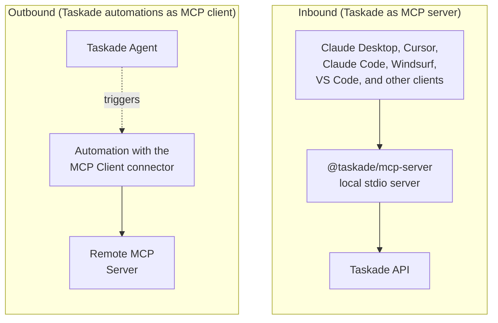

# Workspace MCP: Advanced

This page covers the advanced [Workspace MCP](workspace-mcp.md) topics: MCP directions, token scoping, rate limits, access rules, tool details, troubleshooting, and security.

## Inbound vs Outbound MCP

Taskade uses MCP in two directions. Before you select an integration pattern, identify the direction.



| Direction | Who uses it | Example | Covered in |
| --- | --- | --- | --- |
| **Inbound (local)** | AI tools like Claude Desktop | "Claude, list my Taskade projects" | [Workspace MCP](workspace-mcp.md) (this page adds advanced config) |
| **Outbound** | Taskade **automations** | An automation step lists and calls a remote MCP server's tools. An agent can trigger that automation | [Outbound MCP](#outbound-mcp-the-mcp-client-connector) section below |
| **Inbound (hosted)** | IDE & AI-client orchestration | Create projects, manage & prompt agents, edit app source | [Hosted Taskade MCP](genesis-app-mcp.md) |


## Authentication & Token Scoping

The inbound MCP server (`@taskade/mcp-server`) authenticates with a Personal Access Token via the `TASKADE_API_KEY` environment variable.



**Warning:** Treat a personal access token as a password for the whole account. It has no scope and no workspace limit. It can open everything that its owner can open.


For a workspace boundary, use a separate Taskade **account** that is a member of that workspace only. An OAuth token from the hosted server has the same reach as your account: it can open every workspace that your account can open.


### Token best practices

- **Use one token per client or use case.** This provides revocation and audit isolation.
- The `last_accessed_at` value shows whether a token is still in use. Separate tokens do **not** reduce access.
- **Rotate tokens regularly.** Create a replacement token. Then update all client configurations.
- **Never commit tokens** to version control or share them in chat.
- **Revoke unused tokens** from [taskade.com/settings/api](https://www.taskade.com/settings/api).

### OAuth availability

The hosted Taskade MCP (which runs at `https://www.taskade.com/mcp`) accepts either OAuth 2.0 or a personal access token. The local `@taskade/mcp-server` inbound server uses personal tokens only.


## Rate Limits

MCP tools call Taskade APIs and can return `429` when a request reaches the current limit.

| Symptom | Cause | Fix |
| --- | --- | --- |
| Tool call returns `429` | Rate limit exceeded | Wait for `x-rate-limit-reset`, then retry |
| Multiple tools fail at the same time | Too many concurrent calls | Reduce concurrency. Batch your calls |
| Slow tool response | A large response, or a slow AI step such as an agent prompt | Reduce the query scope. Ask for fewer items in each call |

If limits occur regularly, reduce concurrency. Batch writes when an operation accepts arrays. Use `x-rate-limit-reset` to schedule the next request.


## Multi-Client Setup

You can run `@taskade/mcp-server` in several clients at the same time. Each client starts its own stdio process with its own token.

The exact config for each client is on the Workspace MCP page:

| Client | Config |
| --- | --- |
| Claude Desktop | [`claude_desktop_config.json`](workspace-mcp.md#claude-desktop) |
| Claude Code | [`claude mcp add` with `--env`](workspace-mcp.md#claude-code) |
| Cursor | [`.cursor/mcp.json`](workspace-mcp.md#cursor) |
| VS Code | [`.vscode/mcp.json` with a token prompt](workspace-mcp.md#vs-code) |
| Windsurf | [`mcp_config.json`](workspace-mcp.md#windsurf) |


**Warning:** Do not commit a config file that holds a real token. Inject the token at run time from an environment variable or a secret manager.


## Access Rules

The two inbound servers check access differently.

| Server | Access check |
| --- | --- |
| [Hosted Taskade MCP](genesis-app-mcp.md) | Checks the plan of each workspace. Every paid plan has access. `list_spaces` leaves out workspaces without access |
| `@taskade/mcp-server` (local) | Inherits the authentication, permission, and availability rules of each API operation |

An empty hosted `list_spaces` response can mean that the account has no accessible workspace with MCP enabled. The local server reports access errors from the API operation it calls.


The hosted server is on every paid plan (Starter and above). See the [pricing page](https://www.taskade.com/pricing) for the current plans.


## Tool Catalog Details

The npm-published inbound server mirrors [REST API v1](comprehensive-api-guide/README.md) and adds selected agent chat and legacy webhook subscription tools. The [Workspace MCP](workspace-mcp.md) page lists them by name.

This section describes the tools that integrators most often configure.

### `projectTasksGet`

- **Required args:** `projectId`
- **Optional args:** `limit` (default 100), `after`, `before`
- **Pagination:** Cursor-based - pass the last task id as `after` to page forward.

### `taskCreate`

- **Required args:** `projectId`, `tasks` (an array of up to 20 entries)
- **Each entry:** `contentType` (`text/markdown` | `text/plain`), `content` (up to 2,000 characters), and `placement`. All three are required
- **Placement:** Without `taskId`, use `afterbegin` for the top of the project or `beforeend` for the end. With `taskId`, use `beforebegin`, `afterbegin`, `beforeend`, or `afterend` to place the task relative to that task

### `agentConvosGet` / `agentConvoGet`

- **`agentConvosGet`** lists an agent's conversations (`agentId`, optional `limit`, `page`).
- **`agentConvoGet`** returns one conversation (`agentId`, `convoId`).



**Note:** This server has no bundle tools. Export and import bundles through the REST API or the Action API. See [Bundles & App Kits](bundles.md).



For the full tool list, see the [Workspace MCP](workspace-mcp.md) reference.


## Outbound MCP: the MCP Client connector

Outbound MCP runs through **automations** with the **MCP Client** connector.

Add the connector to an automation. Point it at a remote MCP server. The connector tries Streamable HTTP first and falls back to SSE.

The connector ships exactly two actions and no triggers: **list the server's tools** and **call one tool**.

The MCP Client connector is shipped and ungated. It runs on every plan, including Free.

When the remote server requires a token, add the optional bearer token.


**An agent cannot reach an MCP server on its own.** Taskade has no per-agent MCP connector settings on any plan.

To let an agent use a remote MCP tool, configure the agent to trigger an automation that carries the MCP Client step. The automation hands the result back.

The connector applies these connection rules:

- It accepts `https` URLs only.
- It rejects credentials embedded in the URL.
- It rejects `localhost`, `*.localhost`, `*.local`, and `*.internal`.
- It rejects loopback, private, link-local, CGNAT, unspecified, and IPv4-mapped internal IP literals.
- It rejects redirects instead of following them.
- It gives each transport 20 seconds to complete the handshake.

See **[MCP Client connector](https://www.taskade.com/learn/connect/mcp-client-integration)** for setup. See **[Which Taskade MCP do I want?](mcp-overview.md)** to compare directions.

For services without MCP, use the [100+ native integrations](https://www.taskade.com/integrations). Premium integrations, for example Slack, Gmail, and Notion, need a paid plan.


## Troubleshooting

| Symptom | Likely cause | Fix |
| --- | --- | --- |
| "Connection refused" in Claude Desktop | MCP process crashed | Restart Claude Desktop. Examine `~/Library/Logs/Claude/` |
| "Unauthorized" on every tool | Token invalid or rotated | Regenerate the token. Update all client configurations |
| "Workspace not found" | The token's **account** is not a member of that workspace. Tokens are not workspace-scoped | Invite the account to the workspace. Or use a token from an account that already has access |
| Tools appear but return 429 | Rate limited | Wait for `x-rate-limit-reset`. Reduce concurrency because more tokens do not help |
| Agent invisible in shared workspace | The token owner cannot access the agent | Examine workspace membership and agent access |
| OAuth loop (Hosted Taskade MCP) | Expired refresh token | Re-authenticate in the client |
| Tool timeout | Large response or slow upstream | Examine the upstream service. Reduce the query scope |


If the problem stays, file an issue at [github.com/taskade/taskade/issues](https://github.com/taskade/taskade/issues) with your MCP logs.


## Security Best Practices

- **Audit tool exposure for public agents.** Opt sensitive tools (file access, automation triggers) out of public agent configurations.
- **Assume a leaked token is a full account compromise.** Personal access tokens carry no workspace or resource scope. A leak exposes every workspace the owning account can reach. Revoke the token at [settings/api](https://www.taskade.com/settings/api) instead of reasoning about the blast radius.
- **Isolate by account, not by token.** If an integration must access one workspace, give it a dedicated Taskade account.
- Invite that account only to the required workspace. Then issue the token from that account.
- **Rotate on every personnel change.** When a teammate leaves, rotate any shared tokens.
- **Monitor the workspace activity log** for unexpected MCP-initiated actions.
- The hosted Taskade MCP is always served over TLS at `https://www.taskade.com/mcp`.


## Set this up with your coding agent

Paste this block into your coding agent to connect it.

```text
Start the local Taskade MCP server with "npx -y @taskade/mcp-server" over stdio. Set the environment variable TASKADE_API_KEY to a personal access token from https://www.taskade.com/settings/api. First call workspacesGet and report the workspaces you can see. Do not write anything until I confirm.
```

## Next steps

- [Workspace MCP](workspace-mcp.md): install the local server and set up your client.
- [Hosted Taskade MCP](genesis-app-mcp.md): the no-install server with OAuth.
- [Action API guide](api-v2-reference.md): the API behind the v2 tools.
- [MCP Client connector](https://www.taskade.com/learn/connect/mcp-client-integration): call another MCP server from an automation.

---

_This page is also published at [taskade.com/docs/mcp/workspace-mcp-advanced](https://www.taskade.com/docs/mcp/workspace-mcp-advanced)._
