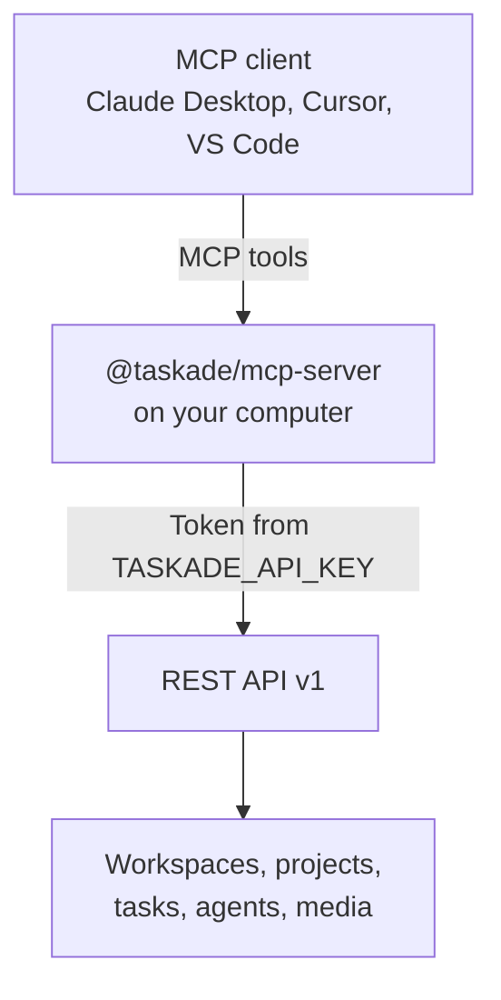

# Workspace MCP

Workspace MCP runs `@taskade/mcp-server` on your computer and connects your MCP client to Taskade projects, tasks, agents, and media. The local server wraps [REST API v1](comprehensive-api-guide/README.md) and adds a small set of Action API v2 tools.


**Tip:** Most readers want the [hosted Taskade MCP](genesis-app-mcp.md) instead. It needs no install, signs in with OAuth, and can edit Taskade Genesis app source. If you are not sure, see [Which Taskade MCP do I want?](mcp-overview.md).


## Before you start

You need a token and Node.js.

| Requirement | Details |
| --- | --- |
| Token | A [personal access token](developers/personal-tokens.md) from [taskade.com/settings/api](https://www.taskade.com/settings/api) |
| Runtime | Node.js 18 or later, with `npx` |
| Client | An MCP client that runs local stdio servers: Claude Desktop, Claude Code, Cursor, VS Code, or Windsurf |
| Plan | Any plan. Each tool keeps the access rules of the API call that it makes. |

## What is MCP?

The [Model Context Protocol](https://modelcontextprotocol.io/) lets an AI assistant call outside tools and read outside data. The `@taskade/mcp-server` package turns the Taskade API into MCP tools.

Your MCP client starts the server on your computer. The server calls REST API v1 with your token.



## Install & run

Taskade publishes the server as **`@taskade/mcp-server`** on npm. Your client runs it with `npx`. Thus you do not install it globally.

```bash
TASKADE_API_KEY="your_api_token_placeholder" npx -y @taskade/mcp-server
```

The server reads the personal access token from `TASKADE_API_KEY`. On the Settings → **API** page, you can also manage OAuth 2.0 clients and webhooks.


**Warning:** Do not commit a config file that has a real token. The token can do everything that your account can do.


## Set up your client

Each client below starts the local server for you. Replace `your_api_token_placeholder` with your token.

### Claude Desktop

Add the server to the Claude Desktop config file, then restart Claude Desktop.

| OS | File |
| --- | --- |
| macOS | `~/Library/Application Support/Claude/claude_desktop_config.json` |
| Windows | `%APPDATA%\Claude\claude_desktop_config.json` |

```json
{
  "mcpServers": {
    "taskade": {
      "command": "npx",
      "args": ["-y", "@taskade/mcp-server"],
      "env": {
        "TASKADE_API_KEY": "your_api_token_placeholder"
      }
    }
  }
}
```

### Claude Code

One command adds the server with its token:

```bash
claude mcp add --transport stdio taskade --env TASKADE_API_KEY=your_api_token_placeholder -- npx -y @taskade/mcp-server
```

### Cursor

Cursor uses the same shape, in `~/.cursor/mcp.json` (all projects) or `.cursor/mcp.json` (one project):

```json
{
  "mcpServers": {
    "taskade": {
      "command": "npx",
      "args": ["-y", "@taskade/mcp-server"],
      "env": {
        "TASKADE_API_KEY": "your_api_token_placeholder"
      }
    }
  }
}
```

### VS Code

Add `.vscode/mcp.json` to your workspace. VS Code uses `servers`. The `${input:…}` value asks for the token on the first run. Thus the file has no secret:

```json
{
  "inputs": [
    {
      "type": "promptString",
      "id": "taskade_api_key",
      "description": "Taskade personal access token",
      "password": true
    }
  ],
  "servers": {
    "taskade": {
      "type": "stdio",
      "command": "npx",
      "args": ["-y", "@taskade/mcp-server"],
      "env": {
        "TASKADE_API_KEY": "${input:taskade_api_key}"
      }
    }
  }
}
```

### Windsurf

Add the server to `~/.codeium/windsurf/mcp_config.json`:

```json
{
  "mcpServers": {
    "taskade": {
      "command": "npx",
      "args": ["-y", "@taskade/mcp-server"],
      "env": {
        "TASKADE_API_KEY": "your_api_token_placeholder"
      }
    }
  }
}
```

### ChatGPT and other remote-only clients

ChatGPT connects only to remote MCP servers. Thus it cannot start this local server. Connect ChatGPT to the [hosted Taskade MCP](genesis-app-mcp.md#chatgpt) instead.

## HTTP / SSE mode

The npm package runs over stdio only. The source code also has an HTTP mode.


**Note:** For HTTP or SSE, clone [github.com/taskade/mcp](https://github.com/taskade/mcp) and run the HTTP entry of the server package. The server listens on `http://localhost:3000`. Set `PORT` to change the port.


Connect over SSE at `http://localhost:3000/sse?access_token=your_api_token_placeholder`.


**Warning:** Use HTTP mode only on a trusted local network or behind TLS. The token goes in a query parameter (`?access_token=…`).


## Example Usage in Claude

After you connect, ask your client for real work. Each prompt below uses the tools in the next section.

```text
Spin up next week's client-onboarding tasks and assign them.
```

```text
Mark every overdue invoice task complete and tell me what is left.
```

```text
Create a project for the Q3 launch with one task for each milestone.
```

```text
Show me the tasks in my Sales Pipeline project and mark the first one complete.
```

## Full tool reference

This table lists every tool that the local server exposes, by area. Use the names to configure exact tool calls.

The tool catalog follows [REST API v1](comprehensive-api-guide/README.md). It also adds tools from Action API v2 for agent chat and legacy webhook subscriptions.

| Area | Tools |
| --- | --- |
| **Workspaces** | `workspacesGet`, `workspaceFoldersGet`, `workspaceCreateProject` |
| **Projects** | `projectGet`, `projectCreate`, `projectCopy`, `projectComplete`, `projectRestore`, `projectMembersGet`, `projectFieldsGet`, `projectShareLinkGet`, `projectShareLinkEnable`, `projectBlocksGet`, `projectTasksGet`, `folderProjectsGet` |
| **Templates** | `folderProjectTemplatesGet`, `projectFromTemplate` |
| **Tasks** | `taskGet`, `taskCreate`, `taskPut`, `taskDelete`, `taskComplete`, `taskUncomplete`, `taskMove`, `taskAssigneesGet`, `taskPutAssignees`, `taskDeleteAssignees`, `taskGetDate`, `taskPutDate`, `taskDeleteDate`, `taskNoteGet`, `taskNotePut`, `taskNoteDelete`, `taskFieldsValueGet`, `taskFieldValueGet`, `taskFieldValuePut`, `taskFieldValueDelete` |
| **Agents** | `folderAgentGenerate`, `folderCreateAgent`, `folderAgentGet`, `agentGet`, `agentUpdate`, `deleteAgent`, `agentKnowledgeProjectCreate`, `agentKnowledgeMediaCreate`, `agentKnowledgeProjectRemove`, `agentKnowledgeMediaRemove`, `agentPublicAccessEnable`, `agentPublicGet`, `agentPublicUpdate`, `agentConvosGet`, `agentConvoGet`, `publicAgentGet` |
| **Media** | `mediasGet`, `mediaGet`, `mediaDelete` |
| **Personal** | `meProjectsGet` |
| **Agent Chat & Webhooks (API v2, beta)** | `promptAgent`, `listConversations`, `getConversation`, `subscribeWebhook`, `unsubscribeWebhook` |



**Note:** The **API v2 (beta)** tools cover agent prompts, agent chat, and the legacy webhook subscriptions. For signed webhooks, use the [Webhook Registration API](webhooks.md#webhook-registration-api).


## Access Behavior

Workspace MCP keeps the authentication, permission, and plan rules of each API operation that it calls. It does not use the plan check of the hosted server. That check allows paid workspaces only.

- The `subscribeWebhook` and `unsubscribeWebhook` tools call the legacy unsigned subscription operations.
- The signed [Webhook Registration API](webhooks.md#webhook-registration-api) is a separate surface. This server has no tool for it.
- If a tool returns an access error, read the requirements of that operation. Then make sure that the token owner has the correct permissions.

## Set this up with your coding agent

Paste this block into your coding agent to connect it.

```text
Start the local Taskade MCP server with "npx -y @taskade/mcp-server" over stdio. Set the environment variable TASKADE_API_KEY to a personal access token from https://www.taskade.com/settings/api. First call workspacesGet and report the workspaces you can see. Do not write anything until I confirm.
```

## Next steps

- [Workspace MCP: Advanced](workspace-mcp-advanced.md): token scoping, rate limits, troubleshooting, and security.
- [Hosted Taskade MCP](genesis-app-mcp.md): the no-install server with OAuth and app source editing.
- [REST API guide](comprehensive-api-guide/README.md): the endpoints that these tools call.
- [github.com/taskade/mcp](https://github.com/taskade/mcp): the source code of the server.

---

_This page is also published at [taskade.com/docs/mcp/workspace-mcp](https://www.taskade.com/docs/mcp/workspace-mcp)._
