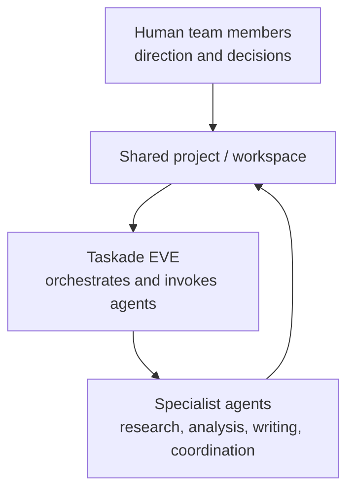

# Multi-Agents

---

## Overview

With multi-agents, **several AI agents work together** on projects, tasks, and chats. Each agent is a specialist with its own knowledge and tools. Together they do more than one general agent can do.

Specialized agents, Taskade EVE, and people work together around one shared project.

> **Workspace DNA impact:** Multi-agent teams make the Intelligence pillar stronger. Each agent adds +10 points to your [Intelligence Score](../genesis/how-genesis-works.md#workspace-intelligence-score). A team of specialists gives better results than one general agent.
>
> **Plan note:** Multi-Agent Teams are available on Pro plans and up.

---

## Set Up Your AI Agents

### Method 1: Build from Scratch

1. Open **AI Agents** in your workspace sidebar.
2. Click **Create** to start a blank agent. You can also click **Generate** to describe the agent, or **Templates** to pick one.
3. Add the name, persona, tone, knowledge, and tools.
4. Do these steps again for each specialist in your team.

### Method 2: Use Templates

1. Open the agent template library.
2. Select a template for each role.
3. Change each agent for your use case.

### Method 3: Generate a Team with AI

This is the fastest way to make a multi-agent team:

1. In your workspace sidebar, open **AI Teams**.
2. Click **Generate**. You can also click **+** (**Create AI team**) next to **AI Teams** and pick **Generate**.
3. Describe your team in plain English (for example, "I need a marketing team with a content writer, SEO specialist, social media manager, and analytics analyst").
4. Press **Enter**. Taskade creates the specialized agents and gives each one a role and tools.
5. Review each agent, and change it if necessary.

> **Tip:** A generated team gets personas, knowledge connections, and tools that match your description. You can change each agent later.

**Example team setup:**

| Agent | Specialty | Knowledge | Tools |
|---|---|---|---|
| **Research Agent** | Data collection, web search | Industry reports, competitor URLs | Search the web, Read a web page |
| **Analyst Agent** | Data analysis, insights | Historical data projects, KPIs | Google Sheets, Custom Fields |
| **Writer Agent** | Content, copywriting | Brand guidelines, tone documents | Google Docs, WordPress |
| **Coordinator Agent** | Task management, routing | Team structure, processes | Slack, Google Calendar, Taskade Actions |

---

## Team Up with AI Agents

### Assign a Single Agent

1. Open a project or a task.
2. Click the **Agent** icon.
3. Select an agent from your workspace.

The agent now has the context of that project or task.

### Assign Multiple Agents

1. Open a project.
2. Click the **Agent** icon.
3. Select more than one agent for the project.

Each agent uses its specialty on the project.

### Bulk-Assign Agents

1. Select many tasks or projects.
2. Use the bulk actions to assign agents.

Taskade assigns the agents to all selected items.

---

## Use the Agent Sidebar

| Feature | Detail |
|---|---|
| **Access** | Click the Agent icon in the sidebar |
| **Switch agents** | Change between assigned agents in the same chat |
| **Context** | The agent sees the project or task that you have open |
| **Tool access** | All enabled tools work in the sidebar |
| **History** | Taskade keeps the chat history of each agent |

<!-- Screenshot: Agent sidebar with multiple agents available -->

---

## Iterate on Output

You can improve the output of multi-agents step by step:

| Technique | Example |
|---|---|
| **Step-by-step improvement** | Research Agent drafts → Writer Agent improves → Reviewer Agent reviews |
| **Split work** | Each agent writes a different section, one after another |
| **Review loop** | Ask one agent to review the output of another agent |
| **Role change** | "Now have the Analyst Agent review what the Writer Agent produced" |

---

## Chat with Agents & Your Team

AI agents and team members can be in the same chat:

| Participant | Role |
|---|---|
| **AI Agents** | Reply from their knowledge and tools |
| **Human team members** | Give direction, make decisions, add context |
| **Taskade EVE** | Orchestrates the chat and can call other agents |

> **Tip:** Type @ and the name of an agent to send a question or a task to that agent.

---

## Copy / Duplicate Multi-Agents

| Action | How | Result |
|---|---|---|
| **Copy an agent** | Agent settings → Duplicate | Makes a copy that you can change |
| **Copy a team** | Duplicate the project with its agent assignments | Taskade copies all agents and their assignments |
| **Share across workspaces** | Publish the agent → Clone it in another workspace | Taskade copies the agent settings. If the knowledge does not connect, connect it again |

---

## Share Agents

| Sharing Method | Scope | How |
|---|---|---|
| **Within workspace** | Team members | All workspace members can use agents by default |
| **Cross-workspace** | Other workspaces | Publish the agent → Clone it |
| **Public** | Anyone | Turn on **Publish Agent** |
| **Embedded in Taskade Genesis app** | App users | Add an agent chat widget to your Taskade Genesis app |

---

## Multi-Agent Architecture Patterns

| Pattern | Description | Best For | Example |
|---|---|---|---|
| **Sequential Pipeline** | Agent A → Agent B → Agent C (the output moves in a line) | Content, data processing | Research → Write → Review |
| **Hub and Spoke** | A central coordinator sends work to specialists | Customer support, difficult questions | Coordinator → sends to Sales, Support, or Billing |
| **Fan-Out** | Many agents answer the same request (in an AI Team, they reply one after another) | Reports, data analysis | Finance, Marketing, and Operations agents each analyze their area |
| **Debate / Review** | Agents review the work of other agents | Quality control, decisions | Proposal Agent writes → Critic Agent reviews → Proposal Agent revises |
| **Escalation Chain** | A general agent starts, and a specialist takes over | Support levels, triage | Level 1 Agent → Level 2 Specialist → Human |

---

## What's Next

| Guide | What you learn |
|---|---|
| [Custom AI Agents](./ai-agents-getting-started.md) | Build single agents |
| [Agent Knowledge & Memory](./agent-knowledge.md) | Give agents knowledge for their area |
| [Tools for AI Agents](./agent-tools.md) | Add tools to each agent |
| [Automations](../automation/README.md) | Connect agents to automations |
| [Autonomous Agents (API)](../../apis-living-system-development/autonomous-agents.md) | Orchestrate multi-agent systems from code |

---

_Step-by-step guides on taskade.com/learn: [Multi-Agents](https://www.taskade.com/learn/agents/multi-agents), [AI Teams](https://www.taskade.com/learn/agents/ai-teams)._
