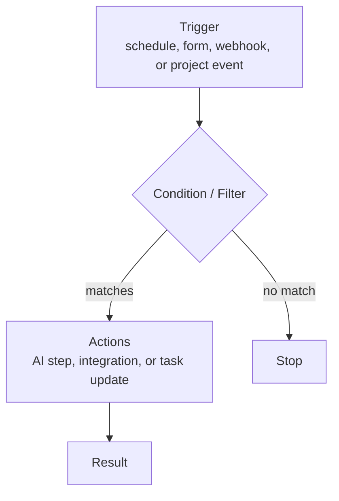

# Automations Overview

Automations are workflows that run on their own. A trigger starts each automation, and its steps do the work in Taskade and in your connected tools.

## I want to…

| I want to… | Go to |
| --- | --- |
| Build my first workflow | [Getting started (fast)](#getting-started-fast) |
| Find available triggers and actions | [Action & Trigger Reference](actions.md) |
| Generate a workflow from a prompt | [Workflow Generator](workflow-generator.md) |
| Connect an integration | [Integration Overview](comprehensive-integration-guide.md) |
| See every available connector | [Integration Options](integrations.md) |
| Start from a ready-made recipe | [Automation Recipes](recipes.md) |

Automations are the Execution layer of Workspace DNA. They react to events and do the work for you.


**Execution Layer**: Automations act on events in your workspace and in your connected tools. Taskade keeps a log of every run. You can examine each run and improve the flow.


## What are automations?

An automation lets your workspace react to an event, make a decision, and do the work.

Every automation has the same shape. A trigger starts it. An optional condition sends it on the correct path. Then the actions do the work.

For the full model, read [Workspace DNA](../../genesis-living-system-builder/genesis/workspace-dna.md).

### What you can do with automations

* **Notifications**: Send alerts to Slack, Microsoft Teams, or email.
* **Routing**: Assign work by content, priority, or owner.
* **Sync**: Keep CRMs, spreadsheets, and databases up to date.
* **Reports**: Send scheduled summaries and digests.
* **Approvals**: Add a **Wait for approval** step. The run waits until a teammate approves or rejects it.

### Core building blocks

#### Triggers

A trigger starts a workflow. Common triggers are schedules, forms, webhooks, and project events.

#### Actions

An action does the work. Actions create tasks, update fields, call webhooks, and send notifications.

#### Conditions and branches

A **Branch** step sends different cases on different paths. For example, an urgent case alerts a person, and a normal case goes into a queue.

#### AI steps

An **Ask an agent** step can sort, extract, or write text. To get typed fields back, set **Output Type** to **Structured Output**. Later steps can then use each field.

#### Failed steps

If an app is busy or down for a few minutes, check **Retry if this step fails** on that step. To let the run go on after a failure, check **Continue if this step fails**.

### Getting started (fast)

1. Select one workflow that you want to automate from start to end.
2. Select one trigger.
3. Add 1 to 3 actions.
4. Test the automation with real data.
5. Add branches and AI steps only when you need them.

### Typical workflows

* Form submission → sort with AI → create task → send a channel message
* Webhook → clean the data → update the CRM → log the result
* Schedule → write a weekly summary → send a digest

### Available Triggers

**Project Events:**

* **Task Added**: a person or a step adds a task
* **Task Completed**: a task is marked as done
* **Task Assigned**: a person gets a task
* **Task Due**: a task reaches its due date
* **New Comment**: a person adds a comment
* **New Due Date**: a task gets a due date
* **Custom Field Updated**: the value of a custom field changes
* **Project Completed**: all tasks in the project are done
* **Public Agent Chat Ended**: a public agent conversation ends
* **Task Moved**: a task moves to another block in the same project
* **Project Created**: a new project starts in a space
* **Due Date Removed**: a task loses its due date
* **File Added to Media**: a person uploads a file to Media

**External Triggers:**

* **Webhook**: receives data from an outside service with an HTTP POST request (Pro and up)
* **Form**: a person submits a form that you build
* **Schedule**: runs every few minutes (paid plans), every hour, day, week, or month
* **Mailhook**: an email arrives at the address of the automation

**Integration Triggers** (from connected services):

Calendly, Slack, Typeform, Gmail, Google Sheets, Google Forms, Google Drive, Webflow, HubSpot, Discord, GitHub, YouTube, RSS, Google Calendar

### Integration Pieces

You can connect your workflows to the tools in the [Taskade integrations](https://www.taskade.com/integrations) directory. Premium integrations (for example Gmail, Slack, Google Sheets, HubSpot, and Stripe) need a paid plan. The Free plan runs the built-in steps and the standard connectors (HTTP Request, RSS, Pushover, and MCP Client).

| Category         | Services                                                             |
| ---------------- | -------------------------------------------------------------------- |
| Communication    | Slack, Discord, Microsoft Teams, WhatsApp Business, Telegram Bot     |
| Email            | Gmail, Mailchimp                                                     |
| Google Workspace | Sheets, Drive, Calendar, Docs, Forms                                 |
| CRM & Sales      | HubSpot, Apollo                                                      |
| Payments         | Stripe                                                               |
| Social Media     | X/Twitter, LinkedIn, Facebook Pages, Reddit, YouTube                 |
| Developer        | GitHub, HTTP                                                         |
| Forms & CMS      | Typeform, Webflow, WordPress                                         |
| Scheduling       | Calendly, Cal.com                                                    |
| AI & Media       | Search the web, Read a web page, Transcribe a YouTube video, Turn a file into text |
| Utilities        | Schedule, Delay, Loop, Branch, Filter                                |

## Next steps

* [Action & Trigger Reference](actions.md): select a trigger and add your first actions
* [Automation Recipes](recipes.md): start from a workflow that works
* [Integration Overview](comprehensive-integration-guide.md): connect the tools that you use now
* [Integration Options](integrations.md): see the full list of connectors
* [MCP Connectors](../genesis/mcp-connectors.md): call an MCP server from an automation with the MCP Client step
* [Living System Troubleshooting](../community-and-sharing/troubleshooting.md): fix problems and get help


This page gives an overview only. The reference pages above have the full lists of triggers and actions, the templates, and the advanced patterns.


---

_Step-by-step guides on taskade.com/learn: [Automations: The Execution Pillar](https://www.taskade.com/learn/automation/automations-execution), [Automation Triggers](https://www.taskade.com/learn/automation/triggers), [Automation Actions](https://www.taskade.com/learn/automation/actions)._
