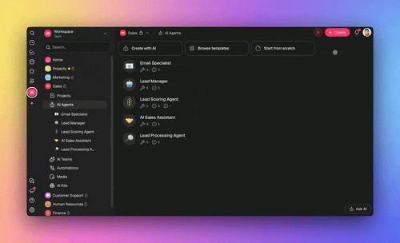

# GenesisAuth

A dedicated security layer for Taskade Genesis apps. Every Taskade Genesis app can ship with real user accounts and secure sign-in — no code, no third-party provider setup, no DevOps.

---

## What Is GenesisAuth

GenesisAuth is the authentication layer for apps built with Taskade Genesis. When you describe an app that needs user accounts, Taskade wires up secure sign-in automatically — session management, credential handling, and access control all work out of the box.

* **Built-in user accounts.** No Auth0 or Clerk to wire up, no schema to design.
* **Pre-built sign-in component** added to the generated app automatically.
* **Scales with your app.** Handles sessions, password hashing, and session tokens securely.
* **Turns every Taskade Genesis app into a real multi-user product.**

---

## Turning Any App Into a Multi-User Product

You don't configure GenesisAuth manually — you describe the need.

1. In Taskade Genesis, describe your app in plain language. Include phrases like:
   * *"a client portal where each client has their own dashboard"*
   * *"users can sign in to see their own habit streaks"*
   * *"a members-only knowledge base"*
2. Taskade EVE generates the app **with the sign-in component in place**.
3. Open the app's settings to review the **App Users** tab.

That's it. Your app now accepts user sign-ups and handles sign-in. Sign-in confirms who a visitor is. It does not hide other people's records: to show each person only their own rows, turn on **Private entries** (row scoping, off by default) and test with a second account. See [Give each user only their own rows](../run-your-business/add-login-and-roles.md#give-each-user-only-their-own-rows).


If your first prompt doesn't trigger auth setup, you can add it later by asking Taskade EVE to *"add sign-in for users"* while editing the app.



**Sign-in is always real.** If a build or edit ever produces a login screen that doesn't actually authenticate, Taskade EVE detects it and automatically replaces it with working, persistent authentication — GenesisAuth sign-in by default, or secure hashed-credential storage for apps that manage their own user directory. EVE tells you when it makes this repair.


---

## The App Users Tab

The **App Users** tab lives in your Taskade Genesis app's settings (**App settings → People & access → App users**). It's a first-class user management dashboard.

### What You Can Do

* See the list of end users who have signed in to your app.
* Add a person by email with **Add person**. Taskade emails them a link to set a password.
* Choose who can sign up: **Anyone** or **Invite only**.
* Disable an account without deleting it, and re-enable it later.
* Delete accounts entirely.

All without touching code.


The App Users tab is currently in Beta. App Users and app sign-in work on every plan, Free included — bug reports welcome at [github.com/taskade/taskade/issues](https://github.com/taskade/taskade/issues).


---

## Workspace Single Sign-On

Workspace SSO (SAML) is company single sign-on for your own team members inside Taskade. It is available on Business and up. See [Account Management](../../account-management/README.md).

* Workspace SSO is a separate feature from GenesisAuth.
* Taskade workspace credentials do not open an app account. People who use a published app, your teammates included, sign in with an app account.
* For an internal tool, add each teammate on the **App Users** tab, or set **Who can sign up** to **Invite only**.

---

## Custom Domain Sign-In

GenesisAuth works seamlessly on apps hosted at your own domain.

* No additional configuration required when you connect a custom domain.
* Session cookies and redirects handle custom domains correctly.
* Specific reliability improvements were added for sign-in flows on custom domains.


Combine GenesisAuth with a [custom domain](../space-apps-guide/custom-domains.md) to deliver a fully branded, production-ready product to end users.


---

## Access Control

GenesisAuth is part of a broader access-control story.

| Control | What It Does | When to Use |
| --- | --- | --- |
| GenesisAuth (App Users) | Account-based sign-in for app end users, on every plan | Any multi-user app, internal tools included |
| Private entries (row scoping) | Shows each signed-in person only the rows that match their login. Off by default | Client portals, member areas |
| Workspace SSO | Company single sign-on for your team inside Taskade (Business and up). It does not sign people in to a published app | Your own team's Taskade accounts |
| Password-protected public links | Single shared password for a link (Pro and up) | Quick gated preview |
| Listed / Unlisted | Controls discoverability (**Show in public listings**) | Non-indexed sharing |
| Public agent tool opt-out | Sensitive tools stay workspace-only | Published agents |

<figure><figcaption></figcaption></figure>

---

## How It Works Under the Hood

You don't need to know these details to use GenesisAuth, but they matter if you're auditing the security model.

* **Token-based session management.** Sign-in produces a secure session token stored in an HTTP-only cookie.
* **Sessions persist across updates.** Signed-in users stay signed in through app updates — no forced re-login.
* **No credentials in the app bundle.** Exported app bundles never contain end-user credentials or session tokens — only the app structure.
* **Per-app user isolation.** Each Genesis app's App Users list is scoped to that app.

---

## Security Best Practices

* **Review exposed tools.** For public agents, opt sensitive tools out so external users can't invoke them.
* **Disable instead of delete** when you want to retain a user's history but block access.
* **Use a custom domain with TLS** for any app that handles user data in production.
* **OIDC sign-in is hardened by default.** App sign-in runs on OIDC, with Taskade as the identity provider. PKCE is an OAuth security check that stops intercepted sign-in codes from being replayed. Taskade accepts only the S256 PKCE method and validates that `redirect_uri` matches your app's own origin. See [App Sign-In (OIDC)](publish-and-clone.md#app-sign-in-oidc) and the [authentication guide](../../apis-living-system-development/developers/authentication.md).
* **Monitor sign-in activity** via the App Users tab and your workspace activity log.
* **Rotate workspace tokens** periodically if you also expose the app via the [Public API](../../apis-living-system-development/developers/authentication.md).

---

## Related


[publish-and-clone.md](publish-and-clone.md)



[custom-domains.md](../space-apps-guide/custom-domains.md)



[authentication.md](../../apis-living-system-development/developers/authentication.md)


---

_Step-by-step guides on taskade.com/learn: [GenesisAuth: Built-In Login for Your Apps](https://www.taskade.com/learn/genesis/genesis-auth), [App Users (Beta): End-User Management for Taskade Genesis Apps](https://www.taskade.com/learn/genesis/app-users)._
