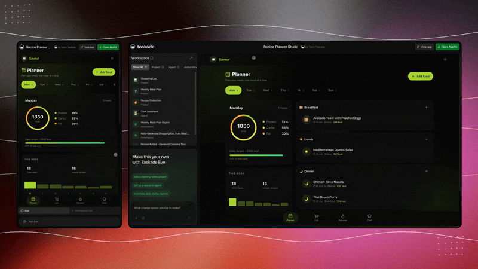
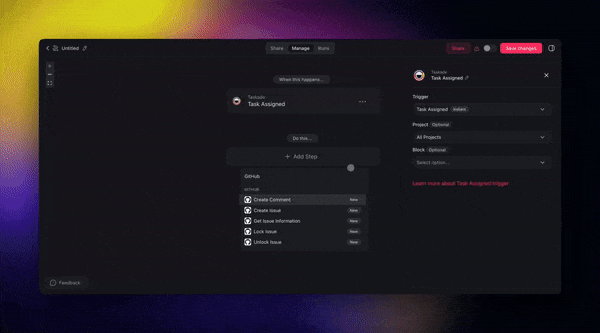

# GitHub Import & Export

Bring Taskade Genesis apps in from GitHub repositories and push your apps back to GitHub with branch-and-PR workflows. Two-way sync turns every Genesis app into a portable, version-controlled kit.

***

## Table of Contents

* [Overview](github-import-export.md#overview)
* [Importing a Genesis App](github-import-export.md#importing-a-genesis-app)
* [Exporting a Genesis App](github-import-export.md#exporting-a-genesis-app)
* [What's in an Export Bundle](github-import-export.md#whats-in-an-export-bundle)
* [Working with the Pull Request Flow](github-import-export.md#working-with-the-pull-request-flow)
* [Permissions & Errors](github-import-export.md#permissions-and-errors)
* [Troubleshooting](github-import-export.md#troubleshooting)
* [Related](github-import-export.md#related)

***

## Overview

GitHub Import & Export lets you treat any Genesis app like code — back it up, collaborate on it through pull requests, and share it with others as a cloneable repository.

* **Import** an app from a public or private GitHub repo. Import works on every plan, with the per-item limits of your plan. For example, a Free workspace can hold 1 agent and 3 apps, and cannot import automations.
* **Export** an app to a brand-new repo or push updates to an existing repo as a pull request. Export to GitHub needs **Pro or above**, and Taskade checks the plan on the server.
* **Round trip**: export to a repo, then import it back into any workspace.

<figure><figcaption></figcaption></figure>

***

## Importing a Genesis App

### From a Public Repository

1. Open the workspace where you want the app. In the workspace header, open the **More** menu and click **Import from GitHub**.
2. If Taskade asks, click **Connect GitHub account** and sign in. You need this step for public repos too.
3. Paste the repository URL and click **Import**. Taskade fetches the app bundle and imports it into your workspace.

Import works with a repo that holds an exported Taskade app. It does not turn an ordinary code repo into an app.

The entire app kit — projects, agents, and automations — comes in together. **Automations are enabled automatically** after import, so the app is ready to run without manual setup.

### From a Private Repository

Private repositories require authenticated access.

1. Click **Connect GitHub account** and authorize Taskade.
2. Paste the private repo URL. The import works when your connected GitHub account can read the repo.
3. Taskade reads the repo contents directly and imports the same way as a public repo.


The GitHub token needs `repo` scope to read private repositories. You can revoke access anytime from your GitHub account settings.


***

## Exporting a Genesis App

### Create a New Repository

1. Open your Genesis app, click **Publish**, then click the **Advanced Settings** icon. You can also open **App settings → Developer → Code**.
2. Click **Export to GitHub**. Connect your GitHub account if you haven't already.
3. Choose **Create new repo**, then pick an **Owner** and type a **Repository name**. You can also make it a **Private repository**.
4. Click **Export**. Taskade creates the repo and pushes your complete app kit.

### Push to an Existing Repository

1. In the Export modal, choose **Update existing**.
2. Enter the **Repository owner** and **Repository name**, then click **Create PR**.
3. Taskade opens a pull request containing your app bundle.
4. Review the diff in GitHub and merge when you're ready.


Existing files in the target repo are preserved. Only the Genesis app bundle is added or updated.


<figure><figcaption></figcaption></figure>

Files that you removed from the app are removed from the export folders, so your repo doesn't accumulate stale artifacts. Other files in the repo stay as they are.

***

## What's in an Export Bundle

An export captures everything needed to reconstruct the app in another workspace.

| Included                                              | Not Included                                   |
| ----------------------------------------------------- | ---------------------------------------------- |
| Projects (structure, tasks, notes)                    | Runtime state (live users, sessions)           |
| AI agents (definitions, tools, knowledge attachments) | API tokens or connected account credentials    |
| Automations (triggers, actions, flow logic)           | Workspace-level settings                       |
| Media assets                                          | End-user account data (handled by GenesisAuth) |
| App configuration (branding, theming)                 | Billing / plan state                           |

***

## Working with the Pull Request Flow

When you push to an existing repo, Taskade does not commit directly to the base branch. Instead:

1. Taskade creates a new branch in the target repo.
2. The Genesis app bundle is committed to that branch.
3. A pull request opens automatically with the diff.
4. You review and merge in GitHub like any other PR.

Each re-export creates a new branch and opens a new pull request against the repo's default branch.

***

## Permissions & Errors

| Scenario                             | What You See                            | How to Fix                                     |
| ------------------------------------ | --------------------------------------- | ---------------------------------------------- |
| Workspace plan is below Pro          | Upgrade prompt instead of the export    | Upgrade the workspace to Pro or above          |
| Collaborator lacks export permission | Clear error message in the Export modal | Workspace owner must grant export rights       |
| GitHub token expired                 | "Unable to access repository"           | Reconnect GitHub from workspace settings       |
| Private repo import fails            | "Repository not found" after connecting | Confirm your connected GitHub account can read the repo, then reconnect |
| Merge conflict on re-export          | GitHub shows conflict markers           | Resolve in GitHub as you would any PR conflict |

***

## Troubleshooting


**"Repository not found" on import**: Double-check the URL and confirm the repo is either public or that your connected GitHub account has access.



**Exported bundle shows stale data**: Export runs on your current app state. If you expect newer content, confirm your latest edits are saved before exporting.



**PR didn't open automatically**: Check your GitHub account's pending authorizations and confirm the Taskade app has write access to the target repository.


***

## Related


[publish-and-clone.md](../community-and-sharing/publish-and-clone.md)



[bundles.md](../../apis-living-system-development/bundles.md)



[developer-home.md](../../apis-living-system-development/developer-home.md)



[genesis-auth.md](../community-and-sharing/genesis-auth.md)


---

_Step-by-step guide on taskade.com/learn: [GitHub App Export & Import](https://www.taskade.com/learn/genesis/github-export-import)._
