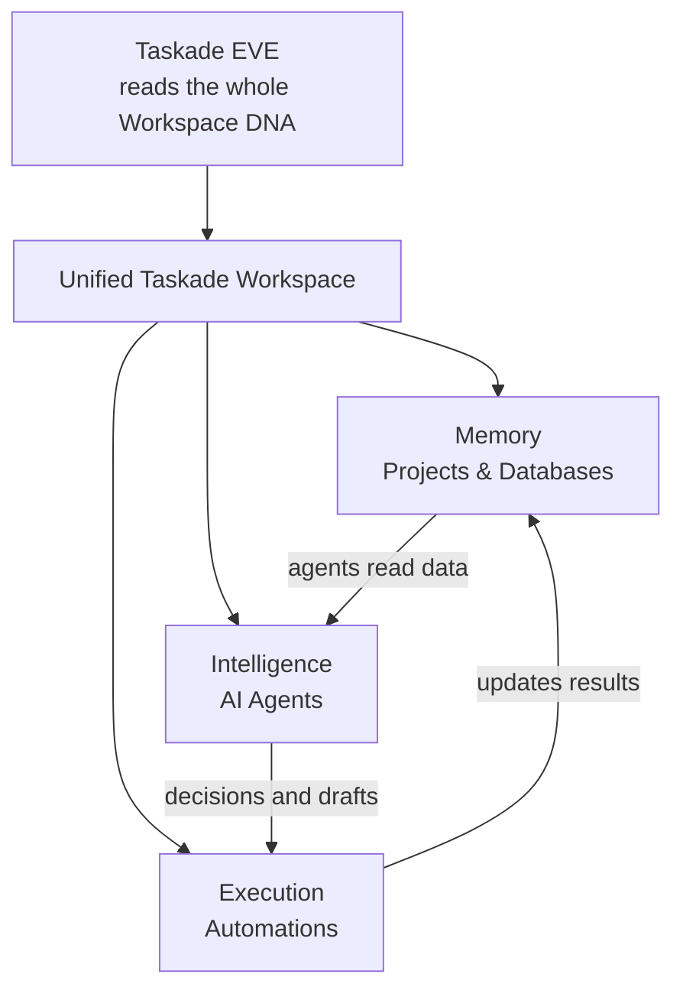

# Workspace DNA

Each Taskade workspace runs on three pillars that work together in a cycle. When you know this structure, you can build better apps, smarter agents, and more reliable automations.

## The Three Pillars

The three pillars make one workspace. Each pillar gives its results to the next pillar.

### 1. Memory — Projects & Databases

Projects store your structured knowledge: tasks, notes, custom fields, documents, and media. Agents read this knowledge, and automations update it.

**What you get:**
- Multiple project views: List, Board, Table, and Mind Map, plus Docs (Beta), Gantt Chart, Calendar, Actionsheet, and Org Chart under **More Views** (Gantt Chart, Actionsheet, and Org Chart are on paid plans)
- Custom fields for structured data
- Real-time sync on all your devices
- File and media uploads that agents can use as knowledge

**Learn more:** [Project Views Mastery](../workspaces/project-views.md) · [Knowledge Organization](../workspaces/knowledge-management.md)

### 2. Intelligence — AI Agents

AI agents use the context of your workspace to think about your data. They write drafts, sort, summarize, answer questions, and take actions with the knowledge in Memory.

**What you get:**
- Custom agents for specific roles or tasks
- Multi-agent teams (AI Teams, Pro and up)
- Built-in tools for web search, code, and file analysis, plus custom slash commands
- Persistent memory across conversations
- Frontier models from top AI labs, with **Auto** as the default

**Learn more:** [AI Agents Getting Started](../ai-features/ai-agents-getting-started.md)

### 3. Execution — Automations

Automations run workflows when an event occurs. They connect your workspace to 100+ outside tools and run 24/7 in the background.

**What you get:**
- Native triggers (webhooks on Pro and up, forms, schedules, project events)
- 100+ integration actions (Slack, Gmail, Google Sheets, HubSpot, Stripe, and more). Premium integrations need a paid plan, and Free runs the standard connectors
- Branches, loops, and conditions
- AI steps that sort, extract, or write drafts inside a workflow

**Learn more:** [Automations Overview](../automation/README.md) · [Integration Options](../automation/integrations.md)

## How the Cycle Works

The three pillars make a loop:

1. **Memory** stores data. Agents and automations read it.
2. **Intelligence** thinks about the data. It makes insights, drafts, and decisions.
3. **Execution** acts on the decisions. It writes the results back to Memory.

Each action makes the cycle stronger. For example, a form submission (Execution) makes a new record (Memory). An agent (Intelligence) can then analyze that record and act on it.

## Why This Matters for Genesis

When you describe an app to Taskade Genesis, it makes all three pillars at the same time:

- **Database projects** for the data of your app (Memory)
- **AI agents** trained on the context of your business (Intelligence)
- **Automation workflows** that connect your tools (Execution)

The app runs on your workspace, not on a separate backend. As a result, each Taskade Genesis app uses the same knowledge, agents, and automations as the rest of your workspace.


**The more you build, the more your workspace knows.** Each project, agent, and automation adds to your Workspace DNA. Future apps can then do more.


## Intelligence Score

Each Taskade Genesis app has an Intelligence Score (0–100, shown as **App IQ**). The score shows how much the workspace of the app holds. Projects add 2 points each (up to 20), agents add 10 points each (up to 30), and automations add 5 points each (up to 30). Integrations are reserved, so 80 is the highest score today. See [How Genesis Works](how-genesis-works.md#workspace-intelligence-score).

| Score | Level | What it means |
|-------|-------|--------------|
| 0–19 | Empty | The start. Add projects and agents |
| 20–39 | Beginner | Basic setup. Your workspace takes shape |
| 40–69 | Learning | Growth. Apps improve with real data |
| 70–89 | Intelligent | Strong AI coverage with active automations |
| 90–100 | Genius | Agents, automations, and data work as one |

A higher score gives Taskade Genesis more context, so it can build better apps.

## Workspace DNA Flow Canvas

The Workspace DNA flow canvas is the **DNA Map**. It is a live graph of the relationships in one workspace. To open it, click **DNA Map** in the workspace sidebar. Each project, agent, and automation shows as a node. Lines between the nodes show how knowledge moves through your workspace.

**What you see on the canvas:**

- **Project nodes** — each database or project in Memory, with its current record count and its connected agents
- **Agent nodes** — each AI agent, the projects that it reads, and the automations that it starts
- **Automation nodes** — active workflows, their trigger sources, and the projects or agents that they write to
- **Edges** — arrows that show how knowledge moves between projects, agents, and automations

The top left corner shows the workspace name and a health line, such as **Everything's connected**. Click an item to see its links, then open it in Taskade.


**No setup required.** Taskade makes the canvas from your Workspace DNA. The projects, agents, and automations that you built show as nodes when you open the view.


### Exploring the DNA graph

Open **Memory** from the sidebar to see your full account as an interactive graph. Your account is at the center. Each of your workspaces is around it. The projects, AI agents, media, and team spaces of each workspace branch out from the workspace.

**You can use two views:**

- **Galaxy** — a force-directed view in 3D (the default) or flat 2D. The 3D galaxy turns slowly in front of a field of stars, so you can see the full picture.
- **Flow** — a clean, structured layout with straight lines between the nodes.

**What you can do:**

- **Inspect a node.** Click a workspace, project, agent, or other node. A panel shows what it is, what it holds, and its child items. From the panel, open the item in Taskade or copy a direct link. On a desktop computer, right-click a node for the same actions.
- **Zoom and move.** Use the zoom in, zoom out, and fit controls on the screen. Or use the keyboard shortcuts `+`, `-`, and `0` (fit to screen). In the 2D galaxy, a minimap in the corner shows your position in the full map.
- **Filter and change colors.** Turn node types (workspaces, projects, AI agents, media, and more) on or off. Select one of several color palettes.
- **See the status.** A health indicator in the corner tells you when all the parts of your account are connected.


**No setup required.** Taskade makes the graph from what you built. Each workspace, project, agent, and media file shows when you open Memory.


## EVE: Your AI Companion

Taskade EVE is the AI builder of Taskade. It reads your full Workspace DNA: each project, agent, and automation. It uses that context to help you build and manage your workspace.

**What Taskade EVE can do:**

- Build Taskade Genesis apps from a description
- Create and configure AI agents
- Make automation workflows
- Create and manage projects, tasks, and data
- Answer questions about your workspace
- Edit existing work (rewrite, change the structure, or add more)

**Interaction modes:**

| Mode | Focus | Best for |
|------|-------|----------|
| **Auto** | All parts | Build full apps with all three pillars: the app, projects, agents, and automations |
| **App** | Interface | Edit pages, layouts, and the UI |
| **Projects** | Projects | Create and manage projects, tasks, and data |
| **AI Agents** | Agents | Build and configure AI agents |
| **Automations** | Workflows | Configure triggers, actions, and integrations |


**Taskade EVE is in every workspace.** Open the AI panel or start a chat. The more your Workspace DNA holds, the better the suggestions of Taskade EVE are.


## Custom Fields & Structured Data

A project can work as a database with custom fields. Custom fields turn a simple task list into structured data.

**Custom field types:**

| Type | Details |
|------|---------|
| **Text** | Free-form text values |
| **Number** | Decimal, currency, or percentage formats |
| **Date/Time** | Dates with an optional time |
| **Select** | Dropdown with color-coded options |

> This table is a summary. See [Projects & Databases](../workspaces/projects-databases.md#available-field-types) for all the field types, such as Rating, Currency, URL, and Person.

**Why custom fields help:**

- You store structured data next to tasks and notes.
- You can filter and sort projects by each field.
- A change in a field value can start an automation, for example "when Status changes to Closed".
- You can make report views with Table and Board layouts.


**Example:** Track sales leads with these fields: Status (Select: New / Contacted / Won / Lost), Deal Amount (Number: currency), Close Date (Date), and Priority (Select: High / Medium / Low). Send automatic follow-ups when Status changes.


## Next Steps

- **Build your first app:** [Your First Living System in 5 Minutes](getting-started.md)
- **Add AI agents:** [AI Agents Getting Started](../ai-features/ai-agents-getting-started.md)
- **Build automations:** [Automations Overview](../automation/README.md)
- **Browse examples:** [Living System Examples & Templates](examples-and-templates.md)

---

_Step-by-step guides on taskade.com/learn: [How Taskade Genesis Works: Workspace DNA](https://www.taskade.com/learn/genesis/workspace-dna), [View Your Workspace DNA Graph](https://www.taskade.com/learn/genesis/dna-graph)._
