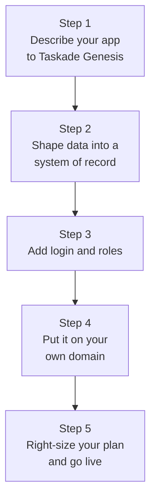

# From idea to live business — the 5 steps

You have a business problem and an idea for an app that solves it. This guide gives you five steps from a plain-English idea to a real, branded app. Your customers can sign in to this app and use it. Each step links to a full guide.

The five steps make one path from idea to a live, branded app.

***

## Step 1 — Describe your app to Genesis

Start with the problem, not the software. Tell Taskade Genesis what you do, who uses the app, and what happens when they use it. Taskade EVE turns that description into a working app: the screens, the data, and the logic that connects them. To change the app, describe the change in plain English.

→ Full guide: [Getting Started with Taskade Genesis](../genesis/getting-started.md)

## Step 2 — Shape your data into a system of record

A business app keeps records: customers, bookings, orders, and requests. Taskade Genesis makes the databases that your app needs. In this step, you give your fields clear names and link related records. Then you pick the view that matches your work, for example a table, a board, or a calendar. A good data structure makes your app the one source of truth for your business.

→ Full guide: [Projects & Databases](../workspaces/projects-databases.md)

## Step 3 — Add login and roles

Real users need accounts. GenesisAuth gives each app a sign-in screen on every plan, with no setup. Tell Taskade EVE that users must log in, and it builds the sign-in screen. In the **App Users** tab, you add people, turn off access, and choose who can sign up.

Sign-in confirms who each person is. It does not hide other people's records. To show each person only their own records, turn on **Private entries**. Then test with a second account.

→ Full guide: [GenesisAuth](../community-and-sharing/genesis-auth.md)

## Step 4 — Put it on your own domain

A branded web address tells your customers that the app is yours. Custom domains are on Pro and up. To connect a domain such as `app.yourcompany.com`, add a CNAME record that points at Taskade. Then add the short SSL record that Taskade gives you. Your app then goes live with automatic HTTPS.

No domain yet? Open **App settings → Launch → Domains**. Under **Buy a brand-new domain**, click **Shop domains**. Taskade then sets up DNS and SSL for you.

→ Full guide: [Custom Domains & Branding](../space-apps-guide/custom-domains.md)

## Step 5 — Right-size your plan and go live

Your app uses AI, and AI uses credits. Before you launch, match your plan and your credit balance to your expected use. Turn on Auto Top-Up so that your workflows do not stop on a busy day. Make sure that your billing is correct, then publish.

→ Full guide: [Credits & Billing](../../account-management/credits-and-billing.md)

***


**Run the checklist before you announce your app.** Use the [Go-Live Checklist](./go-live-checklist.md) to make sure that sign-in, data, domain, and billing are ready for real customers.


## Next steps

* [Go-Live Checklist](./go-live-checklist.md): a last pass before you share the link
* [Add Login & Roles](./add-login-and-roles.md): more about accounts and access control
* [Getting Started with Taskade Genesis](../genesis/getting-started.md): go back to Step 1 to improve your app
* [Custom Domains & Branding](../space-apps-guide/custom-domains.md): put your brand on your launch
* [Run your live app by talking to Claude](../../apis-living-system-development/run-your-app-with-ai.md): after launch, read and update the data of your app in plain English

---

_Step-by-step guides on taskade.com/learn: [Publish and Clone Your Apps](https://www.taskade.com/learn/genesis/publishing), [Custom Domains for Your Apps](https://www.taskade.com/learn/genesis/custom-domains)._
