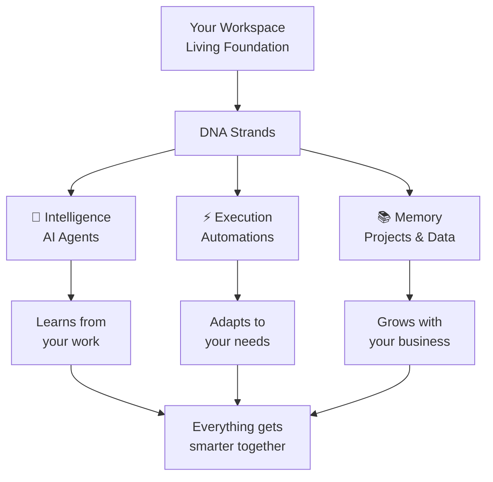

# Chapter 1: Workspaces - The Foundation

This chapter explains the workspace, the base of all your work in Taskade. Your projects, AI agents and automations all live in a workspace.

## What Problem Does a Workspace Solve?

**Have you ever struggled with:**

* **Scattered Information**: Projects spread across different tools and accounts
* **Team Coordination**: Different groups working in isolated silos
* **Scaling Complexity**: Adding new people or projects creates more confusion
* **Lost Context**: Important information buried in endless email threads

**A workspace puts all of this in one place.** Your projects, agents and automations connect in the workspace and work as one system.

## What is a Workspace? (Think of it Like a Living Organism)

A workspace in Taskade is your **digital headquarters**. Each project, AI agent and automation that you make becomes part of it.



**Here's what makes workspaces special:**

* **🏠 Living Container**: Not just storage—your workspace learns and adapts
* **🧬 DNA Foundation**: Everything you create inherits intelligence from the workspace
* **🤝 Team Hub**: Centralized collaboration with isolated security
* **📈 Scalable Growth**: From personal use to enterprise-level organization

## How Workspaces Work (The Living DNA Concept)

Let's break down how this "living" concept works in practice:

### The Home Space (Your Default DNA Strand)

Each workspace starts with a **Home Space**. You cannot delete it. The Home Space contains:

* **Generator Input Field** - Where you create new apps with AI
* **AI Agents Panel** - Your digital team members
* **Automation Center** - Workflow orchestration hub
* **Project Library** - All your work organized intelligently

### DNA Inheritance

When you create new projects or apps, they automatically inherit capabilities from your workspace:

* **Shared Intelligence**: AI agents trained on your business context
* **Connected Automations**: Workflows that span across projects
* **Unified Knowledge**: Data that connects and learns across boundaries

## Creating Your First Workspace (Step-by-Step)

**Do these steps to make a workspace:**



#### Access Workspace Creation

On your Taskade dashboard, click the ➕ plus icon in the left sidebar to create a new workspace. The Free plan includes 1 workspace, and paid plans include unlimited workspaces



#### Name Your Living Foundation

Choose a name that tells what the workspace is for. For example: "Marketing Agency Hub" or "Product Development Lab"



#### Add Your Team DNA

Invite the people who will work in this workspace.



#### Set Your Workspace Personality

Choose colors, icons, and settings that reflect your workspace's purpose and culture. A custom workspace logo needs an upgraded workspace.



Your workspace is ready.

## Understanding Workspace Hierarchy (The Family Tree)

Workspaces contain **Spaces** (formerly called Team Folders) that help organize different areas of work:

```
Your Company Workspace
├── 🏠 Home Space (Default - contains your AI generator)
├── 📁 Client Projects Space
│   ├── 📄 Website Redesign Project
│   ├── 📄 Marketing Campaign
│   └── 🤖 Client Communication Agent
├── 📁 Product Development Space
│   ├── 📄 App Features Roadmap
│   ├── 📄 Bug Tracking System
│   └── ⚡ Release Automation
└── 📁 Sales Team Space
    ├── 📄 Lead Pipeline
    ├── 📊 Sales Dashboard
    └── 🤖 Lead Qualification Agent
```

**Each space inherits DNA from the workspace but specializes for specific purposes.**

## Workspace Types (Choose Your Growth Path)

Each workspace runs on a plan. The plan sets how many members the workspace can have:

| Plan           | For            | Members   | Key Features                                         |
| -------------- | -------------- | --------- | ---------------------------------------------------- |
| **Free**       | Trying it      | 2         | Unlimited projects, 3 Taskade Genesis apps, 1 agent  |
| **Starter**    | Individuals    | 3         | 10,000 credits/mo, premium integrations              |
| **Pro**        | Small teams    | 10        | 50,000 credits/mo, AI Teams, custom domains, webhooks |
| **Business**   | Growing teams  | Unlimited | 150,000 credits/mo, SSO/SAML, app analytics          |
| **Max**        | Heavy AI use   | Unlimited | 400,000 credits/mo                                   |
| **Enterprise** | Large orgs     | Unlimited | SCIM. Contact sales                                  |

See [pricing](https://www.taskade.com/pricing) for current prices.

## The Magic Happens When Everything Connects

**Here's where the "living" concept shines:**

### Cross-Space Intelligence

* Your marketing AI agent learns from sales data
* Product development automations trigger based on customer feedback
* Knowledge from one project enhances recommendations in another

### Adaptive Learning

* The more you use your workspace, the smarter it gets
* AI agents remember your preferences and working style
* Run logs show how each automation performed, so you can refine it

### Scalable Evolution

* Start with one project, grow to hundreds
* Add team members without losing organization
* Connect new tools without disrupting existing workflows

## Workspace Settings (Customizing Your DNA)

**Make your workspace uniquely yours:**

* **🎨 Visual Identity**: Colors, icons, and branding
* **🔐 Security Settings**: Permission levels and access controls
* **⚙️ Default Preferences**: How new projects and tasks behave
* **🤖 AI Agent Training**: What your agents should know about your business
* **🔄 Integration Defaults**: Which tools to connect automatically

## Common Workspace Patterns (Real-World Examples)

### Pattern 1: Agency Hub

```
Creative Agency Workspace
├── 🏠 Home (AI Generator for client proposals)
├── 📁 Client A Space (All client work isolated)
├── 📁 Client B Space (Separate security and billing)
└── 📁 Internal Space (Company operations)
```

### Pattern 2: Product Company

```
Tech Startup Workspace
├── 🏠 Home (Product roadmap and planning)
├── 📁 Development Space (Code and technical docs)
├── 📁 Marketing Space (Campaigns and content)
├── 📁 Sales Space (Leads and customer data)
└── 📁 Support Space (Customer tickets and knowledge base)
```

## How it Works Under the Hood

**Technically speaking, workspaces are:**

* **Isolated databases** with their own security boundaries
* **Shared AI context** that learns across all contained projects
* **Unified automation engines** that can coordinate across spaces
* **Scalable architectures** that grow from personal to enterprise scale

You do not have to know these technical details. Taskade does this work for you.

## Your Workspace is Alive and Learning

**Every interaction makes your workspace smarter:**

* Creating projects teaches it your organizational patterns
* Setting up automations shows it your workflow preferences
* Training AI agents builds its understanding of your business
* Adding team members expands its collaborative intelligence

You now know how a workspace is the base of all your work in Taskade.

**Next chapter:** Read [Projects - Your Data Containers](02_projects.md) to learn how projects keep your data.

***

_Do you have questions about workspaces? Read the guides that follow, or write to support@taskade.com._

---

_Step-by-step guides on taskade.com/learn: [What is a Workspace?](https://www.taskade.com/learn/account/workspaces), [Create a Workspace](https://www.taskade.com/learn/projects/create-workspace), [Create a Team (Folder)](https://www.taskade.com/learn/projects/team-folders)._
