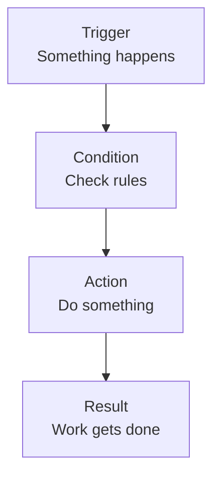

# Chapter 4: Automation - Workflows on Autopilot

In the earlier chapters, you made a workspace, projects, and AI agents. In this chapter, you connect them with **automation**. An automation does routine work for you when an event occurs.

## What Problem Does Automation Solve?

**Manual work causes delays and errors:**

* **Repeated tasks**: People copy data between tools and send the same follow-up emails.
* **Missed deadlines**: People forget to follow up.
* **Different methods**: Each team member does the same job in a different way.
* **Slow responses**: Work waits until a person sees it.

An automation reacts to an event at once. It does the same steps each time, across your workspace and your connected tools.

## What is Automation?

An automation connects your workspace, projects, agents, and outside tools. It follows "if this, then that" logic. AI steps let it make decisions too.



**An automation:**

* **⚡ Reacts to events**: It starts when something changes.
* **🤖 Uses AI**: An agent step can make a decision.
* **🔗 Connects tools**: It reads from one app and writes to another.
* **📈 Grows with your work**: It runs as often as the trigger fires, within the run limit of your plan.

## How Automation Works

**An automation has three parts:**

### Step 1: Define the Trigger (When to Start)

* **Task events:** A task is added, completed, assigned, or due.
* **Time events:** A schedule fires.
* **Outside events:** A webhook, an email, or a form submission arrives.
* **Integration events:** A Slack message arrives, or a Google Sheets row changes.
* **Agent events:** A public agent chat ends, or an agent runs the automation as a tool.

### Step 2: Add Conditions (Filter the Runs)

* **Filter by:** Priority, assignee, project, or custom fields.
* **Compare values:** For example, amount > $1000 or status = "urgent".
* **Combine rules:** Use AND and OR.

### Step 3: Add Actions (What to Do)

* **Tasks:** Create, assign, update, or move tasks.
* **Messages:** Send emails, Slack messages, and notifications.
* **AI steps:** Analyze data, write content, and make decisions.
* **Outside tools:** Update CRMs, spreadsheets, and other apps.
* **Flow control:** Wait, loop over a list, or branch on a condition.

## Create Your First Automation

**Follow these steps to build an automation:**



#### Open the Automation Builder

In your workspace, open **Automations** in the sidebar. Start from scratch, or click **Create with AI** and describe the flow. You can also select a template. Another way is to click **Automate** at the top of a project.



#### Choose Your Trigger

Select the event that starts the automation:

```
"When a new task is created in my Support project"
```



#### Add Conditions

Add a filter that decides when the automation continues:

```
Only if: Priority = "High" AND Assignee is empty
```



#### Define Actions

Add the steps that do the work:

```
Then: Assign to next available support agent
      Send Slack notification to support channel
      Create follow-up task for 24 hours later
```



#### Test and Turn On

If the trigger shows a **Test** button in its **Test Run** section, test the automation with a sample. Then turn the automation on. Examine each run in the **Runs** tab.



The automation now does this work each time the trigger fires.

## Real-World Automation Examples

### Customer Support Workflow

**Trigger:** A customer submits a new support ticket.

**Condition:** Priority = "High"

**Actions:**

* Assign the ticket to a senior support agent.
* Send an urgent Slack message.
* Create an escalation task due in 2 hours.
* Update the CRM with the ticket details.

### Content Publishing Pipeline

**Trigger:** A blog post gets the status "Ready to Publish".

**Condition:** All review tasks are complete.

**Actions:**

* Write social media posts with AI.
* Schedule the posts.
* Send the newsletter to subscribers.
* Create tasks to track engagement.

### Sales Lead Management

**Trigger:** A person submits the lead form.

**Condition:** Company size > 100 employees

**Actions:**

* Create a task for the qualified lead.
* Assign the task to a sales representative.
* Send a welcome email that AI writes for this lead.
* Add the lead and its score to the CRM.

### Project Status Updates

**Trigger:** The project due date is 7 days away.

**Condition:** Project completion < 80%

**Actions:**

* Send a reminder to the project owner.
* Alert a manager if the project is late.
* Write a status report with AI.
* Schedule daily check-ins until the project is complete.

## Advanced Automation Techniques

### Branches (Different Paths for Different Cases)

**A Branch step runs different actions for different conditions:**

```
If task priority = "Critical"
├── Then: Notify all team leads + create emergency meeting
Else if priority = "High"
├── Then: Assign to senior team member + send urgent notification
Else
├── Then: Add to regular queue + normal notification
```

### Loops (One Run for Each Item)

**A Loop step runs its steps once for each item in a list:**

```
For each: Overdue tasks in project
├── Send reminder email to assignee
├── Update task with "Reminder Sent" status
└── Escalate to manager if 3+ reminders sent
```

### AI Steps

**An AI step adds a decision to your workflow:**

```
When: Customer feedback received
├── AI analyzes sentiment and categorizes feedback
├── Routes to appropriate department automatically
├── Generates response suggestions
└── Updates customer satisfaction metrics
```

To get typed fields back from an **Ask an agent** step, set **Output Type** to **Structured Output**. Later steps can then use each field.

### Scheduled Automations

**A schedule runs an automation at fixed times:**

```
Every Monday at 9 AM:
├── Generate weekly progress report
├── Send team status updates
├── Review upcoming deadlines
└── Create next week's priority tasks
```

### Approvals and Failed Steps

* **Wait for approval**: The run stops until a teammate approves or rejects it. A rejection stops the run.
* **Retry if this step fails**: The step tries again when an app is busy or down for a few minutes. You select the wait (1 to 5 minutes) and the number of tries (1 to 5).
* **Continue if this step fails**: The run continues after a failed step, or stops at that step without a failed status.

## Connect 100+ Tools

**Integrations let your automations work in the tools that you use.** Automations run on every plan, Free included. The Free plan has 10 runs for each billing period. Free runs the standard connectors. Premium integrations such as Slack and Gmail need a paid plan. Webhook triggers need Pro and up.

### Communication Integrations

* **Slack and Discord**: Send team notifications and updates.
* **Email**: Send customer messages and reminders.
* **SMS**: Send urgent alerts.

### Business Tools

* **CRM systems**: Update HubSpot, Salesforce, and Pipedrive.
* **Project management**: Sync with Jira, Asana, and Trello.
* **Calendars**: Create events in Google Calendar and Outlook.

### Data and Reports

* **Spreadsheets**: Update Google Sheets.
* **Databases**: Sync data with Airtable and Notion.
* **Reports**: Send data to dashboards and reports.

### Development Tools

* **GitHub**: Track issues and send release notifications.
* **HTTP requests**: Call other web services.
* **Monitoring**: Send system alerts.

## How Automation Connects to Your Workspace DNA

**Automation is the Execution layer of Workspace DNA:**

### Events Start the Work

* **Triggers** find changes in your workspace and connected tools.
* **AI agents** can run as steps in an automation.
* **Projects** get updates from outside data.

### One Automation Can Use Many Parts of the Workspace

* **Many projects**: One automation can read and write more than one project.
* **Agents**: An automation can ask an agent, and an agent can run an automation.
* **Outside tools**: Integrations connect your workspace to the other tools of your business.

### Improve From the Run History

* **Run history**: The **Runs** tab logs every run, with the data at each step.
* **Changes**: You change the triggers, conditions, and steps based on what the runs show.
* **More work, same setup**: The same automation handles more runs without more work from you.

## Best Practices for Automation

### Start Simple

**Start with an automation that has one step:**


```
Simple: "When task completed → Send notification"
Complex: "When high-priority task completed → Update CRM → Send personalized thank-you → Schedule follow-up"
```


### Test Before You Turn It On

**Use test data to make sure that the automation does what you expect:**

* Create sample tasks and look at the result.
* Test unusual cases and errors.
* Look for results that you did not expect.

### Examine and Improve

**Examine your automations on a regular schedule:**

* Look at the success rate and the causes of failures.
* Find slow steps.
* Ask your team for feedback.
* Compare the time saved with the time to build the automation.

### Keep Automations Easy to Manage

* Give each automation a clear name.
* Review your automations on a regular schedule.
* Write down the logic of a complex automation.

## How Automations Run

Taskade runs each automation on its servers. Each run waits for its trigger, follows its conditions, and calls the connected apps for you. You do not need to know these details to build a workflow.

## Common Automation Patterns

### Pattern 1: Customer Onboarding

```
New customer signs up → Create welcome project → Assign onboarding tasks → Send welcome email series → Schedule check-in calls
```

### Pattern 2: Content Approval Workflow

```
Content draft completed → Notify reviewers → Collect feedback → AI summarizes comments → Route for approval → Auto-publish when approved
```

For the approval in this pattern, add a **Wait for approval** step.

### Pattern 3: Project Health Monitoring

```
Daily at 6 PM → Check project status → Calculate completion percentage → Send alerts for at-risk projects → Generate progress reports
```

### Pattern 4: Sales Pipeline Management

```
Lead enters system → Score lead quality → Assign to sales rep → Send personalized email → Schedule follow-up → Update CRM status
```

## Improve Your Automations Over Time

**Each change that you make improves the automation:**

* **Run logs** show the data and the result of each step.
* **One-click retry** runs a failed run again after you fix the cause.
* **AI steps** let an agent make a decision inside the flow.
* **Your edits** to triggers and steps apply to every later run.

**Next:** In [Chapter 5: Taskade Genesis](05_genesis.md), you use AI to build business apps from a description. You write no code.

***

_Find your most repeated task, and automate it first._

[← Back to Chapter 3: AI Agents](03_ai_agents.md) | [Next: Genesis →](05_genesis.md)

---

_Step-by-step guides on taskade.com/learn: [Automations: The Execution Pillar](https://www.taskade.com/learn/automation/automations-execution), [Automation Triggers](https://www.taskade.com/learn/automation/triggers), [Automation Actions](https://www.taskade.com/learn/automation/actions)._
