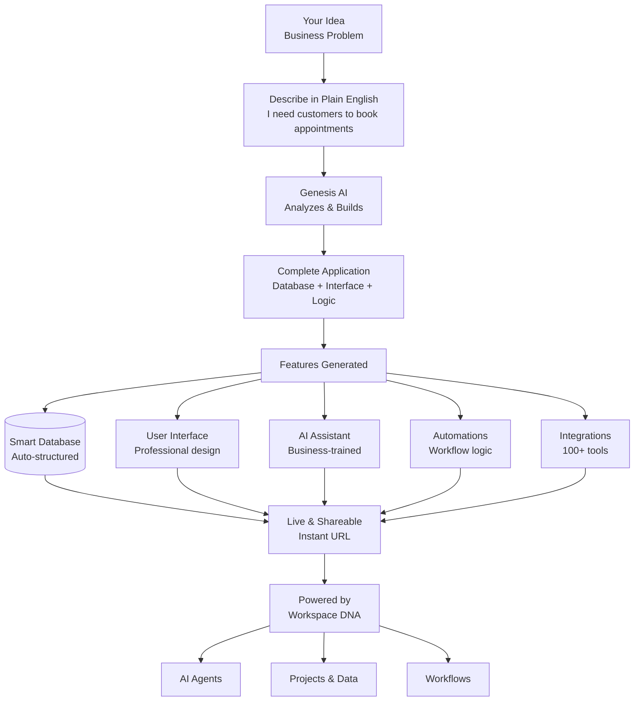

# Chapter 5: Taskade Genesis - Building Apps with AI

The earlier chapters covered workspaces, projects, AI agents, and automation. This chapter covers **Taskade Genesis**. Taskade Genesis builds a complete business app from a plain-English description.

## What Problem Does Taskade Genesis Solve?

**A custom business app is usually hard to get:**

* **Time**: a simple business app can take months to build.
* **Cost**: developers are expensive, and the work is technical.
* **Upkeep**: someone must maintain the code after launch.
* **Access**: a person who does not write code cannot build the app alone.

**Taskade Genesis makes app creation a conversation.** You describe what you need. You get a working business app in minutes.

## What is Taskade Genesis?

Taskade Genesis is the AI app builder of Taskade. It turns a plain-English description into a complete, working business app. It builds more than a form or a screen. It builds the data, the interface, the AI agents, and the automations.



**Taskade Genesis makes:**

* **🏗️ Complete apps**: real, working business software
* **📊 Databases**: projects that store your data in a structure
* **🎨 Screens**: an interface that works on phones and computers
* **🤖 AI agents**: assistants that use your business knowledge
* **⚡ Automations**: workflows that run on their own
* **🔗 Integrations**: connections to 100+ business tools

## How Genesis Works (From Description to Application)

**Taskade Genesis works in four steps.**

### Step 1: Describe Your Business Need

**Write in plain English:**

```
"I run a restaurant and need customers to submit feedback about their dining experience. They should be able to rate food quality, service speed, and overall satisfaction on a 1-5 scale, plus leave optional comments and upload photos. When someone gives us 3 stars or lower, automatically send a Slack message to our manager channel so we can follow up personally."
```

### Step 2: Genesis Analyzes and Builds

**Taskade Genesis reads your description. Then it:**

* Finds the business rules and the data that the app needs
* Designs the screens
* Makes the data structure
* Builds the automations
* Adds the AI agents

### Step 3: Your App is Born

**The finished app has:**

* A clear interface
* Working data and forms
* An AI agent that helps users
* Automations for follow-ups
* Connections to your tools

### Step 4: Live and Evolving

**You can use your app at once:**

* The first build of a new app goes live once at its own link. It stays unlisted, so only people with the link can open it.
* The app works on a computer, a tablet, and a phone.
* You change the app when you chat with Taskade EVE. On a new app, Taskade saves each change as a draft until you click **Publish** again.

## Building Your First Genesis App (Step-by-Step)

**Build a booking app with these steps:**



#### Open Your Workspace

Open Taskade. Your workspace home shows a prompt box at the center of the screen.

The Free plan includes 3 Taskade Genesis apps and starts with 0 AI credits. If your Free account never had AI credits, Taskade EVE shows **Pick a plan to start building** at your first prompt. You can earn free AI credits with referrals and invites, or upgrade. To start with no plan, clone a free app kit from the [Taskade App Factory](https://www.taskade.com/apps).



#### Craft Your App Description

Write a clear description of what you need:

```
"I need customers to book appointments for my consulting business. They should be able to see my availability, select a service type (30-min consultation, 1-hour strategy session, full-day workshop), choose a date and time, and provide their contact information. When someone books, automatically send them a confirmation email and add the appointment to my Google Calendar."
```



#### Submit and Watch Magic Happen

Click the **Send** arrow, or press Enter. Taskade Genesis reads your request and starts to build.



#### Review Your Live App

Wait for the build to finish. A bar shows the app name with **is ready** and a **Publish** button. The preview beside the chat shows your app.



#### Test and Share

Use the app as a real user does. Then share the link with your customers or your team.



**Well done.** You built a complete business app and put it online.

## What Apps Can You Build? (Endless Possibilities)

Taskade Genesis works for most business processes.

### Customer-Facing Applications

* **Appointment booking**: online scheduling with a calendar connection
* **Customer feedback portals**: reviews with automatic follow-ups
* **Support tickets**: problem tracking that sends each ticket to the right person
* **Lead capture forms**: contact forms that send data to your CRM
* **Event registration**: sign-ups with a limit on the number of seats

### Internal Business Tools

* **Inventory management**: stock tracking with reorder alerts
* **Project status dashboards**: progress tracking with team updates
* **Employee onboarding**: steps for each new hire
* **Expense reports**: receipt uploads with approval steps
* **Team performance**: KPI tracking with automatic reports

### Data Collection & Analysis

* **Surveys**: form answers that AI sorts into groups
* **Feedback collection**: input from many channels, with a sentiment score
* **Lead qualification**: a score for each prospect, with automatic follow-up
* **Customer insights**: customer data with trend reports
* **Market research**: survey distribution with answer reports

## The Power of Workspace DNA

**Every app that Taskade Genesis builds uses the Workspace DNA of Chapter 1.**

### Intelligence Inheritance

* **AI agents**: your apps use the agents that you trained
* **Knowledge**: your apps can read your workspace data and projects
* **Voice**: your apps keep your brand and your way of writing

### Automation Integration

* **Workflows**: your apps include automations that match your processes
* **Connections**: your apps connect to the tools that you use now
* **Events**: an event in your app can start an automation

### Learning and Adaptation

* **Content**: your apps show your current business knowledge
* **App Analytics**: see how visitors use a published app (Business and up)
* **Chat edits**: change the app when you chat with Taskade EVE

## Advanced Genesis Techniques

### Multi-Step App Descriptions

**For a larger app, write a numbered prompt:**

```
"Create a complete customer onboarding system that:
1. Collects customer information and requirements
2. Creates a personalized project plan with milestones
3. Sets up automated check-in emails and progress updates
4. Provides a client dashboard to track project status
5. Includes a feedback survey at project completion
6. Automatically follows up based on survey responses"
```

### App Enhancement Through Conversation

**To change an app, send a message to Taskade EVE:**

* "Add file upload capability for project deliverables"
* "Connect this to send confirmation texts via SMS"
* "Make the dashboard mobile-friendly with larger buttons"
* "Add a calendar view for upcoming milestones"

### App Chains and Ecosystems

**Your apps can share data and automations:**

* A customer feedback app can send data to inventory management.
* A lead capture app can feed a sales pipeline automation.
* A support ticket app can add answers to a knowledge base.

## Common build patterns

### Restaurant feedback system

**Problem:** Customer complaints arrived too late. **What you build:** A feedback app that alerts you at once about a low rating.

### Consulting booking system

**Problem:** Appointments changed again and again. **What you build:** A booking app with a calendar connection and automatic confirmations.

### E-commerce inventory tracker

**Problem:** Popular items ran out and nobody saw it. **What you build:** An inventory app that sends a reorder alert before the stock is low.

### Marketing lead pipeline

**Problem:** Lead details got lost in email threads. **What you build:** A lead capture app that puts each new contact into a pipeline.

## Professional App Deployment

### Custom Domains and Branding

**Give your app your own brand:**

* Custom domain names (yourapp.com) on Pro and up: up to 10 per workspace on Pro, unlimited on Business and up
* Your colors and logo (custom app colors need Business and up)
* Your own email templates
* Your own privacy policy and terms

### Enterprise Security

**Security features:**

* Work toward SOC 2 Type II (the independent audit is not completed yet)
* Practices that align with GDPR principles (full compliance is in progress)
* SSO/SAML on Business and up, SCIM provisioning on Enterprise
* Detailed permission controls
* Audit trails and data retention

### Scaling and Performance

**Taskade runs your app for you:**

* The app scales up when more people use it.
* A global CDN loads the app fast in all regions.
* API access lets you build custom integrations.

## How it Works Under the Hood

**The technical parts of Taskade Genesis:**

* **Large language models**: AI that reads your business requirements
* **Full-stack generator**: makes the data, the interface, and the logic
* **Workspace connection**: the app uses your Taskade projects, agents, and automations
* **Hosting**: Taskade publishes the app and serves it worldwide
* **Chat editing**: Taskade EVE updates the app each time you describe a change

You do not need to know these technical parts to build an app.

## Genesis App Categories and Templates

### Business Process Apps

* **Approval workflows**: review and sign-off in more than one step
* **Resource booking**: equipment, rooms, or service times
* **Problem tracking**: bug reports, maintenance requests, and support tickets
* **Document management**: file uploads with version control and sharing

### Customer Experience Apps

* **Customer portals**: self-service account pages and history
* **Loyalty programs**: points, rewards, and redemptions
* **Feedback systems**: input from many channels, with automatic answers
* **Community forums**: discussion boards with moderation and analytics

### Data & Analytics Apps

* **Survey builders**: custom questionnaires with answer reports
* **Performance dashboards**: KPI tracking with automatic reports
* **Inventory systems**: stock management with forecasts
* **Financial tracking**: budget tracking with variance alerts

## Your Genesis Apps Are Living and Evolving

**Your app changes when your business changes:**

* Describe a change, and Taskade EVE updates the app.
* Add projects, agents, and automations, and your app can use them.

**Well done.** You can now build a complete business app from a description.

**Next:** [Chapter 6: Integrations](06_integrations.md) shows how to connect your apps and automations to 100+ business tools.

***

_Pick one business problem. Write it down, describe it to Taskade Genesis, and get a working app in minutes._

[← Back to Chapter 4: Automation](04_automation.md) | [Next: Integrations →](06_integrations.md)

---

_Step-by-step guides on taskade.com/learn: [What is Taskade Genesis?](https://www.taskade.com/learn/genesis/overview), [Create Your First App](https://www.taskade.com/learn/genesis/first-app), [Publish and Clone Your Apps](https://www.taskade.com/learn/genesis/publishing)._
