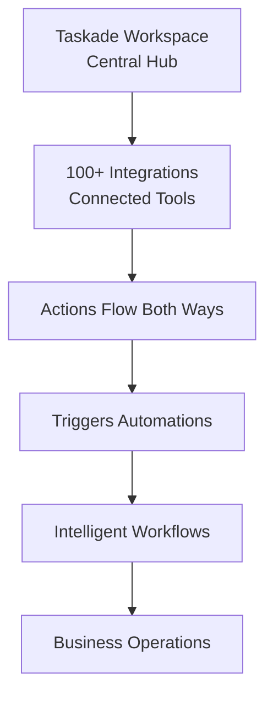

# Chapter 6: Integrations - Connecting Your Tools

In the last chapter, you built apps with Taskade Genesis. In this chapter, you connect Taskade to the other tools of your business. Taskade has 100+ integrations.

## What Problem Do Integrations Solve?

**Without integrations, each tool works alone:**

* **Separate data**: Each system keeps its own copy of the information.
* **Manual copies**: People copy data between spreadsheets, CRMs, and project tools.
* **Lost context**: People move between apps and lose track of the work.
* **Late updates**: One system does not know when another system changes.

Integrations connect your tools. Data moves between them, and an event in one tool can start work in another tool.

## What are Integrations?

An integration is a connection between Taskade and another app. Your workspace becomes the center that coordinates the work.



**Integration categories:**

* **Communication**: Slack, Microsoft Teams, Discord
* **Productivity**: Google Workspace, Notion
* **Sales and CRM**: HubSpot, Salesforce
* **Cloud storage**: Google Drive, OneDrive
* **Social media**: X/Twitter, LinkedIn, Facebook
* **Development**: GitHub, Jira, Figma

**With integrations, you can:**

* **🔄 Move data both ways**: A trigger brings events in. An action sends work out.
* **⚡ React to events**: An event in one tool starts an action in another tool.
* **🤖 Automate workflows**: One automation runs steps in many apps.
* **🔗 Give agents more context**: AI agents can use data from connected tools.

## How Integrations Work

**Integrations work at three levels:**

### Level 1: Data Sync

**Tools share information:**

* A new contact in your CRM becomes a task in Taskade.
* A project update in Taskade goes to your team calendar.
* A file in Taskade goes to your cloud storage.
* A new Slack or Discord message sends a Taskade notification.

### Level 2: Event Triggers

**An event in one tool starts work in another tool:**

* A deal closes in your CRM → Taskade creates a task.
* A developer pushes code to GitHub → Taskade updates the project status.
* A customer emails support → Taskade creates a support ticket.
* Stock gets low → Taskade creates a reorder task.

### Level 3: AI Workflows

**AI steps make decisions in workflows that use many tools:**

* Customer question → AI analyzes it → The right team gets it → The CRM updates → The customer gets a reply.
* Project deadline is near → AI examines the progress → The team gets an update.
* A sales lead qualifies → AI scores it → The lead goes into a follow-up sequence.

## Connect Your First Integration

**Connect Slack to send team notifications.** Slack is a premium integration, so it needs a paid plan. The Free plan runs the standard connectors.



#### Open an Automation

In your workspace, open **Automations** and create an automation. Click **Add step** and add a Slack trigger or action. You can also add Slack to an agent as a tool.



#### Choose Your Tool

In the Slack step, click **Connect**.



#### Allow the Connection

Sign in to Slack and allow Taskade to use your Slack workspace.



#### Configure the Step

Select the channel that gets the messages. Select the event that sends them.



#### Test the Integration

Create a test task and mark it complete. Make sure that the Slack message arrives.



Your tools now share work.

## Integration Categories and Use Cases

### Communication Platforms

**Keep your team up to date:**

#### Slack Integration

* **Project updates**: Send a channel message when the team reaches a milestone.
* **Task assignments**: Tell team members about new work.
* **Deadline alerts**: Send reminders before due dates.
* **Status changes**: Tell stakeholders about progress.

#### Microsoft Teams

* **Channel notifications**: Send updates to the correct Teams channel.
* **Chat messages**: Send a Teams chat message when work changes.
* **Channel creation**: Create a channel for a new project.

#### Discord

* **Community updates**: Send messages to your community or team channels.
* **Group alerts**: Tell a specific group about an event.

### Productivity Tools

**Make daily work faster:**

#### Google Workspace

* **Gmail**: Turn emails into tasks, and send automatic replies.
* **Calendar**: Create events from tasks and deadlines.
* **Sheets**: Update spreadsheets and import data.
* **Docs**: Create documents from project data.

#### Notion

* **Database sync**: Keep Notion databases up to date with Taskade data.
* **Page creation**: Create Notion pages from Taskade projects.

### Sales & CRM Systems

**Track your deals:**

#### HubSpot

* **Contact sync**: Keep contacts the same in both systems.
* **Deal tracking**: Update the CRM when the project reaches a milestone.

#### Salesforce

* **Lead management**: Send Taskade leads to Salesforce.
* **Account updates**: Keep customer information up to date.

### Cloud Storage

**Keep files with your work:**

#### Google Drive

* **File uploads**: Upload files to Drive folders from an automation.
* **Share settings**: Add or remove share permissions from an automation.

#### OneDrive

* **Documents**: Add OneDrive files to projects, tasks, chat, and comments.
* **Agent knowledge**: Add OneDrive files as knowledge for your AI agents.

### Social Media & Marketing

**Manage your online presence:**

#### Twitter/X

* **Posts**: Post updates from your Taskade campaigns.
* **Replies**: Reply to posts from an automation or an AI agent.

#### LinkedIn

* **Posts**: Publish professional content from an automation.
* **Company updates**: Share project milestones on a company page.

### Development Tools

**Connect code and business work:**

#### GitHub

* **Issues**: Create tasks from GitHub issues.
* **Pull requests**: Tell the team when code is ready for review.
* **Releases**: Update projects when a release ships.

#### Jira

* **Ticket sync**: Keep Jira tickets up to date with Taskade progress.
* **Status updates**: Show task completion in both tools.

## Advanced Integration Patterns

### Workflows Across Many Tools

**One process can use many systems:**

```
Customer Inquiry → Slack Alert → Taskade Ticket → AI Analysis → CRM Update → Email Response → Follow-up Task
```

### Conditional Routing

**A Branch step makes a decision from the data:**

```
If deal value > $10K → Create executive review task + schedule meeting
If deal value < $10K → Assign to junior rep + send standard proposal
```

### Data Transformation

**Utility steps change data from one format to another:**

```
Form submission → Transform data → Update spreadsheet → Generate report → Send to stakeholders
```

### Scheduled Automations

**A schedule runs actions in many tools at fixed times:**

```
Every Monday 9 AM → Pull analytics → Generate report → Email to team → Update dashboard
```

## Integration Security and Permissions

### Sign-In Methods

* Most services (Google, Slack, Microsoft) use OAuth 2.0. You sign in to the service, and you allow access.
* Custom integrations use API tokens.
* Many services let you give read-only access or read-write access.

### Data Privacy

* Taskade uses TLS encryption for data in transit, and AES-256 for backups and stored credentials.
* Taskade works toward SOC 2 Type II. The independent audit is not complete yet.
* You control who can use each connection.
* The **Runs** tab of each automation logs every run.

### Reliability

* Taskade retries a step after a short network error, a rate limit, or a server error.
* If an app is busy or down for a few minutes, check **Retry if this step fails** on that step.
* To let a run go on after a failed step, check **Continue if this step fails**.

## Troubleshooting Integrations

### Common Problems and Solutions

#### Connection Problems

* **Credentials**: Make sure that your keys and sign-ins are current and correct.
* **Permissions**: Make sure that Taskade has the access that it needs.
* **Network**: Examine your firewall settings and your connection.
* **Service outages**: Examine the status page of the connected service.

#### Data Sync Problems

* **Field mapping**: Make sure that each field goes to the correct field.
* **Formats**: Make sure that the data formats agree.
* **Duplicates**: Add a filter or a match rule so that the automation does not add the same item two times.
* **Schedule**: Change how often a scheduled automation runs.

#### Performance

* **Fewer calls**: Find many items in one step, then use a loop.
* **Monitoring**: Examine the success rate of each automation in the **Runs** tab.

## Measure the Value of Your Integrations

### Monitor Performance

* Success rates and failure patterns
* Slow steps
* The amount of data that moves
* How many people on your team use each automation

### Measure the Return

* Time saved
* Fewer errors from manual work
* More accurate data
* Faster decisions

### Find Improvements

* Integrations that you can use more
* Manual tasks that you can automate
* Separate data that you can connect
* Slow steps that you can fix

## How Integrations Run

Taskade connects to each service through its API. It receives events through webhooks or scheduled checks, and it changes the data format where necessary. You do not need to know these details to connect a tool.

## Integration Templates and Quick Starts

### Business Process Templates

* **Customer onboarding**: CRM + Email + Project Management
* **Content creation**: Calendar + Social Media + Analytics
* **Lead management**: Forms + CRM + Email Marketing
* **Support operations**: Ticketing + Knowledge Base + Chat

### Industry Examples

* **Agencies**: Project Management + Time Tracking + Invoicing
* **E-commerce**: Inventory + Shipping + Customer Service
* **Healthcare**: Patient Management + Scheduling + Compliance
* **Education**: LMS + Communication + Assessment Tools

## Your Connected Workspace

* **Run history**: Each run shows what happened, so you can improve the workflow.
* **Shared context**: AI agents can use data from connected tools.
* **Your changes**: Each edit to a trigger or step applies to every later run.

**Next:** In [Chapter 7: API](07_api.md), you learn how to use the Taskade API for custom integrations.

***

_Find the manual process that takes the most time in your business. Then find the integration that automates it._

[← Back to Chapter 5: Genesis](05_genesis.md) | [Next: API →](07_api.md)

---

_Step-by-step guides on taskade.com/learn: [Integrations Everywhere: Workspace DNA and the App on Top](https://www.taskade.com/learn/connect/everywhere), [Slack Integration](https://www.taskade.com/learn/connect/slack-integration), [Google Drive Integration](https://www.taskade.com/learn/connect/google-drive)._
