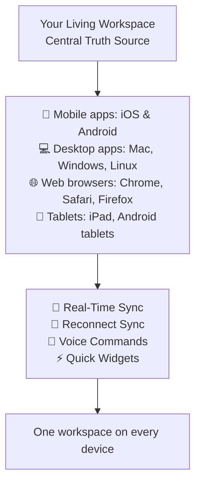

# Chapter 8: Mobile & Desktop - Cross-Platform Productivity

In Chapter 7, you used the API. This last chapter shows how to use your **living workspace on all your devices**: phones, tablets, desktop computers, and web browsers.

## What Problem Does Cross-Platform Solve?

**Many productivity tools work well on only one type of device:**

* **Desktop software** does not work on mobile
* **Mobile apps** do not have all the desktop features
* **Web applications** are hard to use on phones
* **Data** stays separate on each device

**Taskade gives you one workspace on all your devices.** Your changes sync in real time.

## What is Cross-Platform Productivity? (The Unified Experience)

Cross-platform means that you use the **same workspace** on a phone, a tablet, a desktop computer, or a web browser. Taskade syncs this workspace on all your devices.



**With cross-platform access, you get these features:**

* **🔄 Real-Time Sync**: Changes appear on all devices immediately
* **🔁 Reconnect Sync**: When you reconnect, edits from the moments before a connection drop sync
* **🎤 Voice Commands**: Work with your voice instead of your hands
* **⚡ Quick Access**: Quick task creation from any device
* **📱 Native Experiences**: An interface made for each platform
* **🔗 Device Switching**: A change of device in the middle of a task, with no lost work

## Platform-Specific Capabilities

### Mobile Apps (iOS & Android)

**Taskade has native apps for iOS and Android.**

#### Core Mobile Features

* **Workspace Access**: All your projects, AI agents, and automations
* **Touch Interface**: Gestures and touch controls
* **Camera Integration**: Photo uploads and document scans
* **Push Notifications**: Real-time alerts and updates

#### Mobile-Specific Tools

**Quick Add Widget:**

* Task creation with one tap
* Voice input
* Date suggestions when you type a date or time
* Sync when you are online
* A default project for new tasks

**Share to Taskade:** You can share these items to Taskade from other apps:

* Photos and images
* Documents and PDFs
* Web links and articles
* Text snippets
* Audio recordings

### Desktop Applications

**Taskade has desktop apps for Mac, Windows, and Linux.**

#### Desktop Capabilities

* **Multi-Monitor Support**: Use of more than one screen
* **Keyboard Shortcuts**: Shortcuts that make your work faster
* **File System Integration**: Drag-and-drop for files
* **System Tray Access**: Quick access from the system tray, with no full app window
* **Advanced Search**: A fast search of the whole workspace
* **Bulk Operations**: Edits to many items at the same time

#### Desktop-Specific Features

* **Global Hotkeys**: Task creation from any application
* **Clipboard Integration**: Paste with content recognition
* **Window Management**: Split-screen work with your team
* **Customization**: Themes, layouts, and preferences

### Web Browsers

**You can use Taskade in a web browser on any computer.**

#### Web Platform Features

* **Browser Extensions**: Save content from any website
* **Progressive Web App**: Installation from the browser, like a native app
* **Cross-Browser Compatibility**: Support for all modern browsers
* **Responsive Design**: A layout that changes to fit the screen size

#### Browser Extensions

```
Web Clipper Extensions:
├── 📄 Article saving
├── 🎯 Content highlighting
├── 📝 Note taking
├── 🏷️ Tag and organize
├── 🔗 Link preservation
└── 📱 Mobile sync
```

### Tablets and Touch Devices

**The apps work on tablets and other touch devices.**

#### Tablet Optimizations

* **Large Touch Targets**: Controls that are easy to tap with a finger
* **Gesture Support**: Swipe, pinch, and multi-touch gestures
* **Split-Screen**: More than one app on the screen at the same time
* **Stylus Support**: Accurate input with a digital pen
* **Rotation Support**: Portrait and landscape modes

## Real-Time Synchronization

**Taskade keeps your workspace in sync on all platforms.**

### Synchronization Features

* **Instant Updates**: Changes appear immediately on all devices
* **Conflict Resolution**: Taskade merges edits that people make at the same time
* **Version History**: A record of changes, so you can restore an earlier version
* **Reconnect Sync**: When you reconnect, edits from the moments before a connection drop sync
* **Bandwidth Optimization**: Efficient data transfer and caching

### Cross-Device Workflows

```
Seamless Device Transitions:
├── 💻 Start project on desktop
├── 📱 Review on mobile during commute
├── 📱 Add tasks via voice commands
├── 💻 Finalize details on laptop
└── 🔄 Everything stays perfectly synced
```

## Install Taskade on All Your Devices (Step-by-Step)

**Do these steps to use your workspace on all your devices:**



#### Install Mobile Apps

Download Taskade from the App Store (iOS) or Google Play (Android).



#### Install Desktop Apps

Download the desktop app for Mac, Windows, or Linux from taskade.com.



#### Enable Web Access

Open Taskade in a modern web browser. The web app gives you all the features.



#### Configure Sync Settings

Make sure that you sign in to the same account on all devices.



#### Test Synchronization

Create a task on one device. Then make sure that the task appears on your other devices.



Your workspace is now available on all your devices.

## Advanced Cross-Platform Techniques

### Device-Specific Workflows

**Each type of device is good for different work:**

#### Mobile-First Workflows

```
Perfect for mobile scenarios:
├── 🚗 Daily commute planning
├── 🏃‍♂️ Quick task capture during meetings
├── 📸 Photo task creation
├── 🎤 Voice note taking
└── 📱 Instant collaboration
```

#### Desktop Power User Flows

```
Leverage desktop advantages:
├── ⌨️ Keyboard shortcuts for speed
├── 🖱️ Drag-and-drop organization
├── 📊 Multi-monitor project views
├── 🔍 Advanced search and filtering
├── 📈 Bulk editing operations
└── 🤖 Complex automation setup
```

#### Web-Based Collaboration

```
Browser advantages:
├── 🔗 Easy sharing and access
├── 🌐 Cross-platform compatibility
├── 📋 Quick web clipping
├── 🔄 Real-time collaboration
└── 📱 Responsive design everywhere
```

### Offline Productivity

**Taskade needs a live connection.** There is no offline editing mode.

#### When the Connection Drops

* **Recent Edits**: If your connection drops, Taskade keeps the changes from the moments before the drop in memory
* **Reconnect Sync**: When your connection returns, Taskade tries to sync those changes
* **Mobile Fallback**: If your desktop connection drops, you can use the mobile app on mobile data

#### Restore the Connection

```
When the connection drops:
├── ⚠️ Taskade shows a "please try again later" error
├── 🔄 Check your connection and click Retry
├── 🔁 Restart the app if Retry does not help
└── 🧹 Flush your DNS cache if Taskade still cannot connect
```

### Voice and Hands-Free Productivity

**You can use voice commands on all platforms.**

#### Voice Features

* **Task Creation**: "Create task: Call client tomorrow at 3pm"
* **Project Search**: "Find my marketing campaign project"
* **Status Updates**: "Mark task complete"
* **Schedule Management**: "Set up meeting for next Tuesday"

#### Voice Integration

```
Multi-platform voice support:
├── 📱 Mobile: Siri, Google Assistant integration
├── 💻 Desktop: System voice recognition
└── 🌐 Web: Browser voice APIs
```

## Platform-Specific Optimizations

### Mobile App Optimizations

**The mobile apps are made for touch screens and for use on the move.**

#### Touch Interactions

* **Tap**: Select and open
* **Double-tap**: Quick edit
* **Swipe**: Complete or archive
* **Hold**: Context menu
* **Pinch**: Zoom and navigate

#### Mobile UI Patterns

* Use with one hand
* A clear visual structure
* Fast load and response times
* Low battery use
* Good performance on slow connections
* Dark mode

### Desktop Power Features

**The desktop apps add these features:**

#### Keyboard Shortcuts

```
Essential Shortcuts:
├── ⌘K: Global search
├── ⌘F: Search in the open project
├── ⌘/: Add-On menu
├── ⌘↵: Complete task
├── ⌘⇧⌫: Delete task
└── ⌘Z / ⌘⇧Z: Undo / redo
```

#### Advanced Desktop Features

```
Power User Capabilities:
├── 🖥️ Multi-window support
├── 📊 Advanced analytics
├── 🔧 Custom workflows
├── 📈 Bulk operations
├── 🔍 Advanced filtering
└── 🤖 Complex automations
```

## Cross-Platform Collaboration

**Your team can work together from different devices.**

### Real-Time Collaboration

```
Cross-Device Teamwork:
├── 👥 Multiple users edit simultaneously
├── 💬 Live chat and comments
├── 👤 Presence indicators
├── 📝 Live cursors and selections
├── 🔄 Instant sync across platforms
└── 📱 Mobile collaboration support
```

### Device Switching Workflows

```
Seamless Transitions:
├── 💻 Start brainstorming on desktop
├── 📱 Continue during commute
├── 🖥️ Present on conference room display
├── 📱 Follow up on mobile
└── 🔄 Everything stays connected
```

## Performance and Reliability

**Taskade gives consistent performance on all platforms.**

### Platform Optimization

* **Native Code**: Speed improvements for each platform
* **Efficient Sync**: Sync that uses little bandwidth
* **Smart Caching**: Fast loads
* **Battery Optimization**: Background processes that use little power

### Reliability Features

* **Connection Recovery**: Recent edits sync when your connection returns
* **Data Persistence**: Taskade saves your work automatically while you are connected
* **Auto-Save**: Continuous saves prevent data loss
* **Backup Systems**: Several backup layers keep your data safe

## How It Works

**Internally, cross-platform access uses these parts:**

* **Unified Backend**: One central store for all data
* **Real-Time Engine**: WebSocket connections (live links between your device and Taskade) for instant updates
* **Platform-Specific UIs**: A native interface for each platform
* **Adaptive Synchronization**: Taskade resolves and merges edits that conflict
* **Progressive Enhancement**: Core features work on all platforms, and some platforms add more features

You do not need to know these details to use Taskade.

## Best Practices for Cross-Platform Productivity

### Device Strategy

**Use the device that fits the task:**

#### Mobile Scenarios

* Quick task capture and review
* Voice notes during meetings
* Photo documentation
* Instant communication

#### Desktop Scenarios

* Deep work and complex edits
* Multi-tasking and research
* Advanced automation configuration
* Bulk operations and analytics
* Detailed project planning

#### Web Scenarios

* Cross-device collaboration
* Quick access from any computer
* Sharing and presentation
* Temporary access without installation

### Workflow Optimization

**Plan your workflows to use all platforms:**

#### Capture Everywhere, Process Anywhere

```
Task Lifecycle Across Devices:
├── 📱 Mobile: Initial capture and quick edits
├── 💻 Desktop: Detailed work and complex operations
├── 🌐 Web: Collaboration and sharing
└── 📱 Mobile: Final review and completion
```

#### Sync Strategy

```
Synchronization Best Practices:
├── 🔄 Enable auto-sync on all devices
├── 📶 Keep a live connection, and use the mobile app if desktop drops
├── 🔋 Optimize for battery life on mobile
└── 📊 Review sync logs for optimization
```

## Summary

**With cross-platform access:**

* **🌍 Work from anywhere**: You can use your workspace on any device
* **🔄 Continuous work**: You can change devices and continue your work
* **🤝 Better collaboration**: Each team member uses the platform that they prefer
* **📈 Increased productivity**: You use the right tool for each situation
* **🔗 Connected experience**: Taskade keeps all your work in sync

This chapter is the last chapter of the Taskade Tutorial. You learned about all parts of Taskade, from workspaces in Chapter 1 to cross-platform access in this chapter.

**🎉 You completed the Taskade Tutorial.**

***

_Use what you learned to build and improve your own living workspace._

[← Back to Chapter 7: API](07_api.md) | [← Back to Tutorial Overview](README.md)

---

_Step-by-step guides on taskade.com/learn: [Guide to Taskade Mobile](https://www.taskade.com/learn/projects/mobile-guide), [Account Settings (Desktop)](https://www.taskade.com/learn/account/desktop-settings), [Mobile Widgets](https://www.taskade.com/learn/projects/mobile-widgets)._
