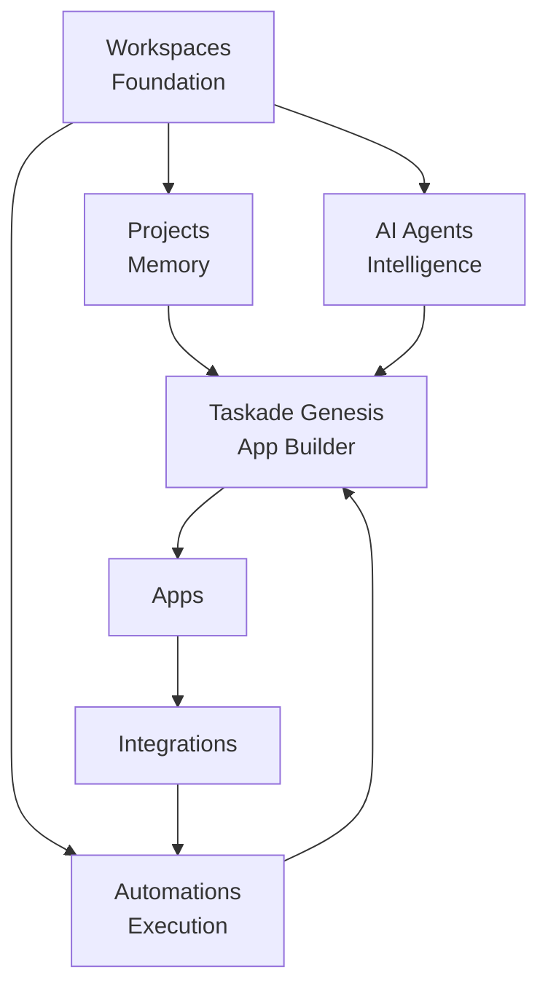

# Tutorial: Taskade - The Living DNA Productivity Platform

**Taskade** is an AI workspace. Your projects, AI agents, and automations work together in one place. Taskade Genesis builds a live app from one plain-English prompt.

**Start here:**

* **New to Taskade?** Read [Chapter 1: Workspaces](01_workspaces.md), then follow the chapters in order.
* **Do you want to build an app now?** Go to [Chapter 5: Genesis](05_genesis.md).
* **Do you want the short version?** Read the [Quick Start Guide](../../getting-started/README.md).

## What You Can Do With Taskade

* **🏠 Keep your work in one workspace**: notes, tasks, databases, AI chat, automations, and apps use the same data.
* **🧬 Build apps with Taskade Genesis**: describe an app in plain English and get a working app with a link.
* **🤖 Use AI agents**: an agent reads your projects and answers from them.
* **⚡ Automate repeat work**: connect 100+ integrations, and let automations create tasks and send messages for you.
* **📱 Work on every device**: use Taskade on the web, on the desktop, and on mobile.

## How the Parts Fit Together

Your workspace holds three parts. Projects are the memory. AI agents are the intelligence. Automations are the execution. Taskade calls these three parts Workspace DNA.

Taskade Genesis uses all three parts to build an app. The API gives developers access to workspaces, projects, AI agents, and automations. The mobile and desktop apps show your workspaces, projects, and apps on every device.

## How This Tutorial Works

This tutorial is for beginners. Each chapter uses what you learned in the chapter before it:

- **Chapter 1: Workspaces**: the home for all your work
- **Chapter 2: Projects**: the place where you keep tasks, notes, and data
- **Chapter 3: AI Agents**: assistants that learn from your work
- **Chapter 4: Automation**: workflows that do repeat tasks for you
- **Chapter 5: Genesis**: complete apps from a plain-English description
- **Chapter 6: Integrations**: connections to the tools that you use
- **Chapter 7: API**: access to Taskade from your own code
- **Chapter 8: Mobile & Desktop**: Taskade on every device

## Chapter Overview

### Chapter 1: [Workspaces - The Living Foundation](01_workspaces.md)
*Learn how your workspace holds everything that you build*

### Chapter 2: [Projects - Your Data Containers](02_projects.md)
*Keep tasks, notes, and data in a structure that fits your work*

### Chapter 3: [AI Agents - Your Digital Team](03_ai_agents.md)
*Make assistants that learn from your work and help your team*

### Chapter 4: [Automation - Workflows on Autopilot](04_automation.md)
*Connect your tools and let automations do repeat tasks*

### Chapter 5: [Genesis - Building Apps with AI](05_genesis.md)
*Turn a plain-English description into a working app*

### Chapter 6: [Integrations - Connecting Your Tools](06_integrations.md)
*Connect Taskade to 100+ services*

### Chapter 7: [API - Developer Interfaces](07_api.md)
*Use the API to build your own solutions and integrations*

### Chapter 8: [Mobile & Desktop - Cross-Platform Productivity](08_mobile_desktop.md)
*Use Taskade with the native apps and the web app*

---

*Generated by [AI Codebase Knowledge Builder](https://github.com/The-Pocket/Tutorial-Codebase-Knowledge)*

---

_Step-by-step guides on taskade.com/learn: [Start Here: How to Use Taskade](https://www.taskade.com/learn/projects/start-here), [What Is Taskade? The AI Workspace Explained](https://www.taskade.com/learn/account/what-is-taskade), [Getting Started with Taskade](https://www.taskade.com/learn/genesis/quickstart)._
